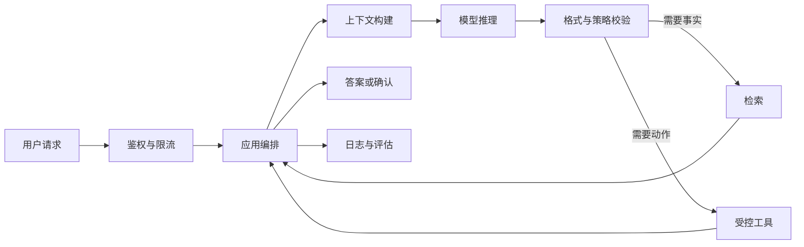

# AI 应用架构

AI 应用架构的关键，是把不确定的模型输出放在可验证、可限制、可恢复的系统中。模型适合做语义理解和候选生成，程序负责权限、事务、状态和最终约束。

## 一条生产请求

实际执行顺序可不同，但每个外部事实和动作都应有明确来源。

## 上下文构建

上下文可能包含：

- 当前用户输入和必要的对话历史。
- 用户权限和业务状态。
- 检索到的资料及来源。
- 工具返回的结构化结果。
- 输出格式和流程规则。

上下文应按任务动态构建。无关历史、重复规则和完整数据库结果会增加成本并干扰模型。

## 状态管理

对话历史不等于业务状态。订单是否支付、工单是否创建、审批是否完成，应来自业务数据库；模型生成的文字不能作为事实来源。

多步骤任务需要显式记录：

- 当前目标和阶段。
- 已执行工具及结果。
- 待确认动作。
- 重试次数和停止原因。
- 可恢复的检查点。

## 失败分类

| 失败层 | 示例 | 处理 |
| --- | --- | --- |
| 输入 | 缺少订单号 | 追问或提示格式 |
| 权限 | 用户无权查询 | 拒绝并审计 |
| 检索 | 没找到可信资料 | 拒答或转人工 |
| 模型 | 格式错误、内容不完整 | 校验、有限重试或降级 |
| 工具 | 超时、参数错、业务冲突 | 分类错误并按规则处理 |
| 下游 | 消息或存储失败 | 幂等重试和补偿 |

## 确定性边界

以下逻辑应由程序控制：

- 身份认证和数据权限。
- 金额、库存、事务和状态流转。
- 写操作确认和幂等。
- 法律、合规和硬性业务规则。
- 结果 schema 和字段校验。

模型可以解释用户意图、生成候选参数和组织说明，但不能成为这些规则的唯一执行者。

## 缓存与成本

可缓存内容包括稳定 Embedding、公共检索结果、确定性分类和重复前缀。包含个人数据、实时状态或随机生成的结果要谨慎缓存，并设置权限隔离和失效策略。

## 版本

一次输出由模型、Prompt、上下文模板、索引、工具 schema 和业务代码共同决定。它们都要进入版本记录，才能复现问题并安全回滚。

架构成熟度不取决于组件数量，而取决于每一步是否有明确责任、失败处理和验证闭环。
