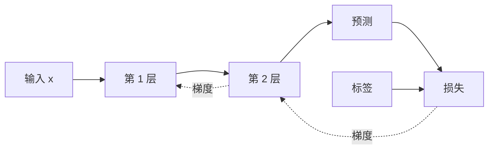

# 神经网络与反向传播

神经网络是由可学习参数和非线性变换组成的函数。训练过程通过样本不断调整参数，使网络逐步逼近目标映射。

## 一个神经元

最简单的神经元先计算输入的加权和，再经过激活函数：

```text
z = x1*w1 + x2*w2 + ... + xn*wn + b
y = activation(z)
```

权重决定各输入的重要程度，偏置移动决策边界，激活函数让模型能够表达非线性关系。

## 为什么需要多层

如果每一层都只有线性变换，那么无论叠加多少层，整体仍然等价于一个线性变换。ReLU、GELU、Sigmoid 等激活函数引入非线性，使网络能够组合出弯曲边界和复杂模式。

多层网络会形成层次化表示，但并不是每一层都能被简单解释为一个人类概念。表示来自训练目标、数据和网络结构共同作用。

## 前向传播示例

一个二分类网络可能是：

```text
输入特征(20维)
  -> Linear(20, 64)
  -> ReLU
  -> Linear(64, 16)
  -> ReLU
  -> Linear(16, 1)
  -> Sigmoid
  -> 正例概率
```

前向传播只负责按当前参数计算结果。训练时还要比较结果和标签。

## 损失与反向传播

二分类常用交叉熵衡量预测概率和真实标签的差异。反向传播从损失出发，按链式法则计算每层参数的梯度。



现代框架会自动构建计算图。开发者需要保证：损失定义正确、梯度没有意外截断、数值稳定、参数确实被优化器管理。

## 激活函数

| 激活函数 | 特点 | 常见位置 |
| --- | --- | --- |
| ReLU | 计算简单，正区间梯度稳定 | CNN、MLP 隐藏层 |
| GELU | 平滑门控，现代 Transformer 常用 | Transformer 隐藏层 |
| Sigmoid | 输出压到 0 到 1 | 二分类输出、门控 |
| Softmax | 把多个分数转换成概率分布 | 多分类输出、Attention 权重 |

隐藏层和输出层的激活函数承担不同职责，不能只按习惯替换。

## 初始化和归一化

参数初始化不当会导致信号逐层放大或衰减。Xavier、Kaiming 等初始化根据层宽控制方差。

BatchNorm、LayerNorm 等归一化技术改善训练稳定性：

- BatchNorm 依赖 Batch 统计量，常见于 CNN。
- LayerNorm 对单个样本特征归一化，常见于 Transformer。

## 梯度问题

- 梯度消失：前层几乎得不到更新，深层网络难训练。
- 梯度爆炸：梯度数值迅速增大，损失可能变成 NaN。
- 死亡 ReLU：神经元长期落在零梯度区间。

残差连接、归一化、合理初始化、梯度裁剪和激活函数选择都能改善这些问题。

## 参数量与计算量

参数量表示模型需要存储多少权重，但运行成本还取决于计算量、输入长度和中间激活。

例如大语言模型生成时，KV Cache 可能占据大量显存；视觉模型处理高分辨率图片时，中间特征图可能比参数更耗显存。因此不能只用参数量判断部署成本。

## 一个可靠的训练检查顺序

1. 检查输入形状、数值范围和标签。
2. 用极小数据集确认模型能过拟合。
3. 确认损失下降且梯度非零。
4. 查看训练与验证曲线。
5. 对典型错误样本做人工分析。
6. 再调整网络规模、优化器和正则化。

神经网络的核心并不神秘：它是可微分函数、损失目标和梯度优化的组合。复杂模型只是在结构、规模和训练数据上更大。
