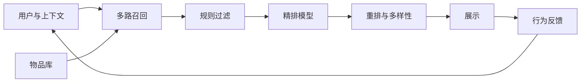

# 推荐系统

推荐系统从大量候选内容中，为当前用户和场景选择更可能有价值的项目。它不是简单预测“喜欢或不喜欢”，而是一条由召回、过滤、排序、重排和反馈组成的实时决策链路。

## 推荐链路

### 召回

从百万级物品中快速找出几百到几千个候选。常见方式包括热门召回、协同过滤、内容相似、向量召回和用户历史召回。

### 排序

使用更丰富的用户、物品和上下文特征，预测点击、观看、购买或长期价值。工业系统常同时预测多个目标。

### 重排

在模型分数基础上处理去重、多样性、新鲜度、库存、合规和业务约束。分数最高的列表不一定是最终体验最好的列表。

## 反馈并不等于真实偏好

用户点击了某项，可能只是因为它排在前面；没有点击某项，也可能是因为根本没有展示。推荐数据天然受到现有策略影响，形成曝光偏差和反馈回路。

因此训练数据要记录曝光、位置、候选来源和当时策略，而不只是点击结果。

## 冷启动

- 新用户：缺少历史行为，可使用地区、设备、入口、即时行为和热门内容。
- 新物品：缺少互动，可使用文本、图片、类目和作者特征。
- 新系统：缺少全站数据，需要规则、内容特征和探索流量起步。

## 评估

离线指标包括 Recall@K、NDCG、AUC；线上还要观察点击率、转化率、停留时长、留存、投诉和生态健康。

只优化点击率可能产生标题党和内容单一。推荐目标应包含长期价值、多样性和安全约束。

## 大模型在推荐中的位置

大模型可以理解物品内容、生成语义特征、解释推荐和处理对话式需求，但高并发主排序通常仍需要低延迟专用模型。更常见的组合是大模型提供语义和交互能力，推荐系统负责大规模候选与稳定排序。

## 一个可落地的起步项目

先实现热门基线和基于内容的相似推荐，再加入用户行为和协同过滤。每次升级都比较覆盖率、长尾曝光、线上延迟和业务指标，避免一开始就堆叠复杂深度模型。
