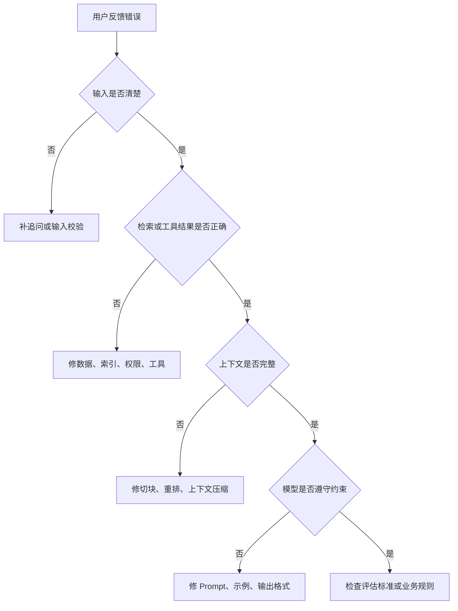

# AI 应用评估与排错

AI 应用不能只靠一次演示判断效果。演示通常覆盖的是顺利路径，真实使用会遇到资料缺失、表达模糊、权限差异、工具失败、成本升高和模型版本变化。评估与排错的目标，是把这些不稳定因素变成可观察、可复现、可改进的问题。

## 先定义什么叫“好”

不同 AI 应用的好坏标准不同。

| 应用类型 | 核心指标 | 不能只看 |
| --- | --- | --- |
| 知识库问答 | 答案正确率、来源命中率、拒答准确率 | 回答是否流畅 |
| 客服助手 | 首次解决率、人工接管率、违规回复率 | 回复是否礼貌 |
| 代码助手 | 构建通过率、测试通过率、缺陷回归率 | 代码看起来是否合理 |
| 数据分析助手 | 查询准确率、结论可追溯性、异常解释质量 | 图表是否漂亮 |
| Agent 自动化 | 任务完成率、工具调用成功率、回滚率 | 是否能跑完一两个样例 |

评估标准要和业务风险绑定。事实问答更关注依据，写操作更关注权限和回滚，代码修改更关注测试和 diff 可审查。

## 建立评估集

评估集是 AI 应用的回归测试。它不需要一开始很大，但必须覆盖真实问题。

一组基本评估集应包含：

- 高频问题：用户最常问的内容。
- 边界问题：资料里只部分提到、需要组合判断的问题。
- 无答案问题：资料中没有依据的问题。
- 权限问题：不同角色能看到不同资料的问题。
- 对抗问题：诱导模型越权、编造或忽略规则的问题。
- 工具失败问题：接口超时、参数错误、资源不存在的问题。

每条样例至少记录：

| 字段 | 说明 |
| --- | --- |
| 输入 | 用户原始问题或任务 |
| 期望行为 | 应回答、拒答、追问、调用工具或转人工 |
| 依据 | 应命中的文档、接口结果或测试命令 |
| 禁止行为 | 不应编造、不应泄露、不应执行的动作 |
| 风险等级 | 错误后果是否严重 |

## 分层排错

AI 应用出错时，不要直接改 Prompt。应按链路逐层排查。

顺序很重要。很多“模型回答错”的根因其实是检索错、资料旧、工具返回字段缺失或权限过滤错误。

## 常见问题

### 幻觉

表现：答案里出现资料没有的事实、API、政策、价格、命令。

排查顺序：

1. 检查上下文里是否真的有依据。
2. 检查 Prompt 是否要求基于来源回答。
3. 检查无答案样例是否被纳入评估。
4. 检查输出是否展示来源。

处理方式：

- 要求答案引用来源编号。
- 没有依据时明确拒答。
- 对高风险领域增加人工确认。
- 让模型先提取依据，再组织答案。

### 检索召回错误

表现：用户问 A，系统找到 B；或者答案漏掉关键文档。

可能原因：

- 文档切块破坏语义。
- 关键词、产品名、错误码没有被召回。
- 向量模型不适合当前领域。
- 权限过滤过早或过晚。
- Top K 太小或重排策略差。

处理方式：

- 调整切块粒度和重叠窗口。
- 使用关键词 + 向量的混合检索。
- 增加查询改写。
- 对候选片段做重排。
- 记录每次回答命中的片段，便于复盘。

### 上下文过长

表现：成本高、延迟高、回答忽略关键片段。

处理方式：

- 减少无关历史对话。
- 只放最相关片段。
- 对长文档先摘要再进入主上下文。
- 把稳定规则放到系统提示或 Skill，避免每次重复塞入。
- 对工具返回做字段裁剪和分页。

### 工具调用失败

表现：参数错、接口超时、权限不足、模型反复调用同一工具。

处理方式：

- 工具 schema 写清字段类型、必填项和枚举。
- 工具错误要区分参数错误、无权限、不存在、超时、内部异常。
- 只读工具和写入工具分开。
- 写操作加幂等键和人工确认。
- 对重复失败设置停止条件。

### 输出格式不稳定

表现：有时返回 JSON，有时返回自然语言；字段缺失或类型不一致。

处理方式：

- 使用结构化输出 schema。
- 提供少量正反例。
- 对模型输出做解析校验，不通过则重试或降级。
- 稳定格式要求很高时，再考虑 SFT 或专门的格式化层。

## 线上监控

上线后至少观察这些指标：

| 指标 | 说明 |
| --- | --- |
| 请求量 | 判断使用规模和峰值 |
| 延迟 | 区分检索、工具、模型生成耗时 |
| 成本 | 统计 token、模型调用次数、缓存命中 |
| 命中率 | RAG 是否找到有效资料 |
| 拒答率 | 过高可能召回差，过低可能幻觉多 |
| 人工接管率 | 判断自动化边界是否合理 |
| 工具失败率 | 观察外部系统和参数质量 |
| 投诉 / 纠错 | 收集真实错误样本 |

监控要能定位到链路阶段。只知道“回答错了”不够，最好能看到本次问题、检索片段、工具结果、模型输出、用户反馈和版本信息。

## 版本管理

AI 应用中会变化的不只是代码：

- 模型版本。
- Prompt。
- 文档索引。
- Embedding 模型。
- 重排策略。
- 工具 schema。
- 权限规则。
- 评估集。

每次变更都应记录版本，并用评估集回归。否则系统变好还是变差，只能靠感觉判断。

## 排错清单

| 现象 | 优先检查 |
| --- | --- |
| 回答编造 | 上下文是否有依据、拒答规则是否生效 |
| 答非所问 | 检索命中片段、查询改写、切块策略 |
| 引用不准 | 来源编号、片段映射、后处理逻辑 |
| 很慢 | 检索耗时、工具耗时、上下文长度、模型队列 |
| 很贵 | token 数、重复调用、缓存命中、模型规格 |
| 越权 | 权限过滤位置、工具权限、日志脱敏 |
| 格式乱 | schema、解析校验、重试策略 |
| Agent 循环不止 | 停止条件、工具错误分类、计划粒度 |

## 总结

AI 应用的质量来自可评估、可追踪、可回归。排错时先看输入和外部依据，再看上下文，最后才调整模型和 Prompt。只要把评估集、日志、权限、版本和监控补齐，AI 系统就能从一次演示逐步变成可维护的工程能力。
