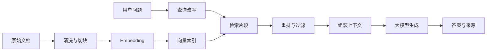

# 第一个 AI 应用：知识库问答

知识库问答是理解 AI 应用最合适的起点。它不只是“把问题发给大模型”，而是把资料检索、上下文组织、答案生成、引用来源、权限和评估串成一条完整链路。

这类应用的目标很明确：用户提出问题，系统从可信资料中找到依据，再让模型基于依据回答。如果资料里没有答案，系统应明确拒答或转人工，而不是编一个看起来合理的结果。

## 目标边界

第一版可以先做小而完整的版本：

| 项目 | 第一版边界 |
| --- | --- |
| 资料范围 | 10 到 50 篇 Markdown、PDF 或产品文档 |
| 用户输入 | 普通自然语言问题 |
| 输出 | 答案、来源标题、来源片段 |
| 权限 | 先做公开资料；内部资料后续再加权限过滤 |
| 评估 | 准备 20 到 50 个标准问题和期望依据 |
| 不做 | 自动写业务系统、复杂 Agent、多轮审批 |

这个边界足够练到 AI 应用的主要结构，又不会一开始就被权限、海量数据和复杂工具拖住。

## 系统结构

一条最小链路如下：



每个环节都有独立职责。检索负责找到资料，模型负责组织答案。不要让模型在没有资料的情况下承担事实来源。

## 第一步：整理资料

资料质量决定系统上限。先把文档整理成稳定格式：

- 去掉页眉、页脚、目录页、重复版权说明。
- 保留标题层级、段落和表格含义。
- 给每篇资料标记来源、版本、更新时间和权限范围。
- 对 PDF、扫描件、图片文档做 OCR 后抽查质量。

文档进入索引前，至少应保留这些字段：

| 字段 | 用途 |
| --- | --- |
| `doc_id` | 唯一标识文档 |
| `title` | 展示来源和辅助检索 |
| `section` | 保留章节位置 |
| `content` | 被检索和放入上下文的正文 |
| `source_url` | 用户核对原文 |
| `updated_at` | 判断资料是否过期 |
| `permission` | 后续做权限过滤 |

## 第二步：切块

切块不是简单按固定字数切。好的切块应尽量保持语义完整。

常见策略：

- 按标题层级切：适合 Markdown、技术文档、制度文档。
- 按段落合并切：适合短文章和 FAQ。
- 带重叠窗口：防止关键上下文被切断。
- 给表格单独处理：保留表头和行含义。

经验上，单个片段不宜太短，否则缺少上下文；也不宜太长，否则检索不准、上下文成本高。可以先从 300 到 800 个中文字符开始，再根据评估结果调整。

## 第三步：建立检索

常见检索方式有三类：

| 检索方式 | 优点 | 局限 |
| --- | --- | --- |
| 关键词检索 | 对专有名词、编号、错误码很准 | 对同义表达不敏感 |
| 向量检索 | 能处理语义相近问题 | 可能漏掉精确关键词 |
| 混合检索 | 兼顾关键词和语义 | 实现和调参更复杂 |

第一版可以先用向量检索；如果资料里有大量产品型号、错误码、接口名、配置项，建议尽早加入关键词或混合检索。

## 第四步：组织上下文

检索到片段后，不要直接全部塞给模型。应先做过滤和排序：

1. 按相似度取候选片段。
2. 去掉重复或权限不匹配片段。
3. 对候选片段做重排。
4. 保留最相关的 3 到 8 个片段。
5. 组装成带来源编号的上下文。

Prompt 应明确三件事：

```text
请只基于给定资料回答。
如果资料不足以回答，说明缺少依据。
回答后列出使用到的来源编号。
```

这条规则不能完全消灭幻觉，但能明显降低模型脱离资料发挥的概率。

## 第五步：返回答案和来源

答案展示要服务核对：

- 正文回答保持简洁。
- 关键结论后附来源编号。
- 来源列表展示文档标题、章节和片段。
- 没有依据时返回“资料中没有找到明确说明”。
- 对高风险建议加上人工确认提示。

知识库问答最重要的不是回答像不像，而是能不能回到依据。

## 第六步：准备评估集

没有评估集，系统很快会陷入“感觉变好了”的调参。第一版至少准备三类问题：

| 类型 | 例子 | 检查点 |
| --- | --- | --- |
| 明确命中 | 某个配置项如何开启 | 是否找到正确片段 |
| 需要综合 | 某功能上线前要满足哪些条件 | 是否合并多个来源 |
| 无答案 | 文档没有提到的问题 | 是否拒答 |

每个问题记录：

- 标准问题。
- 可接受的答案要点。
- 必须引用的来源。
- 不应出现的错误答案。

后续改切块、Embedding、模型、Prompt、重排策略时，都用这组问题回归。

## 常见失败与处理

| 现象 | 可能原因 | 处理方式 |
| --- | --- | --- |
| 答案流畅但依据不对 | 检索召回错了 | 优化切块、混合检索、重排 |
| 只回答一部分 | 相关片段分散 | 增加多路检索或合并相邻片段 |
| 没资料也硬答 | Prompt 约束弱，拒答样例少 | 增加无答案测试和拒答规则 |
| 成本很高 | 上下文放太多 | 缩小候选片段、压缩上下文 |
| 用户看不懂来源 | 来源展示过粗 | 展示标题、章节和命中片段 |
| 新资料搜不到 | 索引未更新 | 建立文档变更后的重建流程 |

## 什么时候升级

第一版稳定后，再考虑增强：

- 增加权限过滤，保证不同用户只能检索可见文档。
- 增加重排模型，提高召回片段质量。
- 增加查询改写，处理口语化问题。
- 增加工具调用，查询实时系统状态。
- 增加 Agent，让系统能多步检索、追问和验证。
- 增加监控，观察问题类型、拒答率、耗时和成本。

升级顺序应由问题驱动。检索不准就先修检索，权限不清就先补权限，不要一开始就把 Agent、微调和复杂编排全部堆上去。

## 总结

第一个 AI 应用不应该追求功能炫，而应该追求链路完整：资料可控、检索可查、上下文清楚、答案有来源、无依据能拒答、效果能评估。把这条链路跑稳后，再学习 Agent、MCP、Skill 和工程化交付，会更容易判断每项技术到底解决哪一层问题。
