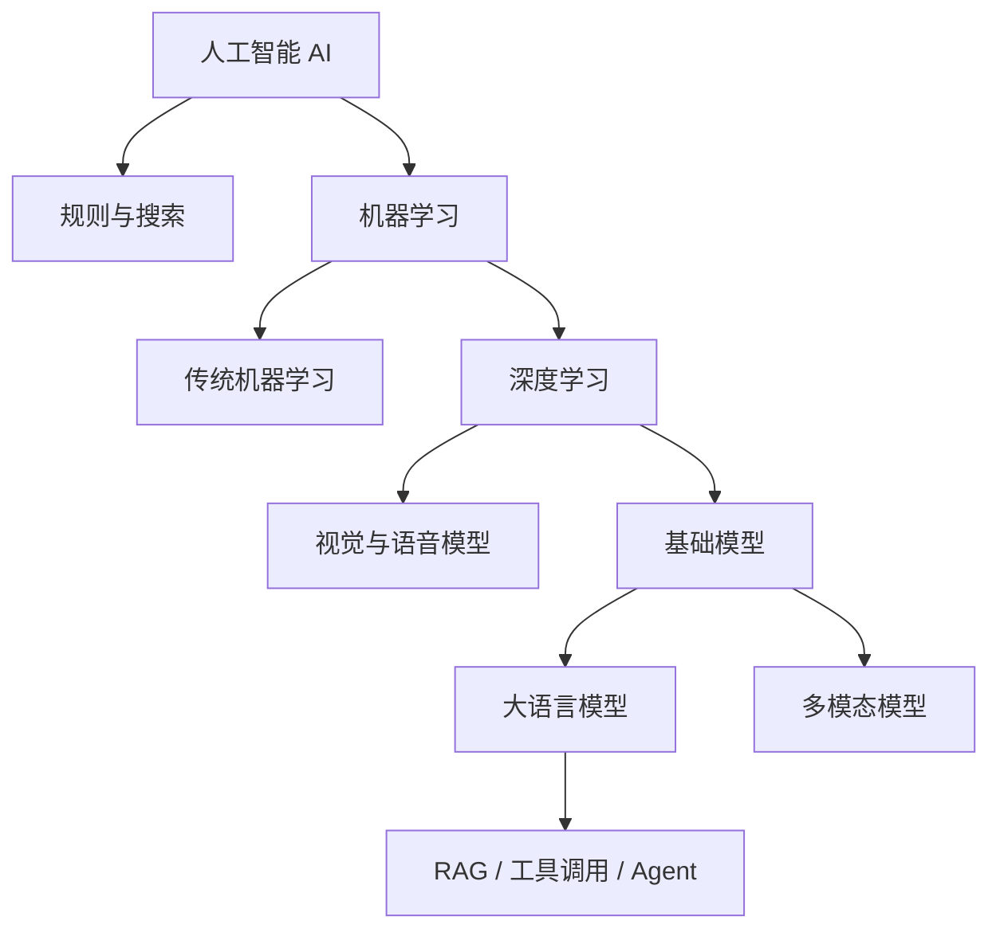

# 人工智能全景

人工智能是一套让计算机完成感知、理解、预测、生成、决策和行动的技术体系。它不是某个聊天产品，也不等同于大语言模型。规则系统、机器学习、深度学习、强化学习、生成式模型和智能体都属于这张技术地图中的不同部分。

理解人工智能，需要同时看清五个层次：业务问题如何定义，数据如何表达现实，模型如何从数据中学习，系统如何把模型接入真实场景，以及如何验证结果可靠、成本可控、权限安全。

## 一张图看懂 AI 技术体系

| 层次 | 主要问题 | 典型技术 | 最终产物 |
| --- | --- | --- | --- |
| 问题与数据 | 要解决什么，事实从哪里来 | 任务建模、样本、特征、标签、数据治理 | 可计算的问题和可信数据集 |
| 学习与模型 | 机器如何从数据中获得规律 | 机器学习、神经网络、深度学习、强化学习 | 能预测、识别或生成的模型 |
| 能力与领域 | 模型能处理什么信息 | NLP、计算机视觉、语音、推荐、时序、多模态 | 面向某类输入输出的能力 |
| 应用与编排 | 如何接入业务和外部世界 | Prompt、RAG、工具调用、Agent、MCP | 可交互、可执行的应用 |
| 工程与治理 | 如何稳定运行并承担责任 | 部署、评估、监控、MLOps、权限、安全、成本 | 可上线、可维护的生产系统 |

这五层不能颠倒。没有清楚的问题和可靠数据，模型再大也可能解决错问题；没有评估和治理，效果不错的演示也无法成为生产系统。

## AI、机器学习、深度学习和大模型

这些词不是并列关系，而是逐层包含、又各有边界。

- **人工智能**描述目标：让机器表现出感知、推理、决策或生成能力。
- **机器学习**描述方法：不把所有规则写死，而是让模型从样本中拟合规律。
- **深度学习**是机器学习的一类方法，使用多层神经网络学习复杂表示。
- **生成式 AI**强调生成新内容，包括文本、图像、语音、视频和代码。
- **大语言模型**是以语言和序列建模为核心的一类基础模型。
- **Agent**不是新模型，而是模型、工具、状态、流程和验证机制组成的任务系统。

## 人工智能如何产生结果

绝大多数现代 AI 系统都可以沿着下面的链路理解：

1. **定义任务**：明确输入、输出、成功标准和不可接受的错误。
2. **准备数据**：采集、清洗、标注、切分并控制数据权限。
3. **选择表示**：把文本、图片、行为或业务字段转换为模型能处理的数值。
4. **训练模型**：前向计算结果，比较预测与目标，反向更新参数。
5. **离线评估**：用未参与训练的数据检查泛化能力和各类错误。
6. **部署推理**：把训练好的模型接入服务，处理真实请求。
7. **应用编排**：加入检索、工具、数据库、业务规则和人工确认。
8. **线上治理**：监控质量、延迟、成本、漂移、越权和安全事件。

传统机器学习、图像识别和大模型应用的实现细节不同，但都离不开这条主线。

## 主要技术分支

| 分支 | 典型输入 | 典型输出 | 常见场景 |
| --- | --- | --- | --- |
| 机器学习 | 表格、指标、用户行为 | 分类、分数、预测值 | 风控、销量预测、流失预测 |
| 自然语言处理 | 文本 | 分类、实体、摘要、回答 | 搜索、客服、文档处理 |
| 计算机视觉 | 图片、视频 | 类别、位置、分割区域 | 质检、识别、医学影像 |
| 语音技术 | 音频 | 文本、语音、说话人 | 转写、合成、语音交互 |
| 推荐系统 | 用户、物品、行为序列 | 排序列表 | 电商、内容、广告推荐 |
| 时间序列 | 按时间排列的观测值 | 趋势、异常、未来数值 | 容量、价格、设备预测 |
| 强化学习 | 状态、动作、奖励 | 行动策略 | 控制、博弈、资源调度 |
| 多模态 | 文本、图片、音频、视频 | 跨模态理解与生成 | 图文问答、视频理解、内容生成 |

详细边界见[主要应用方向](./domains/)。

## 三类典型 AI 系统

### 预测系统

输入结构化数据，输出分类、概率或数值。例如根据用户行为预测流失概率。重点是样本与标签是否可信、特征是否泄漏未来信息、模型上线后分布是否漂移。

### 感知系统

把图片、语音或文本转换为结构化信息。例如从产品照片中定位缺陷。重点是标注质量、复杂环境下的鲁棒性、推理速度和错误代价。

### 生成与行动系统

根据上下文生成文本、代码、图片或工具调用。例如企业知识助手先检索制度，再生成带引用的回答。重点是依据、幻觉、权限、工具风险和验证闭环。

## 方案如何选择

| 问题特征 | 优先考虑 | 原因 |
| --- | --- | --- |
| 规则少、稳定且责任明确 | 业务规则 | 可解释、可测试、成本低 |
| 有大量结构化历史样本，要预测概率或数值 | 传统机器学习 | 训练和推理成本低，效果容易评估 |
| 输入是图片、语音或复杂非结构化数据 | 深度学习 | 能自动学习高维表示 |
| 需要理解、总结、生成或处理开放语言 | 大语言模型 | 语言泛化和生成能力强 |
| 知识经常变化且必须给出来源 | RAG | 把外部资料作为当前依据 |
| 需要查询或修改外部系统 | 工具调用 | 让事实和动作来自受控接口 |
| 任务包含多个步骤且结果可以验证 | Agent | 能在反馈中继续执行和修正 |

选型顺序应从最简单、最容易验证的方案开始。能用规则稳定解决的问题，不必强行使用模型；单次工具调用能完成的任务，也不必包装成复杂 Agent。

## 推荐阅读路径

### 建立全局认识

1. [人工智能发展脉络](./history.md)
2. [AI 核心概念词典](./glossary.md)
3. [学习与实践路线](./learning-path.md)

### 掌握模型原理

1. [基础原理](./foundations/)
2. [机器学习](./ml.md)
3. [深度学习](./deep-learning/)
4. [主要应用方向](./domains/)

### 理解大模型与应用

1. [大语言模型](./llm/)
2. [RAG 与工具调用](./llm/rag-tools.md)
3. [LangChain 工程实践](./applications/langchain/)
4. [智能体](./agent.md)
5. [MCP](./mcp.md)
6. [RSI 递归自我改进](./rsi/)

### 走向生产工程

1. [AI 应用工程](./engineering/)
2. [评估与排错](./evaluation-troubleshooting.md)
3. [项目实践](./practice/)
4. [从 Vibe Coding 到工程化 AI 编程](./vibe-coding/)
5. [流式语音技术实践](./speech-engineering/)：主分段、角色与目标识别、动态调度、共享热词及离线运行。

## 学完后应形成的能力

完整学习不是记住术语，而是能连续回答下面这些问题：

- 一个业务问题是否适合使用 AI，为什么？
- 输入、输出、数据来源和评估标准分别是什么？
- 规则、机器学习、深度学习、大模型应该怎么选？
- 模型为什么会答错，错误发生在数据、检索、模型还是工具层？
- 一个演示如何补齐权限、监控、评估和成本控制后上线？
- 模型、Prompt、索引或工具升级后，如何证明系统没有退化？

能把这些问题落到具体项目中，才算建立了完整的人工智能工程视角。
