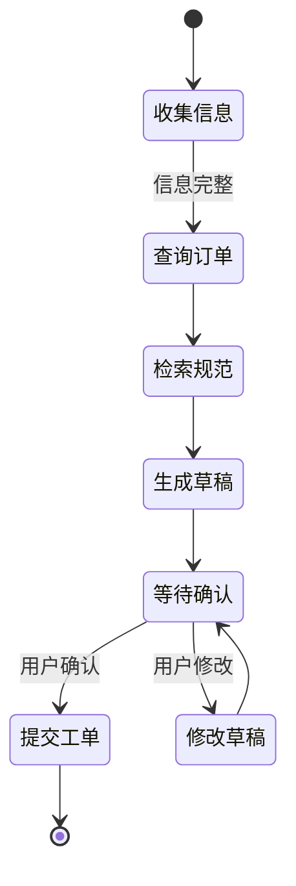

# Agent 项目：工单处理助手

工单处理助手读取用户描述和内部资料，查询订单状态，生成处理建议，并在获得确认后创建或更新工单。这个项目用于理解工具权限、状态管理和多步骤验证。

## 第一版边界

第一版只完成：

1. 对工单分类。
2. 检索相关处理规范。
3. 通过只读工具查询订单。
4. 生成建议和待确认字段。
5. 用户确认后创建工单。

退款、赔付、删除和外部通知暂不自动执行。

## 工具设计

| 工具 | 权限 | 返回 |
| --- | --- | --- |
| `search_policy` | 读取公开或当前用户可见规范 | 来源和片段 |
| `get_order` | 只读当前用户订单 | 结构化订单状态 |
| `create_ticket_draft` | 创建草稿 | 草稿 ID 和待确认字段 |
| `submit_ticket` | 写入，需确认 | 最终工单 ID |

工具参数使用严格 schema，服务端再次校验身份和资源归属。模型不能通过参数声明自己拥有权限。

## 状态机

状态由应用保存，不能只依赖对话文本猜测当前阶段。

## Agent 的使用范围

模型可以根据中间结果决定先追问还是查询资料，但提交动作必须经过确定性检查。工具连续失败、资料冲突或用户意图不清时应停止并转人工。

## 评估集

至少覆盖：

- 正常订单问题。
- 订单不存在和无权访问。
- 资料中没有明确规则。
- 用户中途修改信息。
- 重复提交和网络超时。
- 诱导读取其他用户订单。
- 试图绕过确认直接提交。

评估最终工单状态，而不只评价回复文字是否自然。

## 可观测性

一次任务记录模型版本、使用资料、每次工具参数和结果、状态变化、确认内容、最终工单 ID 和失败原因。敏感字段需要脱敏。

## 完成标准

- 只读与写入工具分离。
- 每次写入都有服务端权限和幂等校验。
- 用户确认内容与实际提交参数一致。
- 工具失败有停止和人工接管路径。
- 全链路可追踪并能复现错误。
- 固定测试集能够在模型或 Prompt 变化后回归。
