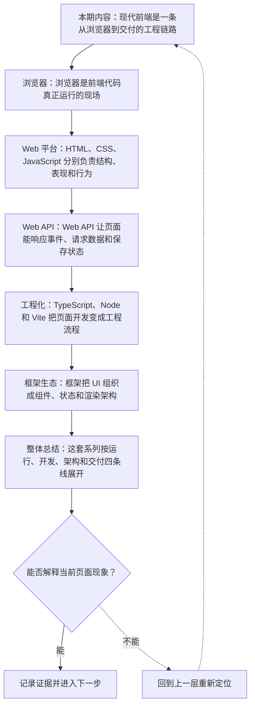
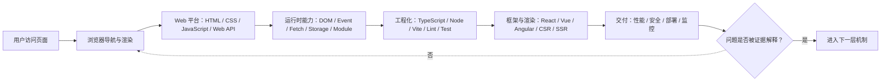
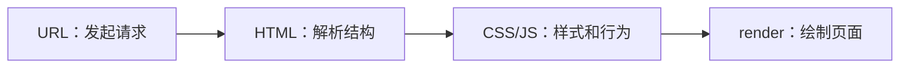
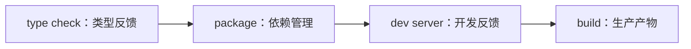

# 现代前端技术全景：Web 平台、工程化与框架生态

&gt; 视频入口：B站合集《前端全链路：从浏览器基础到现代生态》上传并核验后回填正式链接。
&gt; 本文是 EP01 的博客深讲版，包含视频主线，但比视频补充更多机制、流程图、边界判断和排查清单。

## 这篇文章解决什么问题

这期用一张技术地图说明本系列会怎样从浏览器、三件套、Web API、工程化、框架到质量交付逐层展开。

这一篇的中心问题可以概括成：现代前端技术体系如何从浏览器运行扩展到工程化、框架和交付？

关键词：Web platform、JavaScript、TypeScript、delivery、URL、DOM、CSSOM、HTML、CSS、Web API

## 视频主线回顾

### 1. 浏览器是运行现场

一次页面访问会经过请求、解析、执行和渲染。

### 2. Web 平台是底座

HTML、CSS、JavaScript 和 Web API 承担结构、表现、行为和浏览器能力。

### 3. 工程化让项目可协作

TypeScript、Node、包管理、Vite 和质量工具链把开发变成可重复流程。

### 4. 框架和交付闭环

组件框架、渲染架构、测试、性能、安全和监控让功能可靠上线。

## 技术流程图

先用一张图把本期内容串起来。它不是背诵路线，而是排查问题时可以顺着走的证据路线。

## 现代前端技术地图

这张图把本期最关键的结构单独拎出来，适合在复习或做笔记时当作索引。

## 深入展开

### 1. 现代前端是一条从浏览器到交付的工程链路

这一期先看现代前端技术全景。我们会从一次页面访问出发，说明浏览器、HTML、CSS、JavaScript、Web API、TypeScript、Node、Vite、组件框架、渲染架构、测试、性能、安全和交付监控分别在链路里的位置。你会先知道这个系列要讲什么，再进入每个技术点的细节。

这里可以多看一层：先找输入，再看处理过程，最后确认输出。前端很多问题之所以绕，是因为现象出现在页面上，原因却可能藏在网络、样式计算、运行时或构建结果里。

排查时可以顺着这条线问：当前现象是输入不对、处理过程不对，还是最终结果不对。只要能把问题归到其中一格，后面的工具选择就会轻很多。

### 2. 浏览器是前端代码真正运行的现场

用户输入 URL 后，浏览器会发起网络请求，拿到 HTML，继续发现 CSS、JavaScript、图片和字体。它会构建 DOM 和 CSSOM，执行 JavaScript，再把结果渲染到屏幕上。理解浏览器这条主线，后面讲导航、DevTools、性能和安全才有落点。

把这段机制放到工程里看，最实用的切口是证据。不要急着猜是哪一行代码错了，先确认浏览器或工具实际拿到了什么、计算了什么、丢出了什么结果。

排查时可以顺着这条线问：当前现象是输入不对、处理过程不对，还是最终结果不对。只要能把问题归到其中一格，后面的工具选择就会轻很多。

### 3. HTML、CSS、JavaScript 分别负责结构、表现和行为

HTML 描述内容和语义，CSS 负责布局、视觉和响应式，JavaScript 负责交互、状态和逻辑。Web API 则把 JavaScript 连接到 DOM、网络、存储、事件和浏览器能力。很多框架能力看起来很高级，本质上仍然落回这些平台机制。

这个点在真实项目里常常不是孤立问题。它会和状态、缓存、布局、依赖或团队约束连在一起，所以博客版更强调边界：什么归它管，什么应该交给下一层机制判断。

| 维度 | 含义 |
| --- | --- |
| HTML | 内容结构和语义。 |
| CSS | 布局和视觉。 |
| JavaScript | 交互和逻辑。 |

排查时可以顺着这条线问：当前现象是输入不对、处理过程不对，还是最终结果不对。只要能把问题归到其中一格，后面的工具选择就会轻很多。

### 4. Web API 让页面能响应事件、请求数据和保存状态

DOM API 让代码能读取和修改页面节点；事件系统让用户点击、输入和滚动进入程序；Fetch 负责网络请求；storage 和 IndexedDB 保存本地数据；模块系统让代码能拆成依赖图。这一段会在 EP11 到 EP17 逐步展开。

如果要把它讲给别人听，可以按“现象—证据—机制—边界”的顺序。先让对方看到问题，再解释浏览器或工具为什么会给出这样的结果。

| 维度 | 含义 |
| --- | --- |
| DOM | 操作页面节点。 |
| Fetch | 请求网络数据。 |
| storage | 保存本地状态。 |

排查时可以顺着这条线问：当前现象是输入不对、处理过程不对，还是最终结果不对。只要能把问题归到其中一格，后面的工具选择就会轻很多。

### 5. TypeScript、Node 和 Vite 把页面开发变成工程流程

TypeScript 在运行前检查类型；Node.js 让构建工具、脚本和测试跑在浏览器之外；包管理器处理依赖树和 lockfile；Vite 把开发服务器、模块转换、HMR 和生产构建串起来；Formatter、Lint、类型检查和测试则提供持续反馈。

这里可以多看一层：先找输入，再看处理过程，最后确认输出。前端很多问题之所以绕，是因为现象出现在页面上，原因却可能藏在网络、样式计算、运行时或构建结果里。

排查时可以顺着这条线问：当前现象是输入不对、处理过程不对，还是最终结果不对。只要能把问题归到其中一格，后面的工具选择就会轻很多。

### 6. 框架把 UI 组织成组件、状态和渲染架构

组件化让界面拆成可组合单元，响应式模型把状态变化同步到 UI。不同框架在表达方式、更新模型、运行时和编译器分工上有不同取舍。再往上，还要选择 CSR、SSR、SSG、Hydration 或 Islands 等渲染架构，以及路由、数据获取、状态管理和表单这些应用层能力。

把这段机制放到工程里看，最实用的切口是证据。不要急着猜是哪一行代码错了，先确认浏览器或工具实际拿到了什么、计算了什么、丢出了什么结果。

| 维度 | 含义 |
| --- | --- |
| 组件 | UI 边界。 |
| 框架 | 更新模型。 |
| 渲染 | HTML 生成和接管。 |

排查时可以顺着这条线问：当前现象是输入不对、处理过程不对，还是最终结果不对。只要能把问题归到其中一格，后面的工具选择就会轻很多。

## 常见误区与边界

- 不要把全景讲成名词堆砌。
- 不要提前深入框架 API。
- 这一篇不展开：具体框架 API。
- 这一篇不展开：高级构建插件。
- 这一篇不展开：发布平台操作。

## 排查和验证清单

- 先确认问题发生在哪一层：页面结构、样式计算、JavaScript 运行、网络请求、构建产物还是线上交付。
- 用浏览器或工具拿到证据，不只凭肉眼判断。能截图、能看到日志、能看到请求和产物，结论才稳。
- 把最小例子缩到只剩一个变量。变量越少，越容易看清机制。
- 记录输入、处理过程和输出。前端问题往往不是“某个 API 错了”，而是链路中某一步的假设不成立。
- 如果准备把结论放到项目里，再补一层测试、类型检查、可访问性或性能验证。

## 动手练习

1. 用一个最小 HTML 页面复现 现代前端技术全景 里的核心现象。
2. 打开 DevTools，分别记录结构、样式、控制台、网络或性能面板里的一个证据点。
3. 改一个变量，再观察结果是否符合这篇文章里的流程图；如果不符合，把差异写下来。

## 参考来源与本系列依据

- 系列规划：frontend foundations roadmap：30 集内容地图
- Web 平台：MDN Web Docs：基础机制
- 工程生态：TypeScript / Vite / frameworks：工程化和框架定位

## 总结

现代前端不是一堆工具名，而是一条从浏览器运行到工程交付的链路。这个系列会沿着这条链路逐层展开。

博客版到这里就把视频主线扩成了可复习的技术笔记：先知道它在链路里的位置，再知道它怎么运行，最后知道遇到问题该从哪里查。
