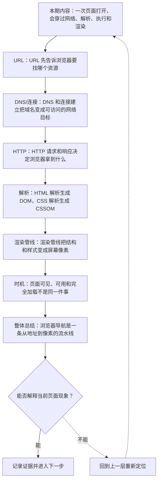
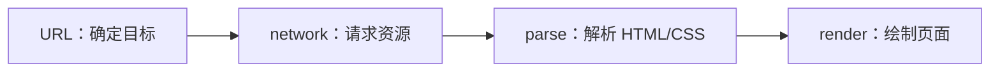
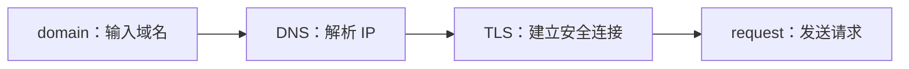
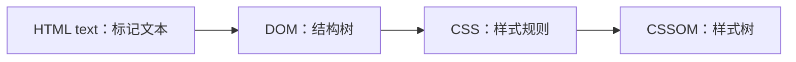
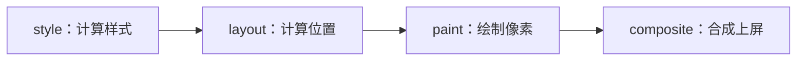

# 浏览器导航流程：URL、DNS、HTTP、DOM 与渲染管线

&gt; 视频入口：B站合集《前端全链路：从浏览器基础到现代生态》上传并核验后回填正式链接。
&gt; 本文是 EP02 的博客深讲版，包含视频主线，但比视频补充更多机制、流程图、边界判断和排查清单。


## 这篇文章解决什么问题

这期拆开一次浏览器导航，从输入 URL 到页面显示，说明网络、解析、执行和渲染如何串起来。

这一篇的中心问题可以概括成：一次浏览器导航如何从 URL 经过网络和渲染管线变成页面？

关键词：URL、DNS、HTTP、DOM、HTTPS、cache、TLS、connection、Content-Type、Cache-Control

## 视频主线回顾

### 1. 从 URL 到网络请求

URL 定位资源，DNS 和连接建立让浏览器找到服务器。

### 2. HTTP 响应

状态码、响应头和响应体决定浏览器如何继续处理。

### 3. 解析 DOM 和 CSSOM

HTML 与 CSS 会变成树结构，JavaScript 可能参与修改。

### 4. 渲染管线

style、layout、paint 和 composite 共同把页面画到屏幕上。

## 技术流程图

先用一张图把本期内容串起来。它不是背诵路线，而是排查问题时可以顺着走的证据路线。




## 深入展开

### 1. 一次页面打开，会穿过网络、解析、执行和渲染

这一期看浏览器导航流程。我们会从输入 URL 开始，讲浏览器怎样查缓存、解析 DNS、建立连接、发送 HTTP 请求，拿到 HTML 后怎样继续发现 CSS 和 JavaScript，怎样构建 DOM 和 CSSOM，最后怎样布局、绘制、合成，把页面显示出来。

这里可以多看一层：先找输入，再看处理过程，最后确认输出。前端很多问题之所以绕，是因为现象出现在页面上，原因却可能藏在网络、样式计算、运行时或构建结果里。



排查时可以顺着这条线问：当前现象是输入不对、处理过程不对，还是最终结果不对。只要能把问题归到其中一格，后面的工具选择就会轻很多。

### 2. URL 先告诉浏览器要找哪个资源

一个 URL 里通常包含协议、主机名、路径、查询参数和片段。协议决定使用 HTTP 还是 HTTPS，主机名决定访问哪个站点，路径和查询参数决定具体资源。浏览器会先判断缓存、Service Worker、历史记录和安全策略，再决定是否发起网络请求。

把这段机制放到工程里看，最实用的切口是证据。不要急着猜是哪一行代码错了，先确认浏览器或工具实际拿到了什么、计算了什么、丢出了什么结果。

```js
https://example.com/products?id=42#reviews
```

- https 是协议。
- example.com 是主机。
- 路径和查询定位资源。

排查时可以顺着这条线问：当前现象是输入不对、处理过程不对，还是最终结果不对。只要能把问题归到其中一格，后面的工具选择就会轻很多。

### 3. DNS 和连接建立把域名变成可访问的网络目标

浏览器需要把域名解析成 IP 地址，这一步由 DNS 完成。随后会建立连接，HTTPS 还需要 TLS 握手来协商加密。现代浏览器会复用连接，也会受到缓存、预连接和网络状态影响。网络慢时，页面还没开始解析就已经在等待。

这个点在真实项目里常常不是孤立问题。它会和状态、缓存、布局、依赖或团队约束连在一起，所以博客版更强调边界：什么归它管，什么应该交给下一层机制判断。



排查时可以顺着这条线问：当前现象是输入不对、处理过程不对，还是最终结果不对。只要能把问题归到其中一格，后面的工具选择就会轻很多。

### 4. HTTP 请求和响应决定浏览器拿到什么

浏览器发出 HTTP 请求后，服务器返回状态码、响应头和响应体。状态码告诉请求结果，Content-Type 告诉浏览器如何解析，Cache-Control 影响缓存，Set-Cookie 可能写入凭据。拿到 HTML 后，浏览器才正式进入页面解析阶段。

如果要把它讲给别人听，可以按“现象—证据—机制—边界”的顺序。先让对方看到问题，再解释浏览器或工具为什么会给出这样的结果。

| 维度 | 含义 |
| --- | --- |
| status | 请求结果。 |
| headers | 缓存、安全、类型。 |
| body | HTML 或资源内容。 |

排查时可以顺着这条线问：当前现象是输入不对、处理过程不对，还是最终结果不对。只要能把问题归到其中一格，后面的工具选择就会轻很多。

### 5. HTML 解析生成 DOM，CSS 解析生成 CSSOM

HTML 会被解析成 DOM 树，CSS 会被解析成 CSSOM。DOM 描述页面结构，CSSOM 描述样式规则。JavaScript 可能读取或修改 DOM，也可能阻塞解析。浏览器要把结构和样式合起来，才能知道每个元素应该长什么样。

这里可以多看一层：先找输入，再看处理过程，最后确认输出。前端很多问题之所以绕，是因为现象出现在页面上，原因却可能藏在网络、样式计算、运行时或构建结果里。



排查时可以顺着这条线问：当前现象是输入不对、处理过程不对，还是最终结果不对。只要能把问题归到其中一格，后面的工具选择就会轻很多。

### 6. 渲染管线把结构和样式变成屏幕像素

浏览器会根据 DOM 和 CSSOM 计算渲染树，确定元素尺寸和位置，这叫 layout。接着把背景、文字、边框等画出来，这叫 paint。最后把不同图层合成到屏幕上。动画、滚动、图片加载和字体加载，都可能让渲染管线再次运行。

把这段机制放到工程里看，最实用的切口是证据。不要急着猜是哪一行代码错了，先确认浏览器或工具实际拿到了什么、计算了什么、丢出了什么结果。



排查时可以顺着这条线问：当前现象是输入不对、处理过程不对，还是最终结果不对。只要能把问题归到其中一格，后面的工具选择就会轻很多。

### 7. 页面可见、可用和完全加载不是同一件事

浏览器会触发 DOMContentLoaded、load 等不同事件。DOMContentLoaded 表示 HTML 已解析完，load 表示页面依赖资源加载完成。用户真正关心的还有主要内容什么时候出现、按钮什么时候能点、交互是否卡顿。后面性能章节会用 LCP、INP、CLS 等指标继续看这些体验。

这个点在真实项目里常常不是孤立问题。它会和状态、缓存、布局、依赖或团队约束连在一起，所以博客版更强调边界：什么归它管，什么应该交给下一层机制判断。

| 维度 | 含义 |
| --- | --- |
| DOMContentLoaded | DOM 解析完成。 |
| load | 依赖资源完成。 |
| interactive | 用户能顺畅操作。 |

排查时可以顺着这条线问：当前现象是输入不对、处理过程不对，还是最终结果不对。只要能把问题归到其中一格，后面的工具选择就会轻很多。

## 常见误区与边界

- 不要把页面显示描述成单一步骤。
- 不要把可见、可用和 load 混为一谈。
- 这一篇不展开：HTTP/3 底层细节。
- 这一篇不展开：浏览器进程模型深挖。
- 这一篇不展开：性能指标完整专题。

## 排查和验证清单

- 先确认问题发生在哪一层：页面结构、样式计算、JavaScript 运行、网络请求、构建产物还是线上交付。
- 用浏览器或工具拿到证据，不只凭肉眼判断。能截图、能看到日志、能看到请求和产物，结论才稳。
- 把最小例子缩到只剩一个变量。变量越少，越容易看清机制。
- 记录输入、处理过程和输出。前端问题往往不是“某个 API 错了”，而是链路中某一步的假设不成立。
- 如果准备把结论放到项目里，再补一层测试、类型检查、可访问性或性能验证。

## 动手练习

1. 用一个最小 HTML 页面复现 浏览器导航流程 里的核心现象。
2. 打开 DevTools，分别记录结构、样式、控制台、网络或性能面板里的一个证据点。
3. 改一个变量，再观察结果是否符合这篇文章里的流程图；如果不符合，把差异写下来。

## 参考来源与本系列依据

- 浏览器文档：MDN Navigation / Rendering：导航和解析基础
- 网络基础：HTTP / DNS / TLS：请求链路
- 性能文档：DOMContentLoaded / load / Core Web Vitals：时机和体验

## 总结

浏览器导航是一条从地址到像素的流水线。理解它，是理解前端性能、调试和安全的第一步。

博客版到这里就把视频主线扩成了可复习的技术笔记：先知道它在链路里的位置，再知道它怎么运行，最后知道遇到问题该从哪里查。
