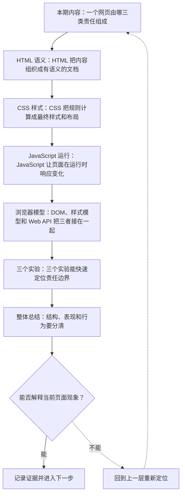

# Web 平台的三门语言：HTML、CSS 与 JavaScript

&gt; 视频入口：B站合集《前端全链路：从浏览器基础到现代生态》上传并核验后回填正式链接。
&gt; 本文是 EP03 的博客深讲版，包含视频主线，但比视频补充更多机制、流程图、边界判断和排查清单。

## 这篇文章解决什么问题

这一篇把一个网页拆成三类技术责任：HTML 组织结构和语义，CSS 计算样式和布局，JavaScript 处理事件、数据和运行逻辑。博客版会进一步补上三者在浏览器内部如何连接，以及遇到页面问题时怎么判断责任边界。

这一篇的中心问题可以概括成：Web 平台的三门语言：HTML、CSS 与 JavaScript

关键词：HTML、CSS、JavaScript、文档结构进入、DOM、selector、cascade、computed、events、API

## 视频主线回顾

### 1. 一个网页由哪三类责任组成

这一期把一个网页拆成三类技术责任：HTML 组织内容结构和语义，CSS 计算样式并完成布局，JavaScript 处理事件、数据和运行逻辑。三者进入浏览器以后，会通过 DOM、样式模型和 Web API 连在一起，最后变成可见、可操作的页面。

我们会看同一个页面的三个结果：关闭 CSS 后，文档结构还在，但视觉排版回到浏览器默认样式；关闭 JavaScript 后，内容和原生控件还在，但脚本增强的交互停止；把原生 button 换成普通 div 后，外观可以模仿，键盘焦点、默认激活和语义信息会明显变化。上一期追完了 URL 到像素的流程，这一期把解析流程里的三门平台语言拆开看清楚。

### 2. HTML 把内容组织成有语义的文档

HTML 写下的是文档结构。标题、段落、列表、链接、表单和按钮这些元素，会被浏览器解析成 DOM 节点，并带着各自的默认语义和原生行为。

例如 `<button type="button">加入购物车</button>`，浏览器看到的不是一段带样式的文字，而是一个可以聚焦、可以用键盘触发、可以被辅助技术识别为按钮的控件。`h1` 表示页面主标题，`nav` 表示导航区域，`form` 表示一组可提交的数据输入。它们让页面不只“看起来有结构”，也让浏览器、搜索引擎和辅助技术能读懂结构。

所以 HTML 的关键结果，是一棵有含义的文档树。后面的样式和脚本都围绕这棵树工作。

### 3. CSS 把规则计算成最终样式和布局

CSS 写下的是呈现规则。选择器先找到目标元素，层叠、继承和优先级决定哪条声明生效，浏览器再得到每个节点的最终样式。

同一个按钮，可以用 CSS 调整颜色、圆角、间距、字号和布局位置。页面也可以用 Flexbox 或 Grid 把内容排成一行、两列或者响应式网格。Computed 面板里看到的 color、display、font-size、margin，就是这些规则计算后的结果。

关闭 CSS 时，HTML 仍然会解析成 DOM，链接仍然可以点击，按钮仍然是按钮；只是颜色、间距、布局和品牌视觉都消失，页面回到浏览器的默认呈现。这个现象说明，CSS 的主要结果是表现和布局，它改变页面怎么显示，也影响元素是否参与布局。

### 4. JavaScript 让页面在运行时响应变化

JavaScript 写下的是运行逻辑。它可以监听用户事件，读取或修改 DOM，调用 fetch 发起网络请求，使用 Storage 保存数据，也可以通过计时器、Promise 和其他 Web API 安排异步任务。

比如用户点击“加入购物车”，脚本可以在 click 事件里把数量从 0 改成 1，向服务器发送请求，再把按钮文字改成“已加入”。这个变化发生在页面已经加载以后，属于运行时行为。

关闭 JavaScript 时，HTML 内容仍然显示，链接和表单这些原生能力仍然能工作；依赖脚本增强的计数、弹窗、动态校验、局部刷新和埋点会停止。这个现象说明，JavaScript 的主要结果是行为、数据流和运行时状态。

### 5. DOM、样式模型和 Web API 把三者接在一起

浏览器会把 HTML 解析成 DOM，把 CSS 解析成样式规则，并根据选择器、层叠和继承计算最终样式。JavaScript 运行时可以通过 DOM API 读取节点、创建节点、改属性和绑定事件，也可以通过 Web API 使用网络、存储、历史记录、剪贴板等浏览器能力。

DOM 和 CSSOM 这类模型，是浏览器暴露出来的数据结构和接口。开发时常说“操作 DOM”，意思是脚本在操作浏览器里的文档模型；看 Computed Style，看到的是浏览器计算后的样式结果。

框架最终也会落到这些平台能力上。组件会生成或更新 DOM，样式方案会产出 CSS 规则，事件处理和数据请求仍然通过 JavaScript 与 Web API 完成。理解这条连接关系，后面看 React、Vue、构建工具和渲染架构时，才知道它们包住了哪一层能力。

### 6. 三个实验能快速定位责任边界

遇到页面问题，可以先做三个很小的实验。

第一个实验是禁用 CSS。页面如果内容还在、控件还能操作，但排版和视觉崩掉，说明结构来自 HTML，呈现主要来自 CSS。

第二个实验是禁用 JavaScript。页面如果首屏内容还在，普通链接还能跳转，但点击后的计数、弹窗或局部刷新停止，说明这些交互依赖脚本运行。

第三个实验是把 `<button>` 换成带 click 事件的 `
`。视觉上可以继续用 CSS 做得很像，但默认键盘焦点、Enter 或 Space 激活、按钮角色和表单关系都会变化。这个实验最适合说明：语义不是装饰，它会影响浏览器行为和可访问性。

### 7. 结构、表现和行为要分清

现在把三门语言收回来：HTML 负责内容结构和语义，产物是浏览器可以理解的文档树；CSS 负责样式计算和布局，产物是每个节点最终怎么显示、怎么占据空间；JavaScript 负责事件、数据和运行逻辑，产物是加载后的动态行为和状态变化。

DOM、样式模型和 Web API 是它们与浏览器连接的位置。这个判断适用于原生页面，也适用于后面的框架页面，因为框架最终仍然要让浏览器理解结构、计算样式、执行脚本。下一期进入 DevTools：我们会把 Elements、Computed、Console、Network 和 Performance 放到同一条证据链里，看看一个页面问题应该从哪个面板开始查。

## 技术流程图

先用一张图把本期内容串起来。它不是背诵路线，而是排查问题时可以顺着走的证据路线。

## 深入展开

### 1. 一个网页由哪三类责任组成

这一期把一个网页拆成三类技术责任：HTML 组织内容结构和语义，CSS 计算样式并完成布局，JavaScript 处理事件、数据和运行逻辑。三者进入浏览器以后，会通过 DOM、样式模型和 Web API 连在一起，最后变成可见、可操作的页面。

我们会看同一个页面的三个结果：关闭 CSS 后，文档结构还在，但视觉排版回到浏览器默认样式；关闭 JavaScript 后，内容和原生控件还在，但脚本增强的交互停止；把原生 button 换成普通 div 后，外观可以模仿，键盘焦点、默认激活和语义信息会明显变化。上一期追完了 URL 到像素的流程，这一期把解析流程里的三门平台语言拆开看清楚。

这里可以多看一层：先找输入，再看处理过程，最后确认输出。前端很多问题之所以绕，是因为现象出现在页面上，原因却可能藏在网络、样式计算、运行时或构建结果里。

排查时可以顺着这条线问：当前现象是输入不对、处理过程不对，还是最终结果不对。只要能把问题归到其中一格，后面的工具选择就会轻很多。

### 2. HTML 把内容组织成有语义的文档

HTML 写下的是文档结构。标题、段落、列表、链接、表单和按钮这些元素，会被浏览器解析成 DOM 节点，并带着各自的默认语义和原生行为。

例如 `<button type="button">加入购物车</button>`，浏览器看到的不是一段带样式的文字，而是一个可以聚焦、可以用键盘触发、可以被辅助技术识别为按钮的控件。`h1` 表示页面主标题，`nav` 表示导航区域，`form` 表示一组可提交的数据输入。它们让页面不只“看起来有结构”，也让浏览器、搜索引擎和辅助技术能读懂结构。

所以 HTML 的关键结果，是一棵有含义的文档树。后面的样式和脚本都围绕这棵树工作。

把这段机制放到工程里看，最实用的切口是证据。不要急着猜是哪一行代码错了，先确认浏览器或工具实际拿到了什么、计算了什么、丢出了什么结果。

排查时可以顺着这条线问：当前现象是输入不对、处理过程不对，还是最终结果不对。只要能把问题归到其中一格，后面的工具选择就会轻很多。

### 3. CSS 把规则计算成最终样式和布局

CSS 写下的是呈现规则。选择器先找到目标元素，层叠、继承和优先级决定哪条声明生效，浏览器再得到每个节点的最终样式。

同一个按钮，可以用 CSS 调整颜色、圆角、间距、字号和布局位置。页面也可以用 Flexbox 或 Grid 把内容排成一行、两列或者响应式网格。Computed 面板里看到的 color、display、font-size、margin，就是这些规则计算后的结果。

关闭 CSS 时，HTML 仍然会解析成 DOM，链接仍然可以点击，按钮仍然是按钮；只是颜色、间距、布局和品牌视觉都消失，页面回到浏览器的默认呈现。这个现象说明，CSS 的主要结果是表现和布局，它改变页面怎么显示，也影响元素是否参与布局。

这个点在真实项目里常常不是孤立问题。它会和状态、缓存、布局、依赖或团队约束连在一起，所以博客版更强调边界：什么归它管，什么应该交给下一层机制判断。

排查时可以顺着这条线问：当前现象是输入不对、处理过程不对，还是最终结果不对。只要能把问题归到其中一格，后面的工具选择就会轻很多。

### 4. JavaScript 让页面在运行时响应变化

JavaScript 写下的是运行逻辑。它可以监听用户事件，读取或修改 DOM，调用 fetch 发起网络请求，使用 Storage 保存数据，也可以通过计时器、Promise 和其他 Web API 安排异步任务。

比如用户点击“加入购物车”，脚本可以在 click 事件里把数量从 0 改成 1，向服务器发送请求，再把按钮文字改成“已加入”。这个变化发生在页面已经加载以后，属于运行时行为。

关闭 JavaScript 时，HTML 内容仍然显示，链接和表单这些原生能力仍然能工作；依赖脚本增强的计数、弹窗、动态校验、局部刷新和埋点会停止。这个现象说明，JavaScript 的主要结果是行为、数据流和运行时状态。

如果要把它讲给别人听，可以按“现象—证据—机制—边界”的顺序。先让对方看到问题，再解释浏览器或工具为什么会给出这样的结果。

排查时可以顺着这条线问：当前现象是输入不对、处理过程不对，还是最终结果不对。只要能把问题归到其中一格，后面的工具选择就会轻很多。

### 5. DOM、样式模型和 Web API 把三者接在一起

浏览器会把 HTML 解析成 DOM，把 CSS 解析成样式规则，并根据选择器、层叠和继承计算最终样式。JavaScript 运行时可以通过 DOM API 读取节点、创建节点、改属性和绑定事件，也可以通过 Web API 使用网络、存储、历史记录、剪贴板等浏览器能力。

DOM 和 CSSOM 这类模型，是浏览器暴露出来的数据结构和接口。开发时常说“操作 DOM”，意思是脚本在操作浏览器里的文档模型；看 Computed Style，看到的是浏览器计算后的样式结果。

框架最终也会落到这些平台能力上。组件会生成或更新 DOM，样式方案会产出 CSS 规则，事件处理和数据请求仍然通过 JavaScript 与 Web API 完成。理解这条连接关系，后面看 React、Vue、构建工具和渲染架构时，才知道它们包住了哪一层能力。

这里可以多看一层：先找输入，再看处理过程，最后确认输出。前端很多问题之所以绕，是因为现象出现在页面上，原因却可能藏在网络、样式计算、运行时或构建结果里。

排查时可以顺着这条线问：当前现象是输入不对、处理过程不对，还是最终结果不对。只要能把问题归到其中一格，后面的工具选择就会轻很多。

### 6. 三个实验能快速定位责任边界

遇到页面问题，可以先做三个很小的实验。

第一个实验是禁用 CSS。页面如果内容还在、控件还能操作，但排版和视觉崩掉，说明结构来自 HTML，呈现主要来自 CSS。

第二个实验是禁用 JavaScript。页面如果首屏内容还在，普通链接还能跳转，但点击后的计数、弹窗或局部刷新停止，说明这些交互依赖脚本运行。

第三个实验是把 `<button>` 换成带 click 事件的 `
`。视觉上可以继续用 CSS 做得很像，但默认键盘焦点、Enter 或 Space 激活、按钮角色和表单关系都会变化。这个实验最适合说明：语义不是装饰，它会影响浏览器行为和可访问性。

把这段机制放到工程里看，最实用的切口是证据。不要急着猜是哪一行代码错了，先确认浏览器或工具实际拿到了什么、计算了什么、丢出了什么结果。

排查时可以顺着这条线问：当前现象是输入不对、处理过程不对，还是最终结果不对。只要能把问题归到其中一格，后面的工具选择就会轻很多。

## 常见误区与边界

- 不要把工具名当成机制本身；先确认它解决的是运行、开发、架构还是交付问题。
- 不要只看最终界面；很多前端问题需要同时看 DOM、样式、网络、运行时和构建产物。
- 不要把框架能力和浏览器原生能力混在一起；框架最终仍然要落回 Web 平台。

## 排查和验证清单

- 先确认问题发生在哪一层：页面结构、样式计算、JavaScript 运行、网络请求、构建产物还是线上交付。
- 用浏览器或工具拿到证据，不只凭肉眼判断。能截图、能看到日志、能看到请求和产物，结论才稳。
- 把最小例子缩到只剩一个变量。变量越少，越容易看清机制。
- 记录输入、处理过程和输出。前端问题往往不是“某个 API 错了”，而是链路中某一步的假设不成立。
- 如果准备把结论放到项目里，再补一层测试、类型检查、可访问性或性能验证。

## 动手练习

1. 用一个最小 HTML 页面复现 Web 平台的三门语言：HTML、CSS 与 JavaScript 里的核心现象。
2. 打开 DevTools，分别记录结构、样式、控制台、网络或性能面板里的一个证据点。
3. 改一个变量，再观察结果是否符合这篇文章里的流程图；如果不符合，把差异写下来。

## 参考来源与本系列依据

- 本文主要依据本系列已完成的视频脚本、时间线和本地 QA 结果整理。

## 总结

把视频里的主线收回来，再用博客版补上更多排查入口、边界判断和实践练习。

博客版到这里就把视频主线扩成了可复习的技术笔记：先知道它在链路里的位置，再知道它怎么运行，最后知道遇到问题该从哪里查。
