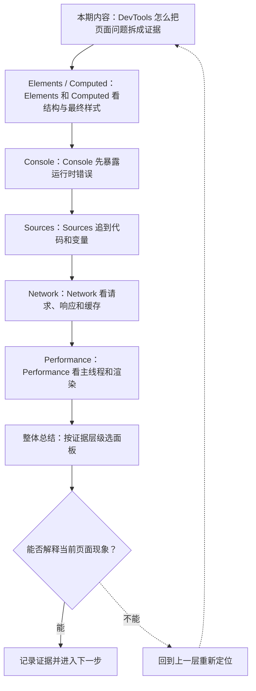

# 浏览器 DevTools 技术体系：DOM、网络、运行时与性能

&gt; 视频入口：B站合集《前端全链路：从浏览器基础到现代生态》上传并核验后回填正式链接。
&gt; 本文是 EP04 的博客深讲版，包含视频主线，但比视频补充更多机制、流程图、边界判断和排查清单。

## 这篇文章解决什么问题

这一篇把同一个页面问题放进 Elements、Console、Sources、Network 和 Performance 这些 DevTools 面板里看。博客版会进一步补上排查顺序、证据边界和常见误判。

这一篇的中心问题可以概括成：浏览器 DevTools 技术体系：DOM、网络、运行时与性能

关键词：Elements、Console、Sources、Network、DOM、style、layout、runtime、expression、error

## 视频主线回顾

### 1. DevTools 怎么把页面问题拆成证据

这一期看 DevTools 怎么把一个页面问题拆成证据。我们会盯住同一个加载更多页面，依次看 Elements、Console、Sources、Network 和 Performance，判断按钮为什么不见、点击为什么没反应、请求为什么慢、卡顿来自哪里。上一期把 HTML、CSS、JavaScript 的职责分清了，这一期就看浏览器把这些结果放在哪些面板里。

### 2. Elements 和 Computed 看结构与最终样式

页面里按钮还在 DOM 里，屏幕上却像没了。Elements 面板先看节点是否存在，再到 Computed 看最终样式。只要 `display:none`、`visibility:hidden`、`opacity:0`，或者布局位置出界，DOM 和视觉结果就会不一样。

把 DOM 和 Computed 放一起看，才能区分“节点没了”和“只是被样式藏住了”。如果按钮还在，事件监听也挂着，但页面看不见它，通常先查样式和布局，而不是先怀疑脚本没运行。

### 3. Console 先暴露运行时错误

点击没反应时，先看 Console。一个 `Cannot read properties of null (reading 'textContent')`，往往说明脚本拿到的是空值；有时也只是节点选择器写错了，页面上的元素和代码里要找的元素不是同一个。

Console 还适合直接试表达式。你可以在里面输入 `document.querySelector(".load-more")`，看当前页面到底有没有那个节点；也可以直接打印数据，确认接口返回值是不是你想的那个结构。这里看到的是运行时结果，不是源码文件。

### 4. Sources 追到代码和变量

要追到代码哪一行，就去 Sources。断点停住后，看 call stack、scope 和当前变量，知道 click 事件到底跑到了哪一步。如果有 source map，压缩后的 bundle 也能映射回源文件。

这个面板回答的是“代码怎么走到这里”。同样的异常，Console 只告诉你报错了，Sources 才能把报错拉回到具体函数、具体分支和具体输入值。排查复杂交互时，这一步最容易把“感觉”变成“位置”。

### 5. Network 看请求、响应和缓存

Network 负责请求证据。页面加载慢、接口没回来、资源反复拉取，先看状态码、响应头、缓存命中和时间线。Network 能告诉你请求有没有发出去、服务器回了什么、等在了哪一段。

如果 `fetch` 返回 404，Console 只会看到一个失败结果；Network 才能看到真正的响应码、响应体、耗时和缓存情况。页面卡住有时不是脚本写错，而是请求慢、资源大，或者重复请求把浏览器拖慢了。

### 6. Performance 看主线程和渲染

Performance 负责主线程和渲染证据。一次点击可能不是网络慢，而是脚本跑太久、布局反复计算、绘制堆得太多。Performance 里的 long task、flame chart、layout shift 和 paint 记录，会告诉你时间花在了哪一步。

它和 Network 不是同一类问题。Network 看的是资源和响应，Performance 看的是浏览器怎样消耗时间。如果接口已经回来，但页面还是很卡，先去看主线程上发生了什么。

### 7. 按证据层级选面板

把顺序收回来：先 Elements 和 Computed 看结构和样式，再 Console 看运行时错误，然后 Sources 找代码和变量，接着 Network 看请求，最后 Performance 看卡顿和渲染。DevTools 不是五个散开的盒子，而是一条从现象走到证据的链。

如果页面不对，先确认它是不是被样式藏住；如果交互不对，先看 Console 有没有红错；如果请求有问题，去 Network；如果卡顿明显，去 Performance。下一期回到 HTML，先把语义和原生行为讲透。

## 技术流程图

先用一张图把本期内容串起来。它不是背诵路线，而是排查问题时可以顺着走的证据路线。

## 深入展开

### 1. DevTools 怎么把页面问题拆成证据

这一期看 DevTools 怎么把一个页面问题拆成证据。我们会盯住同一个加载更多页面，依次看 Elements、Console、Sources、Network 和 Performance，判断按钮为什么不见、点击为什么没反应、请求为什么慢、卡顿来自哪里。上一期把 HTML、CSS、JavaScript 的职责分清了，这一期就看浏览器把这些结果放在哪些面板里。

这里可以多看一层：先找输入，再看处理过程，最后确认输出。前端很多问题之所以绕，是因为现象出现在页面上，原因却可能藏在网络、样式计算、运行时或构建结果里。

排查时可以顺着这条线问：当前现象是输入不对、处理过程不对，还是最终结果不对。只要能把问题归到其中一格，后面的工具选择就会轻很多。

### 2. Elements 和 Computed 看结构与最终样式

页面里按钮还在 DOM 里，屏幕上却像没了。Elements 面板先看节点是否存在，再到 Computed 看最终样式。只要 `display:none`、`visibility:hidden`、`opacity:0`，或者布局位置出界，DOM 和视觉结果就会不一样。

把 DOM 和 Computed 放一起看，才能区分“节点没了”和“只是被样式藏住了”。如果按钮还在，事件监听也挂着，但页面看不见它，通常先查样式和布局，而不是先怀疑脚本没运行。

把这段机制放到工程里看，最实用的切口是证据。不要急着猜是哪一行代码错了，先确认浏览器或工具实际拿到了什么、计算了什么、丢出了什么结果。

排查时可以顺着这条线问：当前现象是输入不对、处理过程不对，还是最终结果不对。只要能把问题归到其中一格，后面的工具选择就会轻很多。

### 3. Console 先暴露运行时错误

点击没反应时，先看 Console。一个 `Cannot read properties of null (reading 'textContent')`，往往说明脚本拿到的是空值；有时也只是节点选择器写错了，页面上的元素和代码里要找的元素不是同一个。

Console 还适合直接试表达式。你可以在里面输入 `document.querySelector(".load-more")`，看当前页面到底有没有那个节点；也可以直接打印数据，确认接口返回值是不是你想的那个结构。这里看到的是运行时结果，不是源码文件。

这个点在真实项目里常常不是孤立问题。它会和状态、缓存、布局、依赖或团队约束连在一起，所以博客版更强调边界：什么归它管，什么应该交给下一层机制判断。

排查时可以顺着这条线问：当前现象是输入不对、处理过程不对，还是最终结果不对。只要能把问题归到其中一格，后面的工具选择就会轻很多。

### 4. Sources 追到代码和变量

要追到代码哪一行，就去 Sources。断点停住后，看 call stack、scope 和当前变量，知道 click 事件到底跑到了哪一步。如果有 source map，压缩后的 bundle 也能映射回源文件。

这个面板回答的是“代码怎么走到这里”。同样的异常，Console 只告诉你报错了，Sources 才能把报错拉回到具体函数、具体分支和具体输入值。排查复杂交互时，这一步最容易把“感觉”变成“位置”。

如果要把它讲给别人听，可以按“现象—证据—机制—边界”的顺序。先让对方看到问题，再解释浏览器或工具为什么会给出这样的结果。

排查时可以顺着这条线问：当前现象是输入不对、处理过程不对，还是最终结果不对。只要能把问题归到其中一格，后面的工具选择就会轻很多。

### 5. Network 看请求、响应和缓存

Network 负责请求证据。页面加载慢、接口没回来、资源反复拉取，先看状态码、响应头、缓存命中和时间线。Network 能告诉你请求有没有发出去、服务器回了什么、等在了哪一段。

如果 `fetch` 返回 404，Console 只会看到一个失败结果；Network 才能看到真正的响应码、响应体、耗时和缓存情况。页面卡住有时不是脚本写错，而是请求慢、资源大，或者重复请求把浏览器拖慢了。

这里可以多看一层：先找输入，再看处理过程，最后确认输出。前端很多问题之所以绕，是因为现象出现在页面上，原因却可能藏在网络、样式计算、运行时或构建结果里。

排查时可以顺着这条线问：当前现象是输入不对、处理过程不对，还是最终结果不对。只要能把问题归到其中一格，后面的工具选择就会轻很多。

### 6. Performance 看主线程和渲染

Performance 负责主线程和渲染证据。一次点击可能不是网络慢，而是脚本跑太久、布局反复计算、绘制堆得太多。Performance 里的 long task、flame chart、layout shift 和 paint 记录，会告诉你时间花在了哪一步。

它和 Network 不是同一类问题。Network 看的是资源和响应，Performance 看的是浏览器怎样消耗时间。如果接口已经回来，但页面还是很卡，先去看主线程上发生了什么。

把这段机制放到工程里看，最实用的切口是证据。不要急着猜是哪一行代码错了，先确认浏览器或工具实际拿到了什么、计算了什么、丢出了什么结果。

排查时可以顺着这条线问：当前现象是输入不对、处理过程不对，还是最终结果不对。只要能把问题归到其中一格，后面的工具选择就会轻很多。

## 常见误区与边界

- 不要把工具名当成机制本身；先确认它解决的是运行、开发、架构还是交付问题。
- 不要只看最终界面；很多前端问题需要同时看 DOM、样式、网络、运行时和构建产物。
- 不要把框架能力和浏览器原生能力混在一起；框架最终仍然要落回 Web 平台。

## 排查和验证清单

- 先确认问题发生在哪一层：页面结构、样式计算、JavaScript 运行、网络请求、构建产物还是线上交付。
- 用浏览器或工具拿到证据，不只凭肉眼判断。能截图、能看到日志、能看到请求和产物，结论才稳。
- 把最小例子缩到只剩一个变量。变量越少，越容易看清机制。
- 记录输入、处理过程和输出。前端问题往往不是“某个 API 错了”，而是链路中某一步的假设不成立。
- 如果准备把结论放到项目里，再补一层测试、类型检查、可访问性或性能验证。

## 动手练习

1. 用一个最小 HTML 页面复现 浏览器 DevTools 技术体系：DOM、网络、运行时与性能 里的核心现象。
2. 打开 DevTools，分别记录结构、样式、控制台、网络或性能面板里的一个证据点。
3. 改一个变量，再观察结果是否符合这篇文章里的流程图；如果不符合，把差异写下来。

## 参考来源与本系列依据

- 本文主要依据本系列已完成的视频脚本、时间线和本地 QA 结果整理。

## 总结

把视频里的主线收回来，再用博客版补上更多排查入口、边界判断和实践练习。

博客版到这里就把视频主线扩成了可复习的技术笔记：先知道它在链路里的位置，再知道它怎么运行，最后知道遇到问题该从哪里查。
