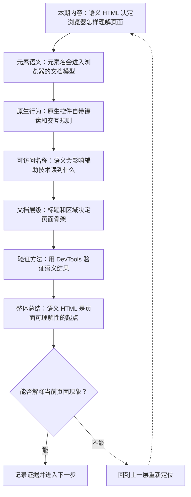
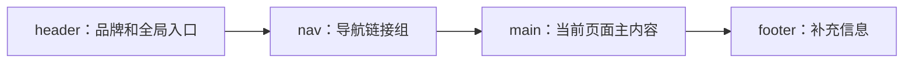

# 语义 HTML 与 DOM 结构

&gt; 视频入口：B站合集《前端全链路：从浏览器基础到现代生态》上传并核验后回填正式链接。
&gt; 本文是 EP05 的博客深讲版，包含视频主线，但比视频补充更多机制、流程图、边界判断和排查清单。


## 这篇文章解决什么问题

这期解释 HTML 元素语义怎样进入 DOM，并影响默认行为、键盘操作、搜索和辅助技术。

这一篇的中心问题可以概括成：语义 HTML 怎样通过 DOM 结构、默认行为和可访问性信息影响浏览器理解页面？

关键词：semantic HTML、DOM、button、div、h1、nav、main、focus、Enter、Space

## 视频主线回顾

### 1. 元素语义会进入 DOM

HTML 元素名不只是给开发者看的标签。`h1`、`nav`、`main`、`button` 会被浏览器解析成 DOM 节点，并携带对应含义。

### 2. 原生控件自带行为

`button` 能被键盘聚焦和激活，`a` 有跳转语义，`input` 能参与表单数据。用 `div` 模拟这些控件时，需要额外补齐键盘、角色和状态。

### 3. 语义影响辅助技术

辅助技术读取的是浏览器暴露的语义信息。正确元素通常能自然得到 role 和 name；纯视觉模拟的控件很容易丢失这些信息。

### 4. 验证语义结果

可以在 DevTools 的 Elements 和 Accessibility 信息里查看 DOM、role、name，再用 Tab、Enter、Space 实际走一遍键盘交互。

## 技术流程图

先用一张图把本期内容串起来。它不是背诵路线，而是排查问题时可以顺着走的证据路线。




## 深入展开

### 1. 语义 HTML 决定浏览器怎样理解页面

这一期看语义 HTML 怎样影响 DOM 结构、默认行为、搜索和辅助技术。我们会用同一个“加入购物车”控件比较 button 和 div：视觉可以做得很像，但浏览器理解到的角色、键盘焦点、默认激活和表单关系会不一样。前四集把浏览器、平台语言和 DevTools 证据链铺好了，从这一期开始进入 HTML 与 CSS 地基。

这里可以多看一层：先找输入，再看处理过程，最后确认输出。前端很多问题之所以绕，是因为现象出现在页面上，原因却可能藏在网络、样式计算、运行时或构建结果里。

| 维度 | 含义 |
| --- | --- |
| button | 自带按钮语义、焦点和键盘激活。 |
| div | 只是普通容器，外观相似不等于语义相同。 |

排查时可以顺着这条线问：当前现象是输入不对、处理过程不对，还是最终结果不对。只要能把问题归到其中一格，后面的工具选择就会轻很多。

### 2. 元素名会进入浏览器的文档模型

HTML 元素名会进入浏览器的文档模型。h1 表示页面主标题，nav 表示导航区域，main 表示主要内容，button 表示可以触发动作的按钮。它们被解析成 DOM 节点以后，不只保留标签名字，还带着浏览器定义好的含义和默认行为。用正确元素写结构，页面就更容易被浏览器、搜索引擎和辅助技术读懂。

把这段机制放到工程里看，最实用的切口是证据。不要急着猜是哪一行代码错了，先确认浏览器或工具实际拿到了什么、计算了什么、丢出了什么结果。

```js
<header>
  <nav>商品分类</nav>
</header>
<main>
  <h1>商品详情</h1>
  <button type="button">加入购物车</button>
</main>
```

- header、nav、main 建立区域。
- h1 提供页面主标题。
- button 提供原生按钮语义。

排查时可以顺着这条线问：当前现象是输入不对、处理过程不对，还是最终结果不对。只要能把问题归到其中一格，后面的工具选择就会轻很多。

### 3. 原生控件自带键盘和交互规则

原生控件自带交互规则。button 可以被 Tab 聚焦，可以用 Enter 或 Space 激活，也能自然参与表单。a 元素有跳转语义，input 会进入表单数据。你当然可以给 div 加 click 事件，但这只补上鼠标点击。键盘焦点、默认激活、可访问名称和表单关系，都需要额外处理。

这个点在真实项目里常常不是孤立问题。它会和状态、缓存、布局、依赖或团队约束连在一起，所以博客版更强调边界：什么归它管，什么应该交给下一层机制判断。

| 维度 | 含义 |
| --- | --- |
| Tab focus | button 自动进入焦点顺序。 |
| Enter / Space | 浏览器提供默认激活。 |
| form relation | 表单控件能参与提交与校验。 |

排查时可以顺着这条线问：当前现象是输入不对、处理过程不对，还是最终结果不对。只要能把问题归到其中一格，后面的工具选择就会轻很多。

### 4. 语义会影响辅助技术读到什么

辅助技术读取的不是截图，而是浏览器暴露出来的可访问性信息。一个 button 里写着“加入购物车”，通常能得到按钮角色和可访问名称。如果换成 div，再只靠 CSS 做成按钮样式，辅助技术可能只读到普通文本。aria-label 可以补充名称，role 可以补充角色，但它们适合修补特殊情况，日常页面优先使用正确的原生元素。

如果要把它讲给别人听，可以按“现象—证据—机制—边界”的顺序。先让对方看到问题，再解释浏览器或工具为什么会给出这样的结果。

| 维度 | 含义 |
| --- | --- |
| button | role: button，name: 加入购物车。 |
| div | role 缺失时只像一段可点击文本。 |

排查时可以顺着这条线问：当前现象是输入不对、处理过程不对，还是最终结果不对。只要能把问题归到其中一格，后面的工具选择就会轻很多。

### 5. 标题和区域决定页面骨架

语义 HTML 还决定页面骨架。标题层级让人和机器知道内容分组，header、nav、main、aside、footer 这类区域元素让页面出现可导航的 landmark。一个页面如果只用 div 堆出视觉卡片，屏幕上也许很像，但 DOM 里缺少结构线索，搜索、快捷导航和维护都会变差。

这里可以多看一层：先找输入，再看处理过程，最后确认输出。前端很多问题之所以绕，是因为现象出现在页面上，原因却可能藏在网络、样式计算、运行时或构建结果里。



排查时可以顺着这条线问：当前现象是输入不对、处理过程不对，还是最终结果不对。只要能把问题归到其中一格，后面的工具选择就会轻很多。

### 6. 用 DevTools 验证语义结果

验证语义时，可以先在 Elements 里看 DOM 结构，再看 Accessibility 信息里的 role 和 name。按钮是否有按钮角色，链接是否有可访问名称，标题层级是否跳级，都能被检查出来。这个动作很适合写页面时顺手做：先让结构正确，再写 CSS，再加 JavaScript。

把这段机制放到工程里看，最实用的切口是证据。不要急着猜是哪一行代码错了，先确认浏览器或工具实际拿到了什么、计算了什么、丢出了什么结果。

| 维度 | 含义 |
| --- | --- |
| Elements | 确认 DOM 节点和嵌套关系。 |
| Accessibility | 查看 role、name 和状态。 |
| Keyboard | 用 Tab、Enter、Space 走一遍。 |

排查时可以顺着这条线问：当前现象是输入不对、处理过程不对，还是最终结果不对。只要能把问题归到其中一格，后面的工具选择就会轻很多。

## 常见误区与边界

- 不要把语义 HTML 简化成 SEO 技巧；它首先是浏览器和辅助技术理解页面的结构。
- 不要把 ARIA 当成替代 HTML 的常规方案；优先使用原生元素。
- 不要只看视觉外观判断控件是否正确；必须验证键盘和可访问名称。
- 这一篇不展开：表单提交、校验和 autocomplete 的完整机制，留到 EP06。
- 这一篇不展开：ARIA 的复杂模式和组件库实践，留到 EP10。
- 这一篇不展开：SEO 排名策略，本集只讲机器可理解的结构基线。

## 排查和验证清单

- 先确认问题发生在哪一层：页面结构、样式计算、JavaScript 运行、网络请求、构建产物还是线上交付。
- 用浏览器或工具拿到证据，不只凭肉眼判断。能截图、能看到日志、能看到请求和产物，结论才稳。
- 把最小例子缩到只剩一个变量。变量越少，越容易看清机制。
- 记录输入、处理过程和输出。前端问题往往不是“某个 API 错了”，而是链路中某一步的假设不成立。
- 如果准备把结论放到项目里，再补一层测试、类型检查、可访问性或性能验证。

## 动手练习

1. 用一个最小 HTML 页面复现 语义 HTML 与 DOM 里的核心现象。
2. 打开 DevTools，分别记录结构、样式、控制台、网络或性能面板里的一个证据点。
3. 改一个变量，再观察结果是否符合这篇文章里的流程图；如果不符合，把差异写下来。

## 参考来源与本系列依据

- 规范：WHATWG HTML Living Standard：元素语义、解析和原生行为基线
- 规范：WAI-ARIA / Accessible Name：role、name 与辅助技术语境
- 浏览器文档：MDN HTML elements / Accessibility：开发者解释和验证入口
- 实验：button 与 div 的键盘和 Accessibility 对照：本集可复现证据

## 总结

语义 HTML 是页面可理解性的起点。先用正确元素建立结构，再写 CSS 和 JavaScript，页面才会在视觉、键盘和辅助技术里都更可靠。

博客版到这里就把视频主线扩成了可复习的技术笔记：先知道它在链路里的位置，再知道它怎么运行，最后知道遇到问题该从哪里查。
