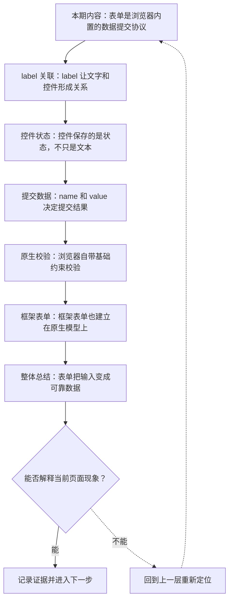
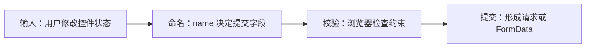

# HTML 表单模型：label、输入控件与原生校验

&gt; 视频入口：B站合集《前端全链路：从浏览器基础到现代生态》上传并核验后回填正式链接。
&gt; 本文是 EP06 的博客深讲版，包含视频主线，但比视频补充更多机制、流程图、边界判断和排查清单。


## 这篇文章解决什么问题

这期解释表单为什么不是一堆输入框，而是一套浏览器内置的数据收集、状态管理和校验模型。

这一篇的中心问题可以概括成：HTML 表单怎样把用户输入组织成可提交、可校验、可访问的数据模型？

关键词：form、label、input、submit、for、id、value、checked、selected、name

## 视频主线回顾

### 1. label 是字段关系

`label` 会把文字说明和控件绑定起来，让点击、键盘和辅助技术都能理解字段名称。

### 2. name 和 value 是提交核心

表单提交时，浏览器收集成功控件的 `name` 和当前值。没有 `name` 的控件不会进入提交结果。

### 3. 原生校验先覆盖基础规则

`required`、`type=email`、`minlength`、`pattern` 等约束能让浏览器先挡住明显无效的数据。

### 4. 框架不替代表单模型

React、Vue 的表单状态封装仍然建立在原生输入控件上。结构和约束先正确，组件状态才可靠。

## 技术流程图

先用一张图把本期内容串起来。它不是背诵路线，而是排查问题时可以顺着走的证据路线。




## 深入展开

### 1. 表单是浏览器内置的数据提交协议

这一期看 HTML 表单模型。我们会把 form、label、input、name、value、submit 和原生校验串起来，说明浏览器怎样收集用户输入，怎样决定哪些字段会提交，怎样在不写 JavaScript 的情况下完成基础校验。理解表单以后，再看组件库里的输入框和复杂业务表单，就不会只盯着样式和事件了。

这里可以多看一层：先找输入，再看处理过程，最后确认输出。前端很多问题之所以绕，是因为现象出现在页面上，原因却可能藏在网络、样式计算、运行时或构建结果里。



排查时可以顺着这条线问：当前现象是输入不对、处理过程不对，还是最终结果不对。只要能把问题归到其中一格，后面的工具选择就会轻很多。

### 2. label 让文字和控件形成关系

label 的价值是建立文字和控件的关系。点击 label 可以聚焦对应 input，读屏软件也能把字段名称读出来。最常见的写法是 label 的 for 指向 input 的 id，也可以把 input 包在 label 内部。没有 label 的输入框，视觉上可能还看得懂，但浏览器很难知道这个控件到底让用户填什么。

把这段机制放到工程里看，最实用的切口是证据。不要急着猜是哪一行代码错了，先确认浏览器或工具实际拿到了什么、计算了什么、丢出了什么结果。

```js
<label for="email">邮箱</label>
<input id="email" name="email" type="email">
```

- for 和 id 建立关联。
- 点击文字可以聚焦 input。
- 辅助技术能读到字段名称。

排查时可以顺着这条线问：当前现象是输入不对、处理过程不对，还是最终结果不对。只要能把问题归到其中一格，后面的工具选择就会轻很多。

### 3. 控件保存的是状态，不只是文本

输入控件保存的是状态。文本框有 value，复选框有 checked，单选按钮通过相同 name 形成互斥组，下拉框有 selected 选项。浏览器提交表单时，会按照控件类型、name 和当前状态决定数据。比如没有 name 的控件不会进入提交数据，未勾选的 checkbox 也不会提交它的值。

这个点在真实项目里常常不是孤立问题。它会和状态、缓存、布局、依赖或团队约束连在一起，所以博客版更强调边界：什么归它管，什么应该交给下一层机制判断。

| 维度 | 含义 |
| --- | --- |
| text | value 保存输入内容。 |
| checkbox | checked 决定是否提交。 |
| radio | 同名选项形成互斥组。 |

排查时可以顺着这条线问：当前现象是输入不对、处理过程不对，还是最终结果不对。只要能把问题归到其中一格，后面的工具选择就会轻很多。

### 4. name 和 value 决定提交结果

提交时，浏览器会把成功控件整理成字段和值。字段名来自 name，字段值来自控件当前 value。传统表单会把这些数据发给 action 指向的地址；现代前端也常用 FormData 在 JavaScript 里读取同一套结果。所以表单不是过时写法，它是一套仍然被 Web API 和框架复用的数据模型。

如果要把它讲给别人听，可以按“现象—证据—机制—边界”的顺序。先让对方看到问题，再解释浏览器或工具为什么会给出这样的结果。

| 维度 | 含义 |
| --- | --- |
| DOM 控件 | input name="email" value="a@example.com" |
| 提交数据 | email = a@example.com |

排查时可以顺着这条线问：当前现象是输入不对、处理过程不对，还是最终结果不对。只要能把问题归到其中一格，后面的工具选择就会轻很多。

### 5. 浏览器自带基础约束校验

浏览器有原生约束校验。required 表示必填，type=email 会检查邮箱格式，minlength 和 maxlength 控制长度，pattern 可以匹配简单规则。提交前，浏览器会检查这些约束，阻止明显无效的数据继续提交。业务校验当然仍然需要后端和前端逻辑，但基础输入规则应该先交给浏览器。

这里可以多看一层：先找输入，再看处理过程，最后确认输出。前端很多问题之所以绕，是因为现象出现在页面上，原因却可能藏在网络、样式计算、运行时或构建结果里。

```js
<input
  name="email"
  type="email"
  required
  autocomplete="email">
```

- required 约束必填。
- type=email 检查格式。
- autocomplete 提供输入提示。

排查时可以顺着这条线问：当前现象是输入不对、处理过程不对，还是最终结果不对。只要能把问题归到其中一格，后面的工具选择就会轻很多。

### 6. 框架表单也建立在原生模型上

框架会给表单增加状态管理和组件抽象。React 里常说 controlled input，Vue 里常用 v-model，但它们处理的仍然是 input 的值、事件和表单状态。真正稳定的做法，是先让 HTML 结构、label、name、type 和校验约束正确，再让框架接管业务状态。否则组件看起来高级，底层输入体验却可能变差。

把这段机制放到工程里看，最实用的切口是证据。不要急着猜是哪一行代码错了，先确认浏览器或工具实际拿到了什么、计算了什么、丢出了什么结果。

| 维度 | 含义 |
| --- | --- |
| HTML | 定义字段和原生约束。 |
| Framework | 同步状态和渲染 UI。 |
| Server | 做最终业务校验。 |

排查时可以顺着这条线问：当前现象是输入不对、处理过程不对，还是最终结果不对。只要能把问题归到其中一格，后面的工具选择就会轻很多。

## 常见误区与边界

- 不要把表单理解成过时技术；现代 Web API 和框架仍然复用它。
- 不要只靠 placeholder 代替 label。
- 不要把前端原生校验当成安全边界；最终校验仍在服务端。
- 这一篇不展开：复杂表单库设计和动态表单引擎。
- 这一篇不展开：后端安全校验与风控规则。
- 这一篇不展开：完整 ARIA 表单模式，留到可访问性单集。

## 排查和验证清单

- 先确认问题发生在哪一层：页面结构、样式计算、JavaScript 运行、网络请求、构建产物还是线上交付。
- 用浏览器或工具拿到证据，不只凭肉眼判断。能截图、能看到日志、能看到请求和产物，结论才稳。
- 把最小例子缩到只剩一个变量。变量越少，越容易看清机制。
- 记录输入、处理过程和输出。前端问题往往不是“某个 API 错了”，而是链路中某一步的假设不成立。
- 如果准备把结论放到项目里，再补一层测试、类型检查、可访问性或性能验证。

## 动手练习

1. 用一个最小 HTML 页面复现 HTML 表单模型 里的核心现象。
2. 打开 DevTools，分别记录结构、样式、控制台、网络或性能面板里的一个证据点。
3. 改一个变量，再观察结果是否符合这篇文章里的流程图；如果不符合，把差异写下来。

## 参考来源与本系列依据

- 规范：WHATWG HTML Forms：表单控件、提交和约束校验
- 浏览器文档：MDN HTML forms / Constraint validation：开发者解释和示例
- 框架文档：React forms / Vue form input bindings：框架表单状态对照
- 实验：FormData 与原生校验示例：本集可复现证据

## 总结

HTML 表单把用户输入变成字段、状态和约束。理解这套模型以后，写原生页面、组件库表单和业务提交都会更稳。

博客版到这里就把视频主线扩成了可复习的技术笔记：先知道它在链路里的位置，再知道它怎么运行，最后知道遇到问题该从哪里查。
