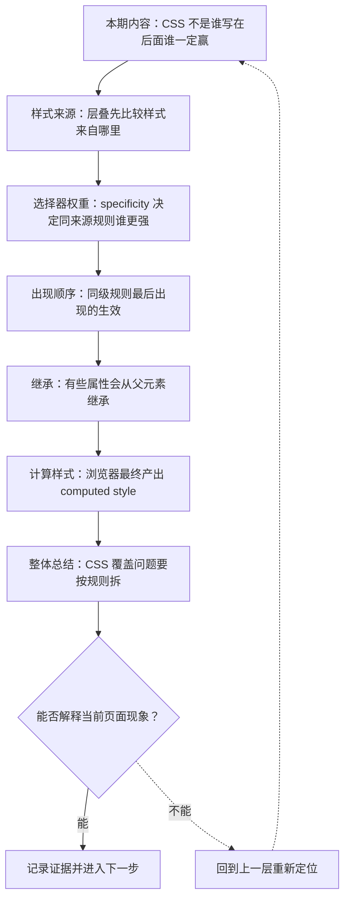
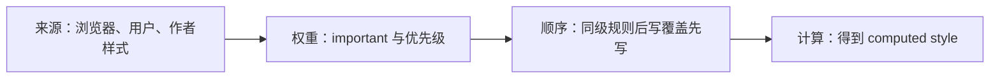

# CSS 层叠、选择器与样式计算

&gt; 视频入口：B站合集《前端全链路：从浏览器基础到现代生态》上传并核验后回填正式链接。
&gt; 本文是 EP07 的博客深讲版，包含视频主线，但比视频补充更多机制、流程图、边界判断和排查清单。


## 这篇文章解决什么问题

这期解释 CSS 为什么会覆盖来覆盖去，以及浏览器最终怎样算出一个元素的 computed style。

这一篇的中心问题可以概括成：浏览器怎样在多条 CSS 声明冲突时决定最终样式？

关键词：CSS、cascade、specificity、computed style、user agent、author、stylesheet、id、class、selector

## 视频主线回顾

### 1. 层叠有明确顺序

CSS 冲突会先比较来源和重要性，再比较 specificity，最后才比较出现顺序。

### 2. specificity 影响维护成本

更强的选择器更容易覆盖别人，也更难被后续规则覆盖。组件样式应该避免无谓升高优先级。

### 3. 继承解释隐形来源

文字类属性常从父级继承，盒模型属性通常不继承。DevTools 可以看到属性来自哪里。

### 4. computed style 是最终证据

浏览器布局和绘制使用的是计算后的结果。调试时要同时看规则命中和最终计算值。

## 技术流程图

先用一张图把本期内容串起来。它不是背诵路线，而是排查问题时可以顺着走的证据路线。




## 深入展开

### 1. CSS 不是谁写在后面谁一定赢

这一期看 CSS 层叠、选择器优先级、继承和最终样式计算。我们会从一个按钮颜色被覆盖的问题开始，拆开浏览器判断样式的顺序：来源、重要性、选择器 specificity、出现顺序，再到继承和 computed style。学会这套规则，调样式时就不会靠玄学试错。

这里可以多看一层：先找输入，再看处理过程，最后确认输出。前端很多问题之所以绕，是因为现象出现在页面上，原因却可能藏在网络、样式计算、运行时或构建结果里。



排查时可以顺着这条线问：当前现象是输入不对、处理过程不对，还是最终结果不对。只要能把问题归到其中一格，后面的工具选择就会轻很多。

### 2. 层叠先比较样式来自哪里

CSS 层叠首先比较样式来源。浏览器有 user agent stylesheet，比如 button 默认有边框，链接默认是蓝色。开发者写的是 author stylesheet。用户也可能通过浏览器或辅助工具提供自己的样式。多数日常问题发生在作者样式内部，但知道来源层级很重要，因为它解释了为什么页面没写样式时也有默认表现。

把这段机制放到工程里看，最实用的切口是证据。不要急着猜是哪一行代码错了，先确认浏览器或工具实际拿到了什么、计算了什么、丢出了什么结果。

| 维度 | 含义 |
| --- | --- |
| user agent | 浏览器默认样式。 |
| author | 页面和组件写的样式。 |
| user | 用户侧偏好或辅助样式。 |

排查时可以顺着这条线问：当前现象是输入不对、处理过程不对，还是最终结果不对。只要能把问题归到其中一格，后面的工具选择就会轻很多。

### 3. specificity 决定同来源规则谁更强

在同一来源里，选择器 specificity 会参与比较。id 选择器通常比 class 强，class、属性和伪类比元素选择器强。比如 .primary 比 button 更具体，#submit 又比 .primary 更具体。这里不要把优先级背成魔法数字，真正要记住的是：样式越依赖很强的选择器，后续维护越难。

这个点在真实项目里常常不是孤立问题。它会和状态、缓存、布局、依赖或团队约束连在一起，所以博客版更强调边界：什么归它管，什么应该交给下一层机制判断。

| 维度 | 含义 |
| --- | --- |
| button | 元素选择器，范围宽，权重低。 |
| .primary | 类选择器，更具体，更容易覆盖。 |

排查时可以顺着这条线问：当前现象是输入不对、处理过程不对，还是最终结果不对。只要能把问题归到其中一格，后面的工具选择就会轻很多。

### 4. 同级规则最后出现的生效

如果来源、重要性和 specificity 都一样，后出现的规则会覆盖先出现的规则。这就是很多样式调整“挪个位置就好了”的原因。但这只在同级规则里成立。如果前面的规则 specificity 更强，后面的弱规则不会因为写得晚就赢。调试时先看规则是否同级，再看顺序。

如果要把它讲给别人听，可以按“现象—证据—机制—边界”的顺序。先让对方看到问题，再解释浏览器或工具为什么会给出这样的结果。

```js
.button { color: blue; }
.button { color: red; }
```

- 两个选择器 specificity 相同。
- 后面的 red 生效。
- 如果换成 #id，顺序就不够用了。

排查时可以顺着这条线问：当前现象是输入不对、处理过程不对，还是最终结果不对。只要能把问题归到其中一格，后面的工具选择就会轻很多。

### 5. 有些属性会从父元素继承

CSS 还有继承。color、font-family、line-height 这类文字属性通常会从父元素传给子元素；margin、padding、border 这类盒模型属性通常不会自动继承。继承让全局排版更方便，也会让某些样式看起来像“从空气里冒出来”。DevTools 的 Computed 面板能看到一个属性是直接命中还是继承而来。

这里可以多看一层：先找输入，再看处理过程，最后确认输出。前端很多问题之所以绕，是因为现象出现在页面上，原因却可能藏在网络、样式计算、运行时或构建结果里。

| 维度 | 含义 |
| --- | --- |
| 常继承 | color、font-family、line-height。 |
| 通常不继承 | margin、padding、border。 |
| 可显式控制 | inherit、initial、unset。 |

排查时可以顺着这条线问：当前现象是输入不对、处理过程不对，还是最终结果不对。只要能把问题归到其中一格，后面的工具选择就会轻很多。

### 6. 浏览器最终产出 computed style

浏览器会把命中的 CSS 规则、继承值、默认值和单位计算合并成 computed style。你写的是 em、rem、百分比或变量，浏览器最终要得到能用于布局和绘制的值。调样式时，Styles 面板适合看哪些规则命中，Computed 面板适合看最终结果。这两个视角配合起来，基本能定位大多数 CSS 覆盖问题。

把这段机制放到工程里看，最实用的切口是证据。不要急着猜是哪一行代码错了，先确认浏览器或工具实际拿到了什么、计算了什么、丢出了什么结果。


排查时可以顺着这条线问：当前现象是输入不对、处理过程不对，还是最终结果不对。只要能把问题归到其中一格，后面的工具选择就会轻很多。

## 常见误区与边界

- 不要把 CSS 简化成后写覆盖先写；这只在同级规则成立。
- 不要滥用 !important 逃避结构问题。
- 不要只看 Styles 面板，最终结果要看 Computed。
- 这一篇不展开：CSS 动画和 GPU 合成细节。
- 这一篇不展开：大型 CSS 架构方法论完整比较。
- 这一篇不展开：Tailwind、CSS Modules 等工程方案，留到工程化和框架部分。

## 排查和验证清单

- 先确认问题发生在哪一层：页面结构、样式计算、JavaScript 运行、网络请求、构建产物还是线上交付。
- 用浏览器或工具拿到证据，不只凭肉眼判断。能截图、能看到日志、能看到请求和产物，结论才稳。
- 把最小例子缩到只剩一个变量。变量越少，越容易看清机制。
- 记录输入、处理过程和输出。前端问题往往不是“某个 API 错了”，而是链路中某一步的假设不成立。
- 如果准备把结论放到项目里，再补一层测试、类型检查、可访问性或性能验证。

## 动手练习

1. 用一个最小 HTML 页面复现 CSS 层叠规则 里的核心现象。
2. 打开 DevTools，分别记录结构、样式、控制台、网络或性能面板里的一个证据点。
3. 改一个变量，再观察结果是否符合这篇文章里的流程图；如果不符合，把差异写下来。

## 参考来源与本系列依据

- 规范：CSS Cascading and Inheritance：层叠、继承和重要性规则
- 浏览器文档：MDN Cascade / Specificity / Computed values：开发者解释和调试入口
- 工具：Chrome DevTools Styles / Computed：本集验证方式
- 实验：按钮颜色覆盖示例：可复现演示

## 总结

CSS 覆盖问题不是玄学。按来源、优先级、顺序、继承和 computed style 拆开，大多数样式问题都会变得清楚。

博客版到这里就把视频主线扩成了可复习的技术笔记：先知道它在链路里的位置，再知道它怎么运行，最后知道遇到问题该从哪里查。
