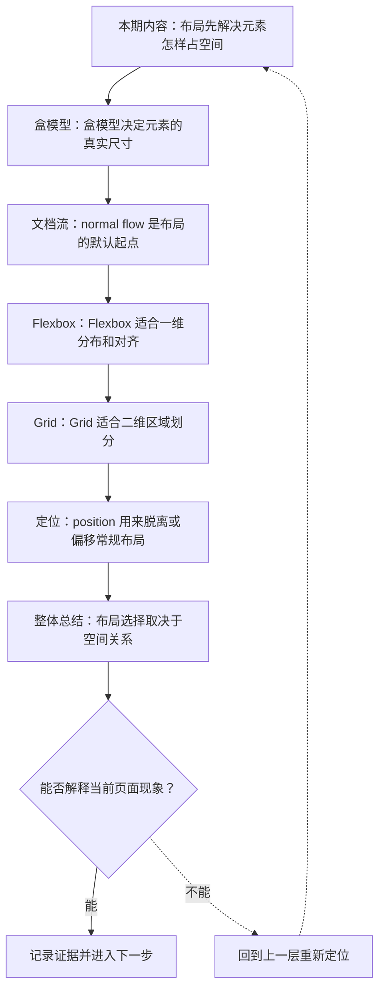

# CSS 布局系统：盒模型、Flex 与 Grid

&gt; 视频入口：B站合集《前端全链路：从浏览器基础到现代生态》上传并核验后回填正式链接。
&gt; 本文是 EP08 的博客深讲版，包含视频主线，但比视频补充更多机制、流程图、边界判断和排查清单。


## 这篇文章解决什么问题

这期把 CSS 布局从盒模型讲到 Flex 和 Grid，解释页面元素怎样占空间、排队、对齐和分区。

这一篇的中心问题可以概括成：CSS 怎样从盒模型、文档流到 Flex 和 Grid 完成页面布局？

关键词：box model、normal flow、Flexbox、Grid、content、padding、border、margin、box-sizing、block

## 视频主线回顾

### 1. 盒模型是尺寸基础

content、padding、border、margin 决定元素真实占用空间。`box-sizing:border-box` 可以让组件尺寸更稳定。

### 2. normal flow 是默认布局

block 从上到下排列，inline 像文本一样在行内流动。很多布局问题要先理解默认流。

### 3. Flex 解决一维对齐

Flexbox 适合导航栏、按钮组、横向卡片等一排或一列的空间分配。

### 4. Grid 解决二维区域

Grid 适合行列同时重要的页面骨架、仪表盘和图片墙。

## 技术流程图

先用一张图把本期内容串起来。它不是背诵路线，而是排查问题时可以顺着走的证据路线。




## 深入展开

### 1. 布局先解决元素怎样占空间

这一期看 CSS 布局系统。我们会从盒模型开始，说明 content、padding、border、margin 怎样决定元素占用空间；再看 normal flow 里 block 和 inline 的排列；最后对比 Flexbox 和 Grid，什么时候用一维对齐，什么时候用二维网格。布局不是背属性，而是建立空间模型。

这里可以多看一层：先找输入，再看处理过程，最后确认输出。前端很多问题之所以绕，是因为现象出现在页面上，原因却可能藏在网络、样式计算、运行时或构建结果里。


排查时可以顺着这条线问：当前现象是输入不对、处理过程不对，还是最终结果不对。只要能把问题归到其中一格，后面的工具选择就会轻很多。

### 2. 盒模型决定元素的真实尺寸

盒模型把元素拆成 content、padding、border 和 margin。默认情况下，width 和 height 只描述 content 区域；加上 padding 和 border 后，元素实际占用会更大。很多项目会设置 box-sizing:border-box，让 width 包含 padding 和 border，这样组件尺寸更符合直觉。

把这段机制放到工程里看，最实用的切口是证据。不要急着猜是哪一行代码错了，先确认浏览器或工具实际拿到了什么、计算了什么、丢出了什么结果。

| 维度 | 含义 |
| --- | --- |
| content | 文字、图片和子元素所在区域。 |
| padding / border | 内边距和边框扩大盒子。 |
| margin | 盒子和外部之间的距离。 |

排查时可以顺着这条线问：当前现象是输入不对、处理过程不对，还是最终结果不对。只要能把问题归到其中一格，后面的工具选择就会轻很多。

### 3. normal flow 是布局的默认起点

normal flow 是浏览器默认布局规则。block 元素通常独占一行，从上到下排列；inline 元素在行内从左到右流动，像文字一样换行。理解默认流很重要，因为 Flex、Grid、position 都是在某个局部改变排列规则，而不是让整个页面从零开始。

这个点在真实项目里常常不是孤立问题。它会和状态、缓存、布局、依赖或团队约束连在一起，所以博客版更强调边界：什么归它管，什么应该交给下一层机制判断。

| 维度 | 含义 |
| --- | --- |
| block | 从上到下排列，通常占满可用宽度。 |
| inline | 在行内流动，随文本换行。 |

排查时可以顺着这条线问：当前现象是输入不对、处理过程不对，还是最终结果不对。只要能把问题归到其中一格，后面的工具选择就会轻很多。

### 4. Flexbox 适合一维分布和对齐

Flexbox 主要解决一维布局。容器有 main axis 和 cross axis，子项可以沿主轴分布，也可以沿交叉轴对齐。比如导航栏两端对齐、按钮组间距一致、卡片在一行里自适应宽度，这些都很适合 Flex。它擅长处理一排或一列里的空间分配。

如果要把它讲给别人听，可以按“现象—证据—机制—边界”的顺序。先让对方看到问题，再解释浏览器或工具为什么会给出这样的结果。

```js
.toolbar {
  display: flex;
  align-items: center;
  justify-content: space-between;
  gap: 16px;
}
```

- main axis 控制主方向。
- align-items 控制交叉轴。
- gap 处理子项间距。

排查时可以顺着这条线问：当前现象是输入不对、处理过程不对，还是最终结果不对。只要能把问题归到其中一格，后面的工具选择就会轻很多。

### 5. Grid 适合二维区域划分

Grid 主要解决二维布局。你可以同时定义 rows 和 columns，让内容落在明确的网格区域里。比如仪表盘、图片墙、页面主框架，行列关系都很重要，Grid 会比 Flex 更自然。一个简单判断是：只关心一条方向，用 Flex；同时关心行和列，用 Grid。

这里可以多看一层：先找输入，再看处理过程，最后确认输出。前端很多问题之所以绕，是因为现象出现在页面上，原因却可能藏在网络、样式计算、运行时或构建结果里。

| 维度 | 含义 |
| --- | --- |
| header | 跨越整行。 |
| sidebar | 固定侧栏区域。 |
| content | 主内容网格。 |

排查时可以顺着这条线问：当前现象是输入不对、处理过程不对，还是最终结果不对。只要能把问题归到其中一格，后面的工具选择就会轻很多。

### 6. position 用来脱离或偏移常规布局

position 负责特殊位置关系。relative 可以在原位置基础上偏移，也能给 absolute 子元素提供定位上下文；absolute 会脱离普通文档流；fixed 固定在视口；sticky 在滚动中切换普通和固定状态。日常页面骨架优先用 flow、Flex 和 Grid，悬浮层、角标、吸顶再考虑定位。

把这段机制放到工程里看，最实用的切口是证据。不要急着猜是哪一行代码错了，先确认浏览器或工具实际拿到了什么、计算了什么、丢出了什么结果。

| 维度 | 含义 |
| --- | --- |
| relative | 保留原空间，可作为定位上下文。 |
| absolute | 脱离文档流，按上下文定位。 |
| sticky | 滚动到阈值后吸附。 |

排查时可以顺着这条线问：当前现象是输入不对、处理过程不对，还是最终结果不对。只要能把问题归到其中一格，后面的工具选择就会轻很多。

## 常见误区与边界

- 不要把 position 当作普通页面布局的默认方案。
- 不要用 Flex 硬做明显二维网格。
- 不要忽略 box-sizing 对组件尺寸的影响。
- 这一篇不展开：复杂动画和滚动驱动动画。
- 这一篇不展开：Container Query 的完整工程实践，留到响应式单集。
- 这一篇不展开：浏览器布局引擎源码级细节。

## 排查和验证清单

- 先确认问题发生在哪一层：页面结构、样式计算、JavaScript 运行、网络请求、构建产物还是线上交付。
- 用浏览器或工具拿到证据，不只凭肉眼判断。能截图、能看到日志、能看到请求和产物，结论才稳。
- 把最小例子缩到只剩一个变量。变量越少，越容易看清机制。
- 记录输入、处理过程和输出。前端问题往往不是“某个 API 错了”，而是链路中某一步的假设不成立。
- 如果准备把结论放到项目里，再补一层测试、类型检查、可访问性或性能验证。

## 动手练习

1. 用一个最小 HTML 页面复现 CSS 布局系统 里的核心现象。
2. 打开 DevTools，分别记录结构、样式、控制台、网络或性能面板里的一个证据点。
3. 改一个变量，再观察结果是否符合这篇文章里的流程图；如果不符合，把差异写下来。

## 参考来源与本系列依据

- 规范：CSS Box Model / Display / Flexbox / Grid：布局机制基线
- 浏览器文档：MDN Layout / Flexbox / Grid：开发者解释和示例
- 工具：Chrome DevTools Layout panel：验证盒模型和网格
- 实验：工具栏和仪表盘布局示例：可复现演示

## 总结

CSS 布局的选择取决于空间关系。先理解盒模型和文档流，再决定用 Flex、Grid 还是 position。

博客版到这里就把视频主线扩成了可复习的技术笔记：先知道它在链路里的位置，再知道它怎么运行，最后知道遇到问题该从哪里查。
