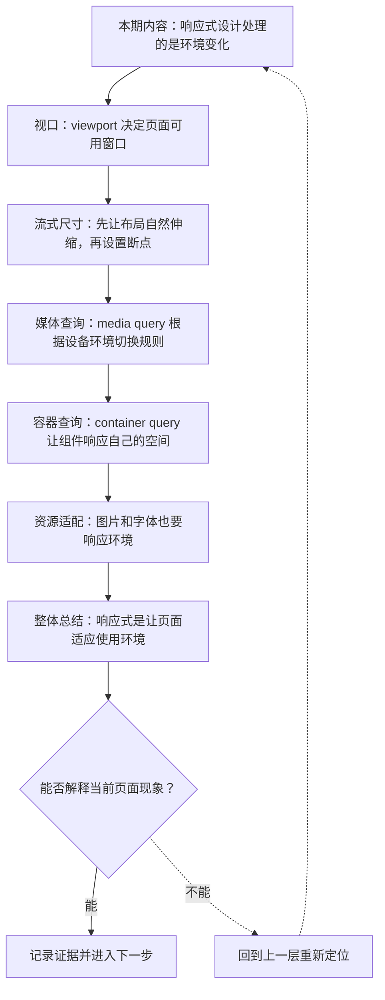
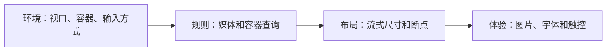

# 响应式设计：视口、媒体查询与容器查询

&gt; 视频入口：B站合集《前端全链路：从浏览器基础到现代生态》上传并核验后回填正式链接。
&gt; 本文是 EP09 的博客深讲版，包含视频主线，但比视频补充更多机制、流程图、边界判断和排查清单。


## 这篇文章解决什么问题

这期解释响应式设计怎样让同一套页面适应不同屏幕、窗口、输入方式和组件容器。

这一篇的中心问题可以概括成：响应式设计怎样让页面适应不同视口、容器和输入环境？

关键词：viewport、media query、container query、responsive、device-width、initial-scale、percent、rem、clamp、max-width

## 视频主线回顾

### 1. viewport 是移动端基线

`width=device-width, initial-scale=1` 让页面按真实设备视口布局，后续响应式规则才有意义。

### 2. 先流式，再断点

百分比、`max-width`、`rem`、`clamp` 能让页面自然伸缩。断点用于临界点切换布局，不是越多越好。

### 3. media query 看环境

媒体查询可以根据宽度、输入方式、动效偏好等条件切换样式。

### 4. container query 看组件空间

容器查询让组件根据自己的容器尺寸变化，更适合组件复用场景。

## 技术流程图

先用一张图把本期内容串起来。它不是背诵路线，而是排查问题时可以顺着走的证据路线。




## 深入展开

### 1. 响应式设计处理的是环境变化

这一期看响应式设计。我们会从 viewport 讲起，说明页面怎样知道当前可用空间；再看流式尺寸、media query 和 container query，最后补上图片、字体和触控目标。响应式不是给手机单独做一版页面，而是让布局、内容和交互在不同环境里保持可用。

这里可以多看一层：先找输入，再看处理过程，最后确认输出。前端很多问题之所以绕，是因为现象出现在页面上，原因却可能藏在网络、样式计算、运行时或构建结果里。



排查时可以顺着这条线问：当前现象是输入不对、处理过程不对，还是最终结果不对。只要能把问题归到其中一格，后面的工具选择就会轻很多。

### 2. viewport 决定页面可用窗口

viewport 是页面布局面对的可见区域。移动浏览器如果没有正确的 viewport meta，可能会用一个虚拟宽度缩放整页，导致文字和布局都不自然。常见设置 width=device-width, initial-scale=1，会让 CSS 像素和设备视口建立合理关系。响应式的第一步，是让页面拿到真实的布局窗口。

把这段机制放到工程里看，最实用的切口是证据。不要急着猜是哪一行代码错了，先确认浏览器或工具实际拿到了什么、计算了什么、丢出了什么结果。

```js
<meta
  name="viewport"
  content="width=device-width, initial-scale=1">
```

- 按设备宽度布局。
- 避免整页缩放。
- 后续断点才有意义。

排查时可以顺着这条线问：当前现象是输入不对、处理过程不对，还是最终结果不对。只要能把问题归到其中一格，后面的工具选择就会轻很多。

### 3. 先让布局自然伸缩，再设置断点

响应式布局应该先尽量流式。宽度可以用百分比、max-width 和 minmax，间距和字体可以用 rem，标题字号可以用 clamp 在范围内变化。断点不是补丁越多越好，而是在布局自然伸缩到某个临界点时，切换排列方式。先流式，再断点，页面会更稳。

这个点在真实项目里常常不是孤立问题。它会和状态、缓存、布局、依赖或团队约束连在一起，所以博客版更强调边界：什么归它管，什么应该交给下一层机制判断。

| 维度 | 含义 |
| --- | --- |
| max-width | 限制大屏阅读宽度。 |
| rem | 跟随根字号和用户偏好。 |
| clamp | 在最小和最大值之间流动。 |

排查时可以顺着这条线问：当前现象是输入不对、处理过程不对，还是最终结果不对。只要能把问题归到其中一格，后面的工具选择就会轻很多。

### 4. media query 根据设备环境切换规则

media query 可以根据视口宽度、方向、分辨率、是否偏好减少动画、输入指针是否精细等条件切换样式。最常见的是 min-width 断点，比如窄屏单列，宽屏双列。更细一点，可以用 pointer 判断鼠标和触控，用 prefers-reduced-motion 尊重用户的动效偏好。

如果要把它讲给别人听，可以按“现象—证据—机制—边界”的顺序。先让对方看到问题，再解释浏览器或工具为什么会给出这样的结果。

```js
@media (min-width: 768px) {
  .cards { grid-template-columns: repeat(2, 1fr); }
}
@media (prefers-reduced-motion: reduce) {
  * { animation: none; }
}
```

- 宽度断点切换布局。
- 用户偏好影响动效。
- 输入方式影响交互尺寸。

排查时可以顺着这条线问：当前现象是输入不对、处理过程不对，还是最终结果不对。只要能把问题归到其中一格，后面的工具选择就会轻很多。

### 5. container query 让组件响应自己的空间

media query 看的是视口，container query 看的是组件所在容器。一个商品卡片放在主内容区可能横向展示，放在侧栏就应该变成纵向。过去这类逻辑常靠页面断点绕，现在可以让组件根据自己的容器尺寸调整样式。组件化时代，container query 会让响应式更贴近真实复用方式。

这里可以多看一层：先找输入，再看处理过程，最后确认输出。前端很多问题之所以绕，是因为现象出现在页面上，原因却可能藏在网络、样式计算、运行时或构建结果里。

| 维度 | 含义 |
| --- | --- |
| media query | 根据整个 viewport 切换。 |
| container query | 根据组件容器空间切换。 |

排查时可以顺着这条线问：当前现象是输入不对、处理过程不对，还是最终结果不对。只要能把问题归到其中一格，后面的工具选择就会轻很多。

### 6. 图片和字体也要响应环境

响应式不只包括布局。图片可以用 srcset 和 sizes 给不同 DPR 和宽度选择合适资源，避免小屏下载过大的图。字体要考虑可读性，行长不能无限变长，触控目标也不能太小。真正好的响应式，是布局、资源和交互一起适配，而不是只把卡片挤成一列。

把这段机制放到工程里看，最实用的切口是证据。不要急着猜是哪一行代码错了，先确认浏览器或工具实际拿到了什么、计算了什么、丢出了什么结果。

| 维度 | 含义 |
| --- | --- |
| image | 按宽度和 DPR 选择资源。 |
| text | 控制字号、行高和行长。 |
| touch | 保证按钮和链接足够可点。 |

排查时可以顺着这条线问：当前现象是输入不对、处理过程不对，还是最终结果不对。只要能把问题归到其中一格，后面的工具选择就会轻很多。

## 常见误区与边界

- 不要把响应式简化为几个屏幕宽度断点。
- 不要忽略触控、动效偏好和文字可读性。
- 不要让小屏下载不必要的大图。
- 这一篇不展开：完整设计系统断点策略。
- 这一篇不展开：多端原生应用适配。
- 这一篇不展开：复杂图片 CDN 转码策略。

## 排查和验证清单

- 先确认问题发生在哪一层：页面结构、样式计算、JavaScript 运行、网络请求、构建产物还是线上交付。
- 用浏览器或工具拿到证据，不只凭肉眼判断。能截图、能看到日志、能看到请求和产物，结论才稳。
- 把最小例子缩到只剩一个变量。变量越少，越容易看清机制。
- 记录输入、处理过程和输出。前端问题往往不是“某个 API 错了”，而是链路中某一步的假设不成立。
- 如果准备把结论放到项目里，再补一层测试、类型检查、可访问性或性能验证。

## 动手练习

1. 用一个最小 HTML 页面复现 响应式设计 里的核心现象。
2. 打开 DevTools，分别记录结构、样式、控制台、网络或性能面板里的一个证据点。
3. 改一个变量，再观察结果是否符合这篇文章里的流程图；如果不符合，把差异写下来。

## 参考来源与本系列依据

- 规范：CSS Media Queries / Container Queries：响应式条件基线
- 浏览器文档：MDN Responsive design / srcset：开发者解释和示例
- 规范：HTML viewport meta / images：视口和响应式图片
- 实验：卡片组件在主栏和侧栏对照：可复现演示

## 总结

响应式设计不是手机另做一版，而是让布局、资源和交互根据使用环境自然变化。

博客版到这里就把视频主线扩成了可复习的技术笔记：先知道它在链路里的位置，再知道它怎么运行，最后知道遇到问题该从哪里查。
