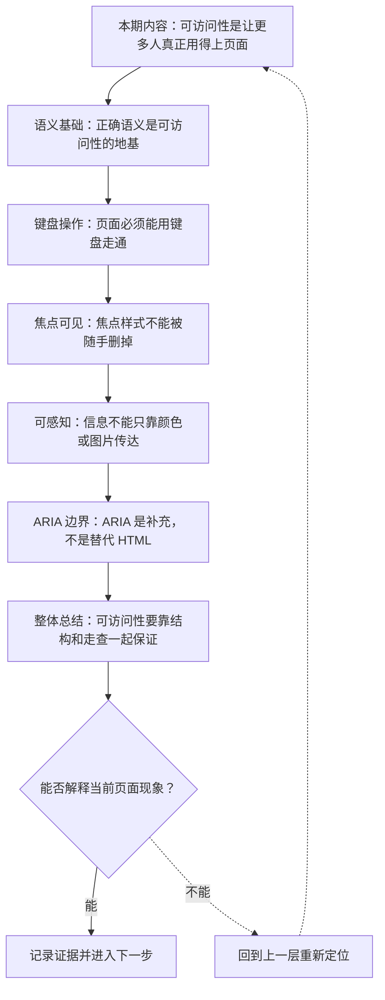
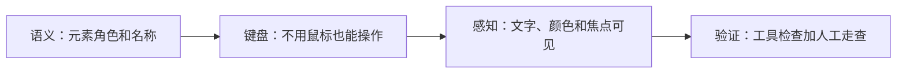
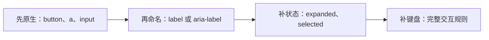

# Web 可访问性基础：语义、键盘与可感知界面

&gt; 视频入口：B站合集《前端全链路：从浏览器基础到现代生态》上传并核验后回填正式链接。
&gt; 本文是 EP10 的博客深讲版，包含视频主线，但比视频补充更多机制、流程图、边界判断和排查清单。


## 这篇文章解决什么问题

这期把可访问性从抽象口号落到页面检查：语义、键盘、焦点、颜色、文本和 ARIA。

这一篇的中心问题可以概括成：Web 可访问性基础怎样落到可验证的页面结构和交互检查？

关键词：accessibility、a11y、keyboard、ARIA、role、name、aria-label、state、Tab、Enter

## 视频主线回顾

### 1. 语义是地基

原生 HTML 元素会提供角色、名称和结构。自定义控件需要额外补齐这些信息。

### 2. 键盘能暴露很多问题

Tab 顺序、焦点可见、Enter/Space 激活、Escape 退出，是最基本的人工走查路径。

### 3. 信息要可感知

颜色对比、错误文字、图片 alt、视频字幕都会影响用户能否获取信息。

### 4. ARIA 只做补充

ARIA 可以补角色、名称和状态，但不会自动补键盘行为。优先使用原生元素。

## 技术流程图

先用一张图把本期内容串起来。它不是背诵路线，而是排查问题时可以顺着走的证据路线。




## 深入展开

### 1. 可访问性是让更多人真正用得上页面

这一期看 Web 可访问性基础。我们会把语义 HTML、键盘操作、焦点可见性、颜色对比、替代文本和 ARIA 放在一条检查线上。可访问性不是只服务某一类用户，它也会影响键盘用户、临时受限场景、低视力环境和自动化测试。能被更多方式使用的页面，通常也是更稳的页面。

这里可以多看一层：先找输入，再看处理过程，最后确认输出。前端很多问题之所以绕，是因为现象出现在页面上，原因却可能藏在网络、样式计算、运行时或构建结果里。



排查时可以顺着这条线问：当前现象是输入不对、处理过程不对，还是最终结果不对。只要能把问题归到其中一格，后面的工具选择就会轻很多。

### 2. 正确语义是可访问性的地基

可访问性首先依赖语义。button、a、input、label、nav、main 这些原生元素会给浏览器和辅助技术提供角色、名称和结构。一个图标按钮如果没有文字，需要 aria-label 提供可访问名称；一个自定义开关如果没有状态，辅助技术就不知道它开着还是关着。先用原生元素，再补 ARIA。

把这段机制放到工程里看，最实用的切口是证据。不要急着猜是哪一行代码错了，先确认浏览器或工具实际拿到了什么、计算了什么、丢出了什么结果。

| 维度 | 含义 |
| --- | --- |
| 原生按钮 | 自动有 role、键盘规则和名称来源。 |
| 自定义控件 | 需要补角色、名称、状态和键盘。 |

排查时可以顺着这条线问：当前现象是输入不对、处理过程不对，还是最终结果不对。只要能把问题归到其中一格，后面的工具选择就会轻很多。

### 3. 页面必须能用键盘走通

键盘检查很简单，也很有效。用 Tab 应该能按合理顺序到达可交互元素，焦点应该清楚可见，Enter 或 Space 应该能激活按钮，Escape 应该能关闭弹层。很多鼠标能用、键盘不能用的问题，根源都是用 div 模拟控件却没有补完整交互规则。

这个点在真实项目里常常不是孤立问题。它会和状态、缓存、布局、依赖或团队约束连在一起，所以博客版更强调边界：什么归它管，什么应该交给下一层机制判断。

| 维度 | 含义 |
| --- | --- |
| Tab order | 焦点顺序符合页面阅读路径。 |
| Activation | Enter 和 Space 能触发控件。 |
| Escape | 弹层和菜单可以退出。 |

排查时可以顺着这条线问：当前现象是输入不对、处理过程不对，还是最终结果不对。只要能把问题归到其中一格，后面的工具选择就会轻很多。

### 4. 焦点样式不能被随手删掉

焦点可见性经常被误伤。有些页面为了好看写 outline:none，却没有提供替代样式，键盘用户就像在黑暗里操作。更好的做法是使用 :focus-visible，为键盘焦点提供清楚的边框、背景或阴影，同时不打扰鼠标点击体验。焦点样式是导航线索，不是视觉瑕疵。

如果要把它讲给别人听，可以按“现象—证据—机制—边界”的顺序。先让对方看到问题，再解释浏览器或工具为什么会给出这样的结果。

```js
.button:focus-visible {
  outline: 3px solid #4dd4ff;
  outline-offset: 3px;
}
```

- 不要裸删 outline。
- 用 focus-visible 区分键盘焦点。
- 保证对比度和可见性。

排查时可以顺着这条线问：当前现象是输入不对、处理过程不对，还是最终结果不对。只要能把问题归到其中一格，后面的工具选择就会轻很多。

### 5. 信息不能只靠颜色或图片传达

可感知意味着信息不能只靠单一感官。文字和背景要有足够对比度，错误状态不能只用红色表示，还要有文字说明。图片如果承载信息，需要 alt 文本；如果只是装饰，应该让辅助技术忽略。视频内容也要考虑字幕。可访问性经常不是复杂技术，而是把信息表达完整。

这里可以多看一层：先找输入，再看处理过程，最后确认输出。前端很多问题之所以绕，是因为现象出现在页面上，原因却可能藏在网络、样式计算、运行时或构建结果里。

| 维度 | 含义 |
| --- | --- |
| contrast | 文字和背景要清楚。 |
| alt text | 信息图片提供替代文本。 |
| error | 错误要有文字说明。 |

排查时可以顺着这条线问：当前现象是输入不对、处理过程不对，还是最终结果不对。只要能把问题归到其中一格，后面的工具选择就会轻很多。

### 6. ARIA 是补充，不是替代 HTML

ARIA 可以补充浏览器无法从原生结构推断出的角色、名称和状态，但它不会自动补交互。给 div 加 role=button，并不会让它自动支持 Space 激活，也不会自动进入正确表单模型。常见原则是：能用原生 HTML，就先用原生；必须自定义时，再同时补 ARIA、键盘和状态同步。

把这段机制放到工程里看，最实用的切口是证据。不要急着猜是哪一行代码错了，先确认浏览器或工具实际拿到了什么、计算了什么、丢出了什么结果。



排查时可以顺着这条线问：当前现象是输入不对、处理过程不对，还是最终结果不对。只要能把问题归到其中一格，后面的工具选择就会轻很多。

## 常见误区与边界

- 不要把可访问性当成上线前一次性扫分。
- 不要用 ARIA 替代本来就适合的 HTML 元素。
- 不要只依赖自动化工具，键盘和读屏语境仍需人工走查。
- 这一篇不展开：完整 WCAG 条款逐条讲解。
- 这一篇不展开：复杂无障碍组件模式完整实现。
- 这一篇不展开：特定读屏软件的深度使用教程。

## 排查和验证清单

- 先确认问题发生在哪一层：页面结构、样式计算、JavaScript 运行、网络请求、构建产物还是线上交付。
- 用浏览器或工具拿到证据，不只凭肉眼判断。能截图、能看到日志、能看到请求和产物，结论才稳。
- 把最小例子缩到只剩一个变量。变量越少，越容易看清机制。
- 记录输入、处理过程和输出。前端问题往往不是“某个 API 错了”，而是链路中某一步的假设不成立。
- 如果准备把结论放到项目里，再补一层测试、类型检查、可访问性或性能验证。

## 动手练习

1. 用一个最小 HTML 页面复现 Web 可访问性 里的核心现象。
2. 打开 DevTools，分别记录结构、样式、控制台、网络或性能面板里的一个证据点。
3. 改一个变量，再观察结果是否符合这篇文章里的流程图；如果不符合，把差异写下来。

## 参考来源与本系列依据

- 标准：WCAG / WAI-ARIA：可访问性原则和 ARIA 语义
- 浏览器文档：MDN Accessibility：开发者解释和实践入口
- 工具：Chrome Accessibility panel / Lighthouse：自动检查和证据
- 实验：键盘走查与按钮对照：可复现演示

## 总结

Web 可访问性不是额外装饰，而是页面质量的一部分。结构正确、键盘可用、焦点可见、信息可感知，页面才真正可靠。

博客版到这里就把视频主线扩成了可复习的技术笔记：先知道它在链路里的位置，再知道它怎么运行，最后知道遇到问题该从哪里查。
