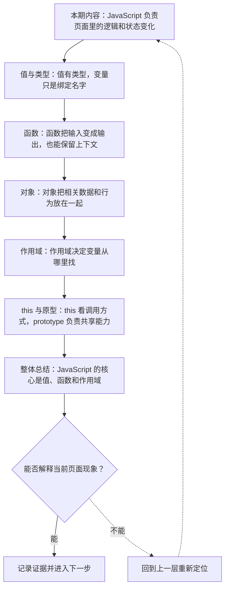

# JavaScript 语言基础：值、函数、对象与作用域

&gt; 视频入口：B站合集《前端全链路：从浏览器基础到现代生态》上传并核验后回填正式链接。
&gt; 本文是 EP11 的博客深讲版，包含视频主线，但比视频补充更多机制、流程图、边界判断和排查清单。


## 这篇文章解决什么问题

这期从语言模型角度解释 JavaScript：值怎样流动，函数怎样执行，对象怎样组织数据，作用域怎样决定变量访问。

这一篇的中心问题可以概括成：JavaScript 的语言模型如何支撑前端逻辑、状态和后续 Web API 使用？

关键词：JavaScript、value、function、object、number、string、const、return、callback、array

## 视频主线回顾

### 1. 变量是名字到值的绑定

原始值和对象值的行为不同。理解引用，是理解数组、对象和状态更新的前提。

### 2. 函数是一等值

函数可以被传递、保存和返回，所以回调、事件监听和 Promise 都能成立。

### 3. 对象组织状态

普通对象、数组、函数和 DOM 节点都可以纳入对象模型理解。

### 4. 作用域和闭包解释变量访问

函数会保留定义处的外部环境，这就是闭包的基础。

## 技术流程图

先用一张图把本期内容串起来。它不是背诵路线，而是排查问题时可以顺着走的证据路线。




## 深入展开

### 1. JavaScript 负责页面里的逻辑和状态变化

这一期看 JavaScript 语言基础。我们会讲值和类型、变量绑定、函数调用、对象组织、作用域和闭包，再简单点到 this 和 prototype。重点不是背语法清单，而是建立一条思路：JavaScript 程序就是值在函数之间流动，状态在对象里组织，变量访问由作用域决定。

这里可以多看一层：先找输入，再看处理过程，最后确认输出。前端很多问题之所以绕，是因为现象出现在页面上，原因却可能藏在网络、样式计算、运行时或构建结果里。


排查时可以顺着这条线问：当前现象是输入不对、处理过程不对，还是最终结果不对。只要能把问题归到其中一格，后面的工具选择就会轻很多。

### 2. 值有类型，变量只是绑定名字

JavaScript 里的值有类型，比如 number、string、boolean、null、undefined、symbol、bigint，还有对象类型。let 和 const 创建的是名字到值的绑定。原始值通常按值理解，对象值按引用理解。很多新手问题，比如对象改了以后另一个变量也变了，根源就是没区分变量名和对象值。

把这段机制放到工程里看，最实用的切口是证据。不要急着猜是哪一行代码错了，先确认浏览器或工具实际拿到了什么、计算了什么、丢出了什么结果。

| 维度 | 含义 |
| --- | --- |
| 原始值 | 数字、字符串、布尔值更像不可变数据。 |
| 对象值 | 数组、函数、普通对象通过引用访问。 |

排查时可以顺着这条线问：当前现象是输入不对、处理过程不对，还是最终结果不对。只要能把问题归到其中一格，后面的工具选择就会轻很多。

### 3. 函数把输入变成输出，也能保留上下文

函数接收参数，执行语句，返回结果。它可以作为值传递给另一个函数，也可以被存在对象里作为方法。回调、事件监听、数组 map 和 Promise 都离不开函数是一等值这个特性。写前端时，很多问题其实是在问：这段逻辑什么时候被调用，调用时拿到哪些值。

这个点在真实项目里常常不是孤立问题。它会和状态、缓存、布局、依赖或团队约束连在一起，所以博客版更强调边界：什么归它管，什么应该交给下一层机制判断。

```js
function formatPrice(value) {
  return "¥" + value.toFixed(2);
}

button.addEventListener("click", onClick);
```

- 可以命名后调用。
- 可以作为回调传递。
- 执行时才读取当前输入。

排查时可以顺着这条线问：当前现象是输入不对、处理过程不对，还是最终结果不对。只要能把问题归到其中一格，后面的工具选择就会轻很多。

### 4. 对象把相关数据和行为放在一起

对象是键和值的集合，数组是有顺序的对象，函数本身也可以被当成对象。前端项目里的用户信息、组件 props、请求配置、DOM 节点引用，都是对象模型的一部分。理解对象以后，再看解构、展开、浅拷贝和不可变更新，才知道它们真正改变的是哪一层引用。

如果要把它讲给别人听，可以按“现象—证据—机制—边界”的顺序。先让对方看到问题，再解释浏览器或工具为什么会给出这样的结果。

| 维度 | 含义 |
| --- | --- |
| plain object | 用键值组织业务数据。 |
| array | 用顺序组织列表。 |
| function | 既能调用，也能被传递。 |

排查时可以顺着这条线问：当前现象是输入不对、处理过程不对，还是最终结果不对。只要能把问题归到其中一格，后面的工具选择就会轻很多。

### 5. 作用域决定变量从哪里找

JavaScript 使用词法作用域。函数在哪里定义，就能记住那里的外层变量。闭包不是神秘技巧，它只是函数和它能访问的外部环境一起被保留下来。事件回调、计时器、模块私有变量和 React Hooks 都大量依赖闭包。调试闭包问题时，要看函数定义位置，而不是只看调用位置。

这里可以多看一层：先找输入，再看处理过程，最后确认输出。前端很多问题之所以绕，是因为现象出现在页面上，原因却可能藏在网络、样式计算、运行时或构建结果里。

```js
function createCounter() {
  let count = 0;
  return function add() {
    count++;
    return count;
  };
}
```

- add 记住外层 count。
- count 不在全局暴露。
- 多次调用共享同一环境。

排查时可以顺着这条线问：当前现象是输入不对、处理过程不对，还是最终结果不对。只要能把问题归到其中一格，后面的工具选择就会轻很多。

### 6. this 看调用方式，prototype 负责共享能力

this 的值主要由调用方式决定：作为对象方法调用、普通函数调用、构造调用、箭头函数捕获外层 this，结果都不同。prototype 则让多个对象共享方法。现代前端更多使用 class、模块和函数式写法，但浏览器对象、数组方法和很多库的底层，仍然离不开原型链。

把这段机制放到工程里看，最实用的切口是证据。不要急着猜是哪一行代码错了，先确认浏览器或工具实际拿到了什么、计算了什么、丢出了什么结果。

| 维度 | 含义 |
| --- | --- |
| this | 和函数怎么被调用有关。 |
| arrow | 捕获外层 this。 |
| prototype | 共享方法和查找链。 |

排查时可以顺着这条线问：当前现象是输入不对、处理过程不对，还是最终结果不对。只要能把问题归到其中一格，后面的工具选择就会轻很多。

## 常见误区与边界

- 不要把变量当成存储盒子而忽略引用。
- 不要把闭包讲成魔法。
- 不要一开始深陷 this 细节，先建立调用方式模型。
- 这一篇不展开：完整 ECMAScript 规范逐章讲解。
- 这一篇不展开：高级类型体操和编译器实现。
- 这一篇不展开：框架响应式系统，留到框架批次。

## 排查和验证清单

- 先确认问题发生在哪一层：页面结构、样式计算、JavaScript 运行、网络请求、构建产物还是线上交付。
- 用浏览器或工具拿到证据，不只凭肉眼判断。能截图、能看到日志、能看到请求和产物，结论才稳。
- 把最小例子缩到只剩一个变量。变量越少，越容易看清机制。
- 记录输入、处理过程和输出。前端问题往往不是“某个 API 错了”，而是链路中某一步的假设不成立。
- 如果准备把结论放到项目里，再补一层测试、类型检查、可访问性或性能验证。

## 动手练习

1. 用一个最小 HTML 页面复现 JavaScript 语言基础 里的核心现象。
2. 打开 DevTools，分别记录结构、样式、控制台、网络或性能面板里的一个证据点。
3. 改一个变量，再观察结果是否符合这篇文章里的流程图；如果不符合，把差异写下来。

## 参考来源与本系列依据

- 规范：ECMAScript Language Specification：语言机制基线
- 浏览器文档：MDN JavaScript Guide：开发者解释
- 实验：闭包计数器与对象引用示例：可复现演示

## 总结

JavaScript 程序可以先看成值、函数、对象和作用域之间的关系。这个模型越清楚，后面的 DOM、事件和异步越容易理解。

博客版到这里就把视频主线扩成了可复习的技术笔记：先知道它在链路里的位置，再知道它怎么运行，最后知道遇到问题该从哪里查。
