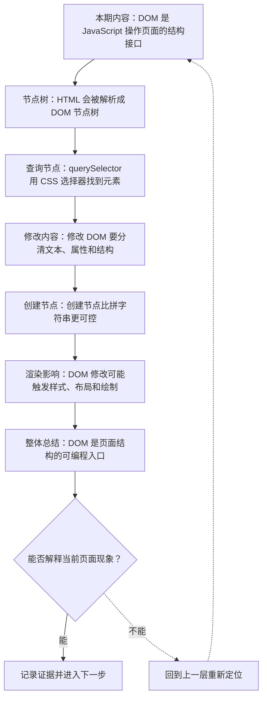
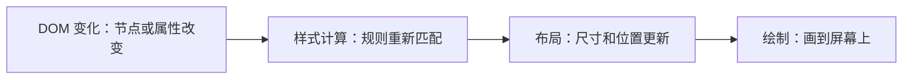

# DOM 编程：节点、查询、修改与渲染影响

&gt; 视频入口：B站合集《前端全链路：从浏览器基础到现代生态》上传并核验后回填正式链接。
&gt; 本文是 EP12 的博客深讲版，包含视频主线，但比视频补充更多机制、流程图、边界判断和排查清单。


## 这篇文章解决什么问题

这期解释 DOM 编程怎样让 JavaScript 读取和修改页面结构，以及这些修改怎样影响浏览器渲染。

这一篇的中心问题可以概括成：DOM 编程怎样让 JavaScript 读取、修改页面结构并影响渲染？

关键词：DOM、document、node、element、querySelector、data attribute、textContent、setAttribute、classList、innerHTML

## 视频主线回顾

### 1. DOM 是节点树

浏览器把 HTML 解析成 document 入口下的节点树，JavaScript 操作的是这些节点对象。

### 2. 查询要稳定

`querySelector` 很方便，但选择器应该基于稳定语义或 data 属性，避免依赖脆弱层级。

### 3. 修改要明确

文本用 `textContent`，属性用 `setAttribute`，样式状态用 `classList`，结构用 `createElement` 和 `append`。

### 4. DOM 修改会影响渲染

节点变化可能触发样式计算、布局和绘制。批量修改通常比读写交错更稳。

## 技术流程图

先用一张图把本期内容串起来。它不是背诵路线，而是排查问题时可以顺着走的证据路线。




## 深入展开

### 1. DOM 是 JavaScript 操作页面的结构接口

这一期看 DOM 编程。我们会讲 document、节点树、querySelector 查询、文本和属性修改、classList 切换样式、创建和插入节点，以及 DOM 修改对样式计算、布局和绘制的影响。理解 DOM，才能知道为什么框架最后还是要把组件结果落到真实页面上。

这里可以多看一层：先找输入，再看处理过程，最后确认输出。前端很多问题之所以绕，是因为现象出现在页面上，原因却可能藏在网络、样式计算、运行时或构建结果里。


排查时可以顺着这条线问：当前现象是输入不对、处理过程不对，还是最终结果不对。只要能把问题归到其中一格，后面的工具选择就会轻很多。

### 2. HTML 会被解析成 DOM 节点树

浏览器解析 HTML 后，会得到一棵 DOM 节点树。document 是入口，html、body、div、button 是元素节点，文字内容是文本节点。我们在 JavaScript 里操作的不是 HTML 字符串本身，而是这棵树上的对象。节点有父子、兄弟和属性关系，页面结构也因此能被脚本遍历和修改。

把这段机制放到工程里看，最实用的切口是证据。不要急着猜是哪一行代码错了，先确认浏览器或工具实际拿到了什么、计算了什么、丢出了什么结果。

| 维度 | 含义 |
| --- | --- |
| document | 整棵树的入口。 |
| element | 标签对应的节点对象。 |
| text | 标签之间的文字节点。 |

排查时可以顺着这条线问：当前现象是输入不对、处理过程不对，还是最终结果不对。只要能把问题归到其中一格，后面的工具选择就会轻很多。

### 3. querySelector 用 CSS 选择器找到元素

querySelector 和 querySelectorAll 可以用 CSS 选择器查找元素。比如 document.querySelector("[data-submit]") 找到提交按钮。实际项目里，不建议依赖很脆的层级路径；更稳的是用语义元素、id、class 或 data 属性作为查询入口。查到节点以后，才能读取文本、绑定事件或修改状态。

这个点在真实项目里常常不是孤立问题。它会和状态、缓存、布局、依赖或团队约束连在一起，所以博客版更强调边界：什么归它管，什么应该交给下一层机制判断。

```js
const button = document.querySelector("[data-submit]");
const items = document.querySelectorAll(".todo-item");
```

- querySelector 返回第一个匹配元素。
- querySelectorAll 返回静态列表。
- data-* 适合做行为标记。

排查时可以顺着这条线问：当前现象是输入不对、处理过程不对，还是最终结果不对。只要能把问题归到其中一格，后面的工具选择就会轻很多。

### 4. 修改 DOM 要分清文本、属性和结构

修改 DOM 时，要分清修改的是文本、属性、样式类名还是结构。textContent 改文本，setAttribute 改属性，classList 切换类名，append 可以插入新节点。innerHTML 虽然方便，但会重新解析字符串，并带来安全风险。日常优先用明确 API 表达意图。

如果要把它讲给别人听，可以按“现象—证据—机制—边界”的顺序。先让对方看到问题，再解释浏览器或工具为什么会给出这样的结果。

| 维度 | 含义 |
| --- | --- |
| textContent | 更新可见文字。 |
| setAttribute | 更新属性和语义信息。 |
| classList | 切换 CSS 状态。 |

排查时可以顺着这条线问：当前现象是输入不对、处理过程不对，还是最终结果不对。只要能把问题归到其中一格，后面的工具选择就会轻很多。

### 5. 创建节点比拼字符串更可控

创建结构可以用 document.createElement，再设置文本、属性和类名，最后 append 到目标容器。这样做比拼接 HTML 字符串更可控，也更容易避免把用户输入当成 HTML 解析。大量插入时，可以先用 DocumentFragment 组装，再一次性放进页面，减少中间状态带来的开销。

这里可以多看一层：先找输入，再看处理过程，最后确认输出。前端很多问题之所以绕，是因为现象出现在页面上，原因却可能藏在网络、样式计算、运行时或构建结果里。

```js
const li = document.createElement("li");
li.textContent = title;
li.classList.add("todo-item");
list.append(li);
```

- 创建元素节点。
- 用 textContent 放文本。
- 最后插入目标容器。

排查时可以顺着这条线问：当前现象是输入不对、处理过程不对，还是最终结果不对。只要能把问题归到其中一格，后面的工具选择就会轻很多。

### 6. DOM 修改可能触发样式、布局和绘制

DOM 修改之后，浏览器可能重新计算样式、布局和绘制。改 class 可能影响样式，插入节点可能影响布局，读取 offsetWidth 这类布局信息时，浏览器可能被迫先把前面的修改计算完。性能优化不是不改 DOM，而是避免频繁读写交错，尽量把修改批量处理。

把这段机制放到工程里看，最实用的切口是证据。不要急着猜是哪一行代码错了，先确认浏览器或工具实际拿到了什么、计算了什么、丢出了什么结果。



排查时可以顺着这条线问：当前现象是输入不对、处理过程不对，还是最终结果不对。只要能把问题归到其中一格，后面的工具选择就会轻很多。

## 常见误区与边界

- 不要把 DOM 当成字符串拼接目标。
- 不要忽略 innerHTML 的安全风险。
- 不要频繁交错读写布局信息。
- 这一篇不展开：虚拟 DOM diff 细节，留到框架批次。
- 这一篇不展开：复杂渲染性能剖析，留到性能单集。
- 这一篇不展开：Web Components 深度实践。

## 排查和验证清单

- 先确认问题发生在哪一层：页面结构、样式计算、JavaScript 运行、网络请求、构建产物还是线上交付。
- 用浏览器或工具拿到证据，不只凭肉眼判断。能截图、能看到日志、能看到请求和产物，结论才稳。
- 把最小例子缩到只剩一个变量。变量越少，越容易看清机制。
- 记录输入、处理过程和输出。前端问题往往不是“某个 API 错了”，而是链路中某一步的假设不成立。
- 如果准备把结论放到项目里，再补一层测试、类型检查、可访问性或性能验证。

## 动手练习

1. 用一个最小 HTML 页面复现 DOM 编程 里的核心现象。
2. 打开 DevTools，分别记录结构、样式、控制台、网络或性能面板里的一个证据点。
3. 改一个变量，再观察结果是否符合这篇文章里的流程图；如果不符合，把差异写下来。

## 参考来源与本系列依据

- 标准：DOM Standard：节点、文档和 API 基线
- 浏览器文档：MDN DOM / Document APIs：开发者解释
- 工具：Chrome DevTools Elements / Performance：验证修改和渲染影响

## 总结

DOM 是 JavaScript 操作页面的结构接口。查到节点、明确修改、理解渲染影响，是写可靠交互的基础。

博客版到这里就把视频主线扩成了可复习的技术笔记：先知道它在链路里的位置，再知道它怎么运行，最后知道遇到问题该从哪里查。
