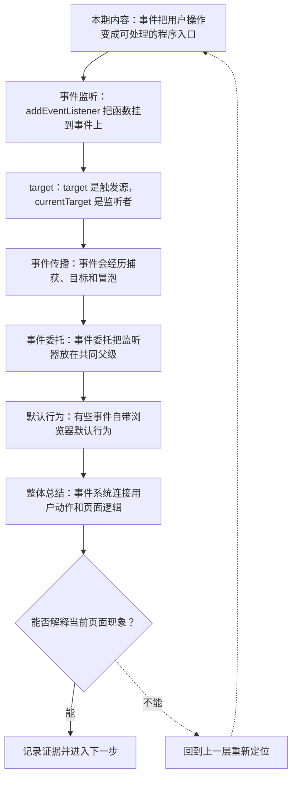
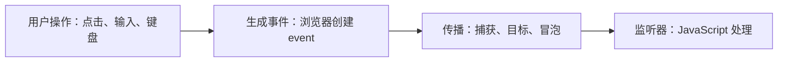
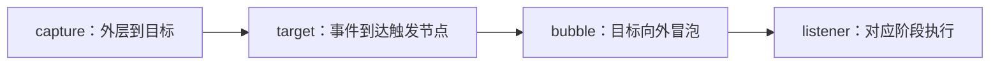

# 浏览器事件系统：监听、冒泡、委托与默认行为

&gt; 视频入口：B站合集《前端全链路：从浏览器基础到现代生态》上传并核验后回填正式链接。
&gt; 本文是 EP13 的博客深讲版，包含视频主线，但比视频补充更多机制、流程图、边界判断和排查清单。


## 这篇文章解决什么问题

这期解释浏览器事件怎样把用户操作送进 JavaScript，以及冒泡、委托和默认行为为什么重要。

这一篇的中心问题可以概括成：浏览器事件系统如何把用户操作传给 JavaScript，并通过传播和默认行为影响页面？

关键词：event、addEventListener、bubbling、click、target、currentTarget、capture、bubble、stopPropagation、delegation

## 视频主线回顾

### 1. 监听器是事件入口

`addEventListener` 把处理函数挂到指定事件上，事件发生时浏览器调用它。

### 2. target 和 currentTarget 要分清

`target` 是触发源，`currentTarget` 是当前监听器所在节点。

### 3. 冒泡支撑事件委托

把监听器放在父级，通过 `closest` 判断子项，可以处理动态列表。

### 4. 默认行为需要谨慎阻止

`preventDefault` 会阻止浏览器原生行为，必须确认替代体验完整。

## 技术流程图

先用一张图把本期内容串起来。它不是背诵路线，而是排查问题时可以顺着走的证据路线。




## 深入展开

### 1. 事件把用户操作变成可处理的程序入口

这一期看浏览器事件系统。我们会讲 addEventListener 怎样注册监听，event.target 和 currentTarget 有什么区别，事件捕获和冒泡怎样传播，事件委托为什么常用，以及 preventDefault 和 stopPropagation 分别会改变什么。事件是前端交互的入口，理解它，组件通信和表单交互都会清楚很多。

这里可以多看一层：先找输入，再看处理过程，最后确认输出。前端很多问题之所以绕，是因为现象出现在页面上，原因却可能藏在网络、样式计算、运行时或构建结果里。



排查时可以顺着这条线问：当前现象是输入不对、处理过程不对，还是最终结果不对。只要能把问题归到其中一格，后面的工具选择就会轻很多。

### 2. addEventListener 把函数挂到事件上

addEventListener 接收事件名和处理函数。比如 button.addEventListener("click", handleClick)，意思是当按钮点击事件发生时，浏览器调用 handleClick。处理函数会拿到 event 对象，里面包含事件类型、目标元素、按键、坐标等信息。调试事件时，先确认监听挂在谁身上，再看事件何时触发。

把这段机制放到工程里看，最实用的切口是证据。不要急着猜是哪一行代码错了，先确认浏览器或工具实际拿到了什么、计算了什么、丢出了什么结果。

```js
button.addEventListener("click", (event) => {
  console.log(event.type);
  console.log(event.target);
});
```

- 事件发生时调用函数。
- event 保存事件上下文。
- 监听对象影响 currentTarget。

排查时可以顺着这条线问：当前现象是输入不对、处理过程不对，还是最终结果不对。只要能把问题归到其中一格，后面的工具选择就会轻很多。

### 3. target 是触发源，currentTarget 是监听者

event.target 指向最初触发事件的节点，currentTarget 指向当前正在执行监听器的节点。一个列表项里有按钮，点击按钮时 target 可能是 button，但如果监听器挂在 ul 上，currentTarget 就是 ul。理解这个区别，才能写对事件委托，也能避免误判到底点中了哪个元素。

这个点在真实项目里常常不是孤立问题。它会和状态、缓存、布局、依赖或团队约束连在一起，所以博客版更强调边界：什么归它管，什么应该交给下一层机制判断。

| 维度 | 含义 |
| --- | --- |
| target | 真正被点到的内部元素。 |
| currentTarget | 当前监听器挂载的元素。 |

排查时可以顺着这条线问：当前现象是输入不对、处理过程不对，还是最终结果不对。只要能把问题归到其中一格，后面的工具选择就会轻很多。

### 4. 事件会经历捕获、目标和冒泡

事件传播通常分为捕获阶段、目标阶段和冒泡阶段。捕获从外层往目标走，冒泡从目标往外层走。默认 addEventListener 多数监听在冒泡阶段执行，所以子元素触发的点击，会一路冒泡到父元素。stopPropagation 可以阻止继续传播，但不要滥用，否则会让组件之间的事件关系变得很难调试。

如果要把它讲给别人听，可以按“现象—证据—机制—边界”的顺序。先让对方看到问题，再解释浏览器或工具为什么会给出这样的结果。



排查时可以顺着这条线问：当前现象是输入不对、处理过程不对，还是最终结果不对。只要能把问题归到其中一格，后面的工具选择就会轻很多。

### 5. 事件委托把监听器放在共同父级

事件委托利用冒泡，把监听器挂在共同父级上，再通过 event.target 判断具体点中了哪个子项。这样新插入的列表项不需要单独绑定监听，也能减少大量重复监听器。委托适合列表、菜单和表格操作，但也要注意选择器判断要准确，避免点到内部图标时识别失败。

这里可以多看一层：先找输入，再看处理过程，最后确认输出。前端很多问题之所以绕，是因为现象出现在页面上，原因却可能藏在网络、样式计算、运行时或构建结果里。

```js
list.addEventListener("click", (event) => {
  const item = event.target.closest("[data-id]");
  if (!item) return;
  selectItem(item.dataset.id);
});
```

- 监听父级 list。
- closest 找到目标子项。
- 动态新增项也能响应。

排查时可以顺着这条线问：当前现象是输入不对、处理过程不对，还是最终结果不对。只要能把问题归到其中一格，后面的工具选择就会轻很多。

### 6. 有些事件自带浏览器默认行为

很多事件有默认行为。点击 a 会跳转，提交 form 会发送数据，键盘输入会改变输入框内容。preventDefault 可以阻止默认行为，比如前端路由拦截链接跳转，或自定义表单提交。但阻止默认行为之前要确定自己真的补上了等价体验，否则会破坏浏览器原生能力。

把这段机制放到工程里看，最实用的切口是证据。不要急着猜是哪一行代码错了，先确认浏览器或工具实际拿到了什么、计算了什么、丢出了什么结果。

| 维度 | 含义 |
| --- | --- |
| link | 点击默认导航。 |
| form | 提交默认发送数据。 |
| input | 键盘默认编辑文本。 |

排查时可以顺着这条线问：当前现象是输入不对、处理过程不对，还是最终结果不对。只要能把问题归到其中一格，后面的工具选择就会轻很多。

## 常见误区与边界

- 不要滥用 stopPropagation。
- 不要阻止默认行为却不提供替代体验。
- 不要混淆 target 和 currentTarget。
- 这一篇不展开：框架合成事件实现细节。
- 这一篇不展开：Pointer Events 深度实践。
- 这一篇不展开：复杂手势识别和拖拽库。

## 排查和验证清单

- 先确认问题发生在哪一层：页面结构、样式计算、JavaScript 运行、网络请求、构建产物还是线上交付。
- 用浏览器或工具拿到证据，不只凭肉眼判断。能截图、能看到日志、能看到请求和产物，结论才稳。
- 把最小例子缩到只剩一个变量。变量越少，越容易看清机制。
- 记录输入、处理过程和输出。前端问题往往不是“某个 API 错了”，而是链路中某一步的假设不成立。
- 如果准备把结论放到项目里，再补一层测试、类型检查、可访问性或性能验证。

## 动手练习

1. 用一个最小 HTML 页面复现 浏览器事件系统 里的核心现象。
2. 打开 DevTools，分别记录结构、样式、控制台、网络或性能面板里的一个证据点。
3. 改一个变量，再观察结果是否符合这篇文章里的流程图；如果不符合，把差异写下来。

## 参考来源与本系列依据

- 标准：DOM Standard Events：事件传播和监听基线
- 浏览器文档：MDN Events：开发者解释
- 实验：列表事件委托示例：可复现演示

## 总结

事件系统是前端交互入口。理解监听、传播、委托和默认行为，才能写出稳定的用户操作逻辑。

博客版到这里就把视频主线扩成了可复习的技术笔记：先知道它在链路里的位置，再知道它怎么运行，最后知道遇到问题该从哪里查。
