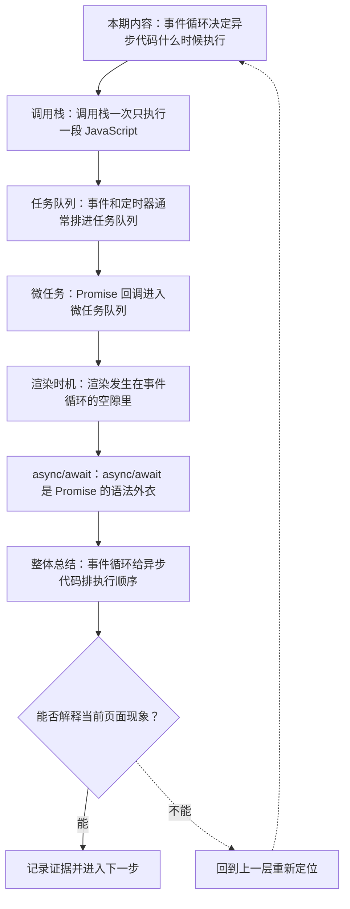
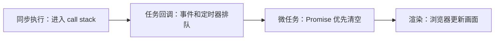
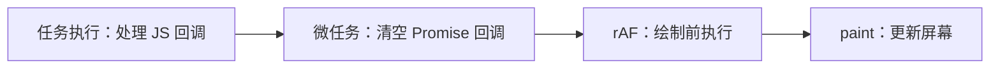

# 事件循环：调用栈、任务队列、微任务与渲染

&gt; 视频入口：B站合集《前端全链路：从浏览器基础到现代生态》上传并核验后回填正式链接。
&gt; 本文是 EP14 的博客深讲版，包含视频主线，但比视频补充更多机制、流程图、边界判断和排查清单。


## 这篇文章解决什么问题

这期解释 JavaScript 为什么是单线程执行，但仍能处理点击、定时器、网络回调和页面渲染。

这一篇的中心问题可以概括成：JavaScript 事件循环怎样安排同步代码、任务、微任务和浏览器渲染？

关键词：event loop、call stack、microtask、main thread、long task、task、setTimeout、event、Promise、queueMicrotask

## 视频主线回顾

### 1. 调用栈执行同步代码

主线程一次只执行当前调用栈里的 JavaScript。长时间不清空会阻塞输入和渲染。

### 2. 任务处理事件和定时器

点击、定时器等回调会排进任务队列，等当前任务结束后再执行。

### 3. 微任务通常更早

Promise 回调进入微任务队列，会在当前任务结束后、下一个任务前清空。

### 4. 渲染在空隙里发生

DOM 修改会被浏览器合并到后续渲染时机。`requestAnimationFrame` 适合绘制前更新。

## 技术流程图

先用一张图把本期内容串起来。它不是背诵路线，而是排查问题时可以顺着走的证据路线。




## 深入展开

### 1. 事件循环决定异步代码什么时候执行

这一期看 JavaScript 事件循环。我们会讲调用栈、任务队列、微任务队列、Promise 回调、setTimeout、requestAnimationFrame 和浏览器渲染之间的关系。重点是建立时间模型：同步代码先跑完，微任务在当前任务结束后清空，宏任务一轮一轮进入，浏览器在合适时机渲染页面。

这里可以多看一层：先找输入，再看处理过程，最后确认输出。前端很多问题之所以绕，是因为现象出现在页面上，原因却可能藏在网络、样式计算、运行时或构建结果里。



排查时可以顺着这条线问：当前现象是输入不对、处理过程不对，还是最终结果不对。只要能把问题归到其中一格，后面的工具选择就会轻很多。

### 2. 调用栈一次只执行一段 JavaScript

JavaScript 在主线程上执行时，调用栈一次只跑当前这段代码。函数 A 调用函数 B，B 会进栈，B 执行完再回到 A。只要调用栈长时间不清空，浏览器就没机会处理点击、滚动和渲染，所以页面会卡住。长任务优化的第一步，就是别让同步代码霸占主线程太久。

把这段机制放到工程里看，最实用的切口是证据。不要急着猜是哪一行代码错了，先确认浏览器或工具实际拿到了什么、计算了什么、丢出了什么结果。

| 维度 | 含义 |
| --- | --- |
| push | 函数调用进入栈。 |
| run | 当前函数执行。 |
| pop | 执行结束离开栈。 |

排查时可以顺着这条线问：当前现象是输入不对、处理过程不对，还是最终结果不对。只要能把问题归到其中一格，后面的工具选择就会轻很多。

### 3. 事件和定时器通常排进任务队列

用户点击、计时器到点、网络事件等，会把对应回调排进任务队列。当前同步代码执行完，调用栈清空后，事件循环才会取下一个任务执行。setTimeout(fn, 0) 不是立即执行，而是把 fn 放到后续任务里，至少要等当前任务结束。

这个点在真实项目里常常不是孤立问题。它会和状态、缓存、布局、依赖或团队约束连在一起，所以博客版更强调边界：什么归它管，什么应该交给下一层机制判断。

```js
console.log("A");
setTimeout(() => console.log("B"), 0);
console.log("C");
// A, C, B
```

- 同步日志先执行。
- setTimeout 回调进入后续任务。
- 0 毫秒也不是插队。

排查时可以顺着这条线问：当前现象是输入不对、处理过程不对，还是最终结果不对。只要能把问题归到其中一格，后面的工具选择就会轻很多。

### 4. Promise 回调进入微任务队列

Promise.then、queueMicrotask 这类回调进入微任务队列。当前任务执行完后，浏览器会先清空微任务，再去处理下一个任务。这样 Promise 回调通常比 setTimeout 更早执行。但如果微任务不断追加微任务，也可能拖延渲染和后续事件处理。

如果要把它讲给别人听，可以按“现象—证据—机制—边界”的顺序。先让对方看到问题，再解释浏览器或工具为什么会给出这样的结果。

```js
console.log("A");
Promise.resolve().then(() => console.log("B"));
setTimeout(() => console.log("C"), 0);
console.log("D");
// A, D, B, C
```

- 同步先完成。
- 微任务在任务间隙清空。
- 定时器是后续任务。

排查时可以顺着这条线问：当前现象是输入不对、处理过程不对，还是最终结果不对。只要能把问题归到其中一格，后面的工具选择就会轻很多。

### 5. 渲染发生在事件循环的空隙里

浏览器会在合适的事件循环时机更新渲染。你修改 DOM 后，屏幕不一定立刻变化；浏览器会合并样式计算、布局和绘制。requestAnimationFrame 会在下一次绘制前调用，适合做动画读写。理解这个节奏，就能解释为什么大量同步任务会让动画掉帧。

这里可以多看一层：先找输入，再看处理过程，最后确认输出。前端很多问题之所以绕，是因为现象出现在页面上，原因却可能藏在网络、样式计算、运行时或构建结果里。



排查时可以顺着这条线问：当前现象是输入不对、处理过程不对，还是最终结果不对。只要能把问题归到其中一格，后面的工具选择就会轻很多。

### 6. async/await 是 Promise 的语法外衣

async 函数会返回 Promise。遇到 await 时，函数暂停，把后续逻辑放到 Promise 继续执行的路径里。它让异步代码更像同步写法，但底层仍然遵守事件循环和微任务规则。调试 async/await 时，不要只看代码顺序，还要看哪些部分已经被切到异步延续里。

把这段机制放到工程里看，最实用的切口是证据。不要急着猜是哪一行代码错了，先确认浏览器或工具实际拿到了什么、计算了什么、丢出了什么结果。

| 维度 | 含义 |
| --- | --- |
| async | 函数返回 Promise。 |
| await | 暂停当前 async 函数。 |
| continue | 结果回来后继续执行。 |

排查时可以顺着这条线问：当前现象是输入不对、处理过程不对，还是最终结果不对。只要能把问题归到其中一格，后面的工具选择就会轻很多。

## 常见误区与边界

- 不要把 setTimeout 0 当成立即执行。
- 不要把 async/await 当成新线程。
- 不要忽略长任务对渲染和输入的影响。
- 这一篇不展开：Node.js 事件循环完整阶段。
- 这一篇不展开：浏览器调度器源码实现。
- 这一篇不展开：Web Worker 深度并发模型。

## 排查和验证清单

- 先确认问题发生在哪一层：页面结构、样式计算、JavaScript 运行、网络请求、构建产物还是线上交付。
- 用浏览器或工具拿到证据，不只凭肉眼判断。能截图、能看到日志、能看到请求和产物，结论才稳。
- 把最小例子缩到只剩一个变量。变量越少，越容易看清机制。
- 记录输入、处理过程和输出。前端问题往往不是“某个 API 错了”，而是链路中某一步的假设不成立。
- 如果准备把结论放到项目里，再补一层测试、类型检查、可访问性或性能验证。

## 动手练习

1. 用一个最小 HTML 页面复现 JavaScript 事件循环 里的核心现象。
2. 打开 DevTools，分别记录结构、样式、控制台、网络或性能面板里的一个证据点。
3. 改一个变量，再观察结果是否符合这篇文章里的流程图；如果不符合，把差异写下来。

## 参考来源与本系列依据

- 标准：HTML Event Loop：浏览器事件循环基线
- 规范：ECMAScript Promise Jobs：微任务语义
- 浏览器文档：MDN Event loop / requestAnimationFrame：开发者解释

## 总结

事件循环解释了异步代码的执行顺序。同步、任务、微任务和渲染的关系清楚了，网络请求和 UI 更新才不会乱。

博客版到这里就把视频主线扩成了可复习的技术笔记：先知道它在链路里的位置，再知道它怎么运行，最后知道遇到问题该从哪里查。
