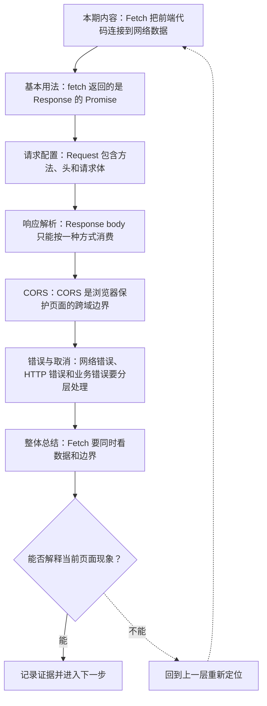
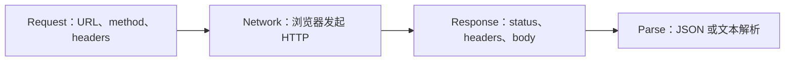
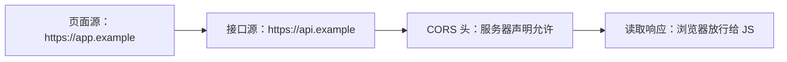

# Fetch 与网络请求：Request、Response、CORS 与错误处理

&gt; 视频入口：B站合集《前端全链路：从浏览器基础到现代生态》上传并核验后回填正式链接。
&gt; 本文是 EP15 的博客深讲版，包含视频主线，但比视频补充更多机制、流程图、边界判断和排查清单。


## 这篇文章解决什么问题

这期解释前端怎样用 Fetch 发起网络请求，怎样读取响应，以及为什么 CORS 和错误处理经常让人困惑。

这一篇的中心问题可以概括成：Fetch 如何发起请求、读取响应，并处理 CORS、错误和取消？

关键词：Fetch、Request、Response、CORS、fetch、Promise、response.ok、method、headers、body

## 视频主线回顾

### 1. fetch 返回 Response

`await fetch()` 拿到的是响应对象。HTTP 404 或 500 不一定会 throw，需要检查 `response.ok`。

### 2. 请求配置要和接口约定一致

method、headers、body 决定请求语义。JSON 提交和 FormData 上传的处理方式不同。

### 3. 响应体要解析

`response.json()`、`text()`、`blob()` 是不同消费方式，同一个 body 不能随便重复读取。

### 4. CORS 是浏览器边界

跨源请求需要服务器声明允许，否则页面不能读取响应。

## 技术流程图

先用一张图把本期内容串起来。它不是背诵路线，而是排查问题时可以顺着走的证据路线。




## 深入展开

### 1. Fetch 把前端代码连接到网络数据

这一期看 Fetch 与网络请求。我们会讲 fetch 怎样发 Request，Response 怎样读取 body，HTTP status 和 headers 怎样判断结果，JSON 为什么需要单独解析，CORS 为什么会拦截跨域访问，以及 AbortController 怎样取消请求。网络请求不是一行 await fetch 就结束，关键是知道成功、失败和浏览器安全边界分别在哪里。

这里可以多看一层：先找输入，再看处理过程，最后确认输出。前端很多问题之所以绕，是因为现象出现在页面上，原因却可能藏在网络、样式计算、运行时或构建结果里。



排查时可以顺着这条线问：当前现象是输入不对、处理过程不对，还是最终结果不对。只要能把问题归到其中一格，后面的工具选择就会轻很多。

### 2. fetch 返回的是 Response 的 Promise

fetch(url) 会返回一个 Promise，解析后得到 Response 对象。这个 Promise 通常在网络层拿到响应时 fulfilled，即使 HTTP status 是 404 或 500，也不会自动 throw。也就是说 await fetch 成功，只说明请求有响应；业务是否成功，要看 response.ok、status 和响应内容。

把这段机制放到工程里看，最实用的切口是证据。不要急着猜是哪一行代码错了，先确认浏览器或工具实际拿到了什么、计算了什么、丢出了什么结果。

```js
const response = await fetch("/api/user");
if (!response.ok) {
  throw new Error("HTTP " + response.status);
}
const data = await response.json();
```

- 先拿 Response。
- 再检查 ok 和 status。
- 最后解析 body。

排查时可以顺着这条线问：当前现象是输入不对、处理过程不对，还是最终结果不对。只要能把问题归到其中一格，后面的工具选择就会轻很多。

### 3. Request 包含方法、头和请求体

请求不只有 URL。method 决定语义，headers 描述内容类型和认证信息，body 携带提交数据。提交 JSON 时，通常要设置 Content-Type: application/json，并把对象 JSON.stringify 成字符串。文件上传常用 FormData，让浏览器自动处理边界。请求配置要和后端接口约定一致。

这个点在真实项目里常常不是孤立问题。它会和状态、缓存、布局、依赖或团队约束连在一起，所以博客版更强调边界：什么归它管，什么应该交给下一层机制判断。

| 维度 | 含义 |
| --- | --- |
| method | GET、POST、PUT、DELETE。 |
| headers | 内容类型和认证信息。 |
| body | 提交 JSON 或 FormData。 |

排查时可以顺着这条线问：当前现象是输入不对、处理过程不对，还是最终结果不对。只要能把问题归到其中一格，后面的工具选择就会轻很多。

### 4. Response body 只能按一种方式消费

Response 的 body 可以用 json、text、blob、arrayBuffer 等方式读取。常见接口返回 JSON，就用 await response.json()。注意 body 本质上是流，消费过一次就不能再次消费同一个响应体。调试时如果既想看原文又想解析 JSON，可以先 clone 响应，或者在 DevTools Network 面板看响应内容。

如果要把它讲给别人听，可以按“现象—证据—机制—边界”的顺序。先让对方看到问题，再解释浏览器或工具为什么会给出这样的结果。

| 维度 | 含义 |
| --- | --- |
| response.json() | 把 JSON 文本解析成对象。 |
| response.text() | 按纯文本读取 body。 |

排查时可以顺着这条线问：当前现象是输入不对、处理过程不对，还是最终结果不对。只要能把问题归到其中一格，后面的工具选择就会轻很多。

### 5. CORS 是浏览器保护页面的跨域边界

CORS 解决的是浏览器页面能不能读取跨源响应。源由协议、域名和端口组成。当前端请求另一个源时，服务器需要通过 Access-Control-Allow-Origin 等响应头明确允许。复杂请求还会先发 preflight。CORS 报错常发生在浏览器侧，后端日志可能已经有请求，但页面仍然不能读响应。

这里可以多看一层：先找输入，再看处理过程，最后确认输出。前端很多问题之所以绕，是因为现象出现在页面上，原因却可能藏在网络、样式计算、运行时或构建结果里。



排查时可以顺着这条线问：当前现象是输入不对、处理过程不对，还是最终结果不对。只要能把问题归到其中一格，后面的工具选择就会轻很多。

### 6. 网络错误、HTTP 错误和业务错误要分层处理

错误处理最好分层。网络断开或 DNS 失败，fetch Promise 会 reject；HTTP 404、500 要看 status；业务错误通常在 JSON 里的 code 或 message。搜索框和页面切换时，还可能需要 AbortController 取消旧请求，避免过期响应覆盖新状态。前端请求的难点，往往不是发送，而是处理边界。

把这段机制放到工程里看，最实用的切口是证据。不要急着猜是哪一行代码错了，先确认浏览器或工具实际拿到了什么、计算了什么、丢出了什么结果。

| 维度 | 含义 |
| --- | --- |
| network | 请求没拿到响应。 |
| HTTP | status 不在成功范围。 |
| business | 响应成功但业务失败。 |

排查时可以顺着这条线问：当前现象是输入不对、处理过程不对，还是最终结果不对。只要能把问题归到其中一格，后面的工具选择就会轻很多。

## 常见误区与边界

- 不要把 await fetch 等同于业务成功。
- 不要把 CORS 当成前端能单方面修的错误。
- 不要混淆网络错误、HTTP 错误和业务错误。
- 这一篇不展开：HTTP/2、HTTP/3 深度协议细节。
- 这一篇不展开：GraphQL 和 RPC 框架。
- 这一篇不展开：Service Worker 离线策略，留到部署和性能相关内容。

## 排查和验证清单

- 先确认问题发生在哪一层：页面结构、样式计算、JavaScript 运行、网络请求、构建产物还是线上交付。
- 用浏览器或工具拿到证据，不只凭肉眼判断。能截图、能看到日志、能看到请求和产物，结论才稳。
- 把最小例子缩到只剩一个变量。变量越少，越容易看清机制。
- 记录输入、处理过程和输出。前端问题往往不是“某个 API 错了”，而是链路中某一步的假设不成立。
- 如果准备把结论放到项目里，再补一层测试、类型检查、可访问性或性能验证。

## 动手练习

1. 用一个最小 HTML 页面复现 Fetch 网络请求 里的核心现象。
2. 打开 DevTools，分别记录结构、样式、控制台、网络或性能面板里的一个证据点。
3. 改一个变量，再观察结果是否符合这篇文章里的流程图；如果不符合，把差异写下来。

## 参考来源与本系列依据

- 标准：Fetch Standard：请求响应模型和 CORS 基线
- 浏览器文档：MDN Fetch API / CORS：开发者解释
- 工具：Chrome DevTools Network：请求验证入口

## 总结

Fetch 的核心不是一行请求，而是 Request、Response、CORS 和错误边界的组合。分层处理，网络交互才可靠。

博客版到这里就把视频主线扩成了可复习的技术笔记：先知道它在链路里的位置，再知道它怎么运行，最后知道遇到问题该从哪里查。
