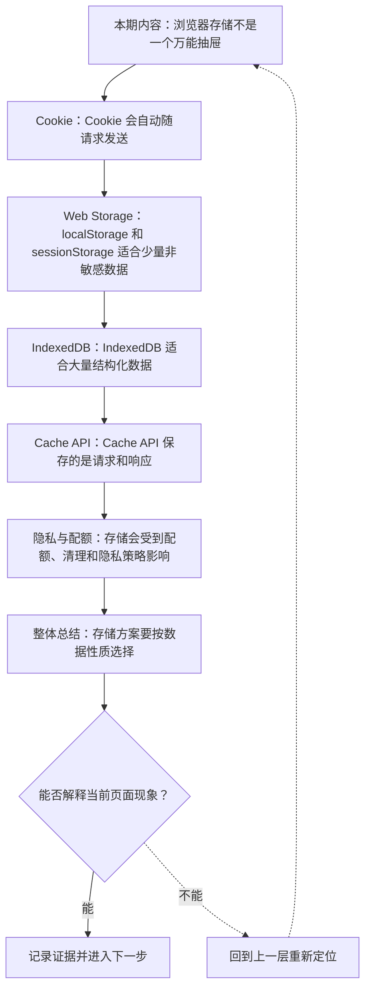

# 浏览器存储：Cookie、localStorage、IndexedDB 与 Cache

&gt; 视频入口：B站合集《前端全链路：从浏览器基础到现代生态》上传并核验后回填正式链接。
&gt; 本文是 EP16 的博客深讲版，包含视频主线，但比视频补充更多机制、流程图、边界判断和排查清单。

## 这篇文章解决什么问题

这期解释浏览器里几种常见存储各自适合放什么，以及安全、容量和隐私边界在哪里。

这一篇的中心问题可以概括成：浏览器不同存储 API 的适用场景、安全边界和生命周期有什么差异？

关键词：Cookie、localStorage、IndexedDB、Cache API、HttpOnly、SameSite、Secure、sessionStorage、sync、object store

## 视频主线回顾

### 1. Cookie 会随请求发送

Cookie 适合会话识别，但要配置 HttpOnly、Secure、SameSite 等属性。

### 2. Web Storage 简单但有限

localStorage 和 sessionStorage 适合少量非敏感数据，且是同步 API。

### 3. IndexedDB 处理大量结构化数据

离线文档、草稿和复杂列表更适合异步对象数据库。

### 4. Cache API 缓存请求响应

它更像网络资源缓存，常和 Service Worker 配合。

## 技术流程图

先用一张图把本期内容串起来。它不是背诵路线，而是排查问题时可以顺着走的证据路线。

## 深入展开

### 1. 浏览器存储不是一个万能抽屉

这一期看浏览器存储。我们会比较 Cookie、localStorage、sessionStorage、IndexedDB 和 Cache API：它们分别适合什么数据，容量和同步异步有什么差异，安全属性怎样影响登录态，隐私和清理策略为什么会改变持久性。存储选错了，轻则体验混乱，重则带来安全风险。

这里可以多看一层：先找输入，再看处理过程，最后确认输出。前端很多问题之所以绕，是因为现象出现在页面上，原因却可能藏在网络、样式计算、运行时或构建结果里。

| 维度 | 含义 |
| --- | --- |
| 小而敏感 | 登录态通常交给 Cookie 和服务端策略。 |
| 大而结构化 | 离线数据和索引更适合 IndexedDB。 |

排查时可以顺着这条线问：当前现象是输入不对、处理过程不对，还是最终结果不对。只要能把问题归到其中一格，后面的工具选择就会轻很多。

### 2. Cookie 会自动随请求发送

Cookie 的特点是会按域名和路径自动随请求发送，所以常用于会话识别。Set-Cookie 可以配置 Expires、Max-Age、Secure、HttpOnly、SameSite 等属性。HttpOnly 能让 JavaScript 读不到 Cookie，降低 XSS 窃取风险；SameSite 能帮助限制跨站请求场景。登录态不要随手放进 localStorage，Cookie 属性往往更合适。

把这段机制放到工程里看，最实用的切口是证据。不要急着猜是哪一行代码错了，先确认浏览器或工具实际拿到了什么、计算了什么、丢出了什么结果。

| 维度 | 含义 |
| --- | --- |
| 自动发送 | 请求会带上匹配 Cookie。 |
| HttpOnly | 阻止 JS 直接读取。 |
| SameSite | 限制跨站发送场景。 |

排查时可以顺着这条线问：当前现象是输入不对、处理过程不对，还是最终结果不对。只要能把问题归到其中一格，后面的工具选择就会轻很多。

### 3. localStorage 和 sessionStorage 适合少量非敏感数据

localStorage 会在同源下持久保存，sessionStorage 通常跟随标签页会话。它们 API 简单，适合主题偏好、草稿标记、引导状态这类少量非敏感数据。但它们是同步 API，读写大数据会阻塞主线程；同时 JavaScript 能直接读取，不适合保存访问令牌这类敏感信息。

这个点在真实项目里常常不是孤立问题。它会和状态、缓存、布局、依赖或团队约束连在一起，所以博客版更强调边界：什么归它管，什么应该交给下一层机制判断。

| 维度 | 含义 |
| --- | --- |
| localStorage | 同源持久保存，关闭页面后仍在。 |
| sessionStorage | 跟随当前标签页会话。 |

排查时可以顺着这条线问：当前现象是输入不对、处理过程不对，还是最终结果不对。只要能把问题归到其中一格，后面的工具选择就会轻很多。

### 4. IndexedDB 适合大量结构化数据

IndexedDB 是浏览器内置的异步对象数据库，适合保存大量结构化数据，比如离线文档、消息草稿、复杂列表和本地索引。它的 API 比 localStorage 复杂，但不会用同步读写阻塞主线程，也能按对象仓库和索引组织数据。做真正的离线能力时，IndexedDB 往往绕不开。

如果要把它讲给别人听，可以按“现象—证据—机制—边界”的顺序。先让对方看到问题，再解释浏览器或工具为什么会给出这样的结果。

| 维度 | 含义 |
| --- | --- |
| object store | 按仓库存储对象。 |
| index | 按字段查询数据。 |
| async | 不阻塞主线程。 |

排查时可以顺着这条线问：当前现象是输入不对、处理过程不对，还是最终结果不对。只要能把问题归到其中一格，后面的工具选择就会轻很多。

### 5. Cache API 保存的是请求和响应

Cache API 常和 Service Worker 一起使用，用来保存 Request 和 Response。它适合缓存静态资源、接口响应和离线页面，让应用在网络不稳定时仍能加载。它不是替代 IndexedDB 的业务数据库；如果要按字段搜索和编辑业务对象，还是应该考虑 IndexedDB。

这里可以多看一层：先找输入，再看处理过程，最后确认输出。前端很多问题之所以绕，是因为现象出现在页面上，原因却可能藏在网络、样式计算、运行时或构建结果里。

排查时可以顺着这条线问：当前现象是输入不对、处理过程不对，还是最终结果不对。只要能把问题归到其中一格，后面的工具选择就会轻很多。

### 6. 存储会受到配额、清理和隐私策略影响

浏览器会限制每个来源的存储配额，也可能在空间压力、隐私模式、跟踪防护或用户清理数据时删除本地存储。第三方 Cookie 和跨站存储也受到越来越严格的限制。前端不能把浏览器本地存储当成唯一真相，重要数据要能和服务端同步或恢复。

把这段机制放到工程里看，最实用的切口是证据。不要急着猜是哪一行代码错了，先确认浏览器或工具实际拿到了什么、计算了什么、丢出了什么结果。

| 维度 | 含义 |
| --- | --- |
| quota | 每个来源有容量限制。 |
| cleanup | 用户或浏览器可能清理。 |
| privacy | 第三方和跨站更受限制。 |

排查时可以顺着这条线问：当前现象是输入不对、处理过程不对，还是最终结果不对。只要能把问题归到其中一格，后面的工具选择就会轻很多。

## 常见误区与边界

- 不要把访问令牌随手放 localStorage。
- 不要把本地存储当永久可靠来源。
- 不要用 Cache API 替代业务数据库。
- 这一篇不展开：Service Worker 完整离线架构。
- 这一篇不展开：浏览器厂商隐私策略逐项比较。
- 这一篇不展开：数据库索引优化细节。

## 排查和验证清单

- 先确认问题发生在哪一层：页面结构、样式计算、JavaScript 运行、网络请求、构建产物还是线上交付。
- 用浏览器或工具拿到证据，不只凭肉眼判断。能截图、能看到日志、能看到请求和产物，结论才稳。
- 把最小例子缩到只剩一个变量。变量越少，越容易看清机制。
- 记录输入、处理过程和输出。前端问题往往不是“某个 API 错了”，而是链路中某一步的假设不成立。
- 如果准备把结论放到项目里，再补一层测试、类型检查、可访问性或性能验证。

## 动手练习

1. 用一个最小 HTML 页面复现 浏览器存储 里的核心现象。
2. 打开 DevTools，分别记录结构、样式、控制台、网络或性能面板里的一个证据点。
3. 改一个变量，再观察结果是否符合这篇文章里的流程图；如果不符合，把差异写下来。

## 参考来源与本系列依据

- 标准：HTML Web Storage / IndexedDB / Fetch Cache：API 基线
- 浏览器文档：MDN Cookies / Storage / IndexedDB / Cache：开发者解释
- 安全资料：OWASP Session Management：会话存储风险语境

## 总结

浏览器存储要按数据性质选择：会话、偏好、结构化数据和资源缓存不是同一类问题。

博客版到这里就把视频主线扩成了可复习的技术笔记：先知道它在链路里的位置，再知道它怎么运行，最后知道遇到问题该从哪里查。
