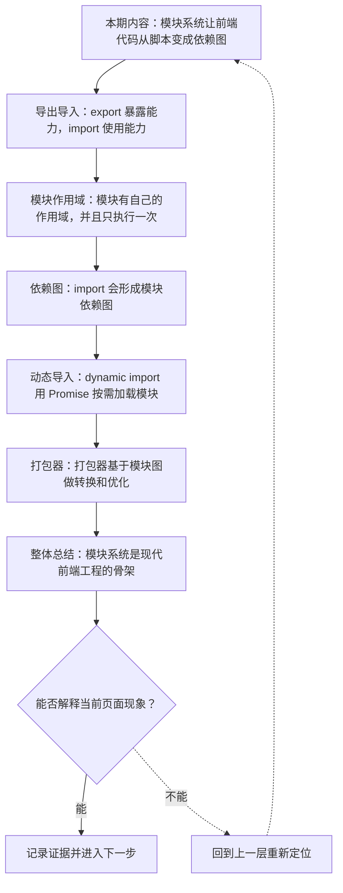
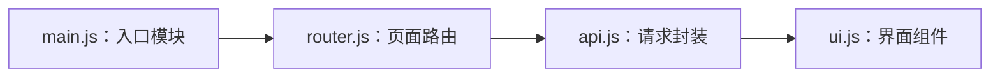

# JavaScript 模块系统：import、export、依赖图与加载策略

&gt; 视频入口：B站合集《前端全链路：从浏览器基础到现代生态》上传并核验后回填正式链接。
&gt; 本文是 EP17 的博客深讲版，包含视频主线，但比视频补充更多机制、流程图、边界判断和排查清单。


## 这篇文章解决什么问题

这期解释 JavaScript 模块怎样拆分代码、建立依赖图，并影响浏览器加载和工程化打包。

这一篇的中心问题可以概括成：JavaScript 模块系统怎样形成依赖图，并支撑浏览器加载和工程化优化？

关键词：ESM、import、export、dependency graph、default、module scope、singleton、side effect、entry、bundle

## 视频主线回顾

### 1. import/export 是模块接口

模块通过显式导入导出连接，减少全局变量和隐式依赖。

### 2. 模块有自己的作用域

顶层变量默认私有，同一模块通常只初始化一次。

### 3. 依赖图支撑加载和构建

浏览器和打包器都从入口出发分析模块图。

### 4. dynamic import 支持按需加载

`import()` 返回 Promise，适合把非首屏大模块拆出去。

## 技术流程图

先用一张图把本期内容串起来。它不是背诵路线，而是排查问题时可以顺着走的证据路线。




## 深入展开

### 1. 模块系统让前端代码从脚本变成依赖图

这一期看 JavaScript 模块系统。我们会讲 ESM 的 import 和 export，模块作用域和只执行一次，浏览器怎样按依赖图加载模块，dynamic import 怎样做按需加载，打包工具为什么要分析依赖图，以及 tree shaking 为什么依赖静态结构。理解模块，是进入 TypeScript、Vite 和框架工程化之前的关键一步。

这里可以多看一层：先找输入，再看处理过程，最后确认输出。前端很多问题之所以绕，是因为现象出现在页面上，原因却可能藏在网络、样式计算、运行时或构建结果里。


排查时可以顺着这条线问：当前现象是输入不对、处理过程不对，还是最终结果不对。只要能把问题归到其中一格，后面的工具选择就会轻很多。

### 2. export 暴露能力，import 使用能力

ESM 用 export 暴露变量、函数或类，用 import 从另一个模块导入。命名导出适合多个明确能力，默认导出适合一个主要能力。模块接口越清楚，文件之间的依赖就越容易维护。不要让模块偷偷依赖全局变量，现代工程更鼓励显式 import。

把这段机制放到工程里看，最实用的切口是证据。不要急着猜是哪一行代码错了，先确认浏览器或工具实际拿到了什么、计算了什么、丢出了什么结果。

```js
// price.js
export function formatPrice(value) {
  return "¥" + value.toFixed(2);
}

// app.js
import { formatPrice } from "./price.js";
```

- export 暴露函数。
- import 建立依赖。
- 路径和名称都清楚。

排查时可以顺着这条线问：当前现象是输入不对、处理过程不对，还是最终结果不对。只要能把问题归到其中一格，后面的工具选择就会轻很多。

### 3. 模块有自己的作用域，并且只执行一次

ESM 模块有自己的作用域。文件顶层的变量默认只在模块内可见，不会像传统 script 那样挂到全局对象上。同一个模块被多个地方 import 时，模块代码通常只执行一次，导入方共享同一份模块实例。这解释了为什么模块可以保存内部状态，也提醒我们不要随意在模块顶层放会造成隐式副作用的逻辑。

这个点在真实项目里常常不是孤立问题。它会和状态、缓存、布局、依赖或团队约束连在一起，所以博客版更强调边界：什么归它管，什么应该交给下一层机制判断。

| 维度 | 含义 |
| --- | --- |
| private | 顶层变量默认模块内私有。 |
| once | 模块通常只初始化一次。 |
| side effect | 顶层副作用要谨慎。 |

排查时可以顺着这条线问：当前现象是输入不对、处理过程不对，还是最终结果不对。只要能把问题归到其中一格，后面的工具选择就会轻很多。

### 4. import 会形成模块依赖图

一个入口模块 import 其他模块，其他模块再 import 更多模块，就形成依赖图。浏览器原生加载 ESM 时，会解析这张图并按依赖顺序执行。打包器也从入口出发，分析依赖图，把代码转换、合并或拆分。现代前端构建的很多能力，本质上都来自这张图。

如果要把它讲给别人听，可以按“现象—证据—机制—边界”的顺序。先让对方看到问题，再解释浏览器或工具为什么会给出这样的结果。



排查时可以顺着这条线问：当前现象是输入不对、处理过程不对，还是最终结果不对。只要能把问题归到其中一格，后面的工具选择就会轻很多。

### 5. dynamic import 用 Promise 按需加载模块

import() 是动态导入，会返回 Promise。它适合路由切换、弹层编辑器、图表库这类不一定马上用到的代码。打包工具通常会把动态导入拆成单独 chunk，等需要时再加载。按需加载能改善首屏体积，但也要处理加载中、失败和预加载策略。

这里可以多看一层：先找输入，再看处理过程，最后确认输出。前端很多问题之所以绕，是因为现象出现在页面上，原因却可能藏在网络、样式计算、运行时或构建结果里。

```js
button.addEventListener("click", async () => {
  const { openEditor } = await import("./editor.js");
  openEditor();
});
```

- 点击后再加载模块。
- 返回 Promise。
- 适合大而非首屏代码。

排查时可以顺着这条线问：当前现象是输入不对、处理过程不对，还是最终结果不对。只要能把问题归到其中一格，后面的工具选择就会轻很多。

### 6. 打包器基于模块图做转换和优化

打包器会读取模块图，处理 TypeScript、CSS、图片等资源，再输出浏览器能高效加载的文件。tree shaking 依赖 ESM 的静态 import/export，尝试移除没有被使用的导出。代码分割、路径别名、开发服务器热更新，也都建立在模块图和转换流水线上。下一阶段讲 Vite 时会继续展开。

把这段机制放到工程里看，最实用的切口是证据。不要急着猜是哪一行代码错了，先确认浏览器或工具实际拿到了什么、计算了什么、丢出了什么结果。

| 维度 | 含义 |
| --- | --- |
| transform | 转换 TS、CSS 和资源。 |
| bundle | 合并或拆分输出文件。 |
| tree shaking | 移除未使用导出。 |

排查时可以顺着这条线问：当前现象是输入不对、处理过程不对，还是最终结果不对。只要能把问题归到其中一格，后面的工具选择就会轻很多。

## 常见误区与边界

- 不要把模块当成简单文件拼接。
- 不要忽略顶层副作用对 tree shaking 的影响。
- 不要把动态导入滥用于所有代码，加载体验也要设计。
- 这一篇不展开：完整 bundler 插件机制，留到 Vite 单集。
- 这一篇不展开：CommonJS 与 ESM 互操作深坑。
- 这一篇不展开：微前端模块联邦等高级方案。

## 排查和验证清单

- 先确认问题发生在哪一层：页面结构、样式计算、JavaScript 运行、网络请求、构建产物还是线上交付。
- 用浏览器或工具拿到证据，不只凭肉眼判断。能截图、能看到日志、能看到请求和产物，结论才稳。
- 把最小例子缩到只剩一个变量。变量越少，越容易看清机制。
- 记录输入、处理过程和输出。前端问题往往不是“某个 API 错了”，而是链路中某一步的假设不成立。
- 如果准备把结论放到项目里，再补一层测试、类型检查、可访问性或性能验证。

## 动手练习

1. 用一个最小 HTML 页面复现 JavaScript 模块系统 里的核心现象。
2. 打开 DevTools，分别记录结构、样式、控制台、网络或性能面板里的一个证据点。
3. 改一个变量，再观察结果是否符合这篇文章里的流程图；如果不符合，把差异写下来。

## 参考来源与本系列依据

- 规范：ECMAScript Modules：ESM 语义基线
- 浏览器文档：MDN JavaScript modules：开发者解释
- 工具文档：Vite / Rollup module graph：工程化语境

## 总结

JavaScript 模块把项目从脚本集合变成可分析的依赖图。现代前端工程化、打包和优化都建立在这个骨架上。

博客版到这里就把视频主线扩成了可复习的技术笔记：先知道它在链路里的位置，再知道它怎么运行，最后知道遇到问题该从哪里查。
