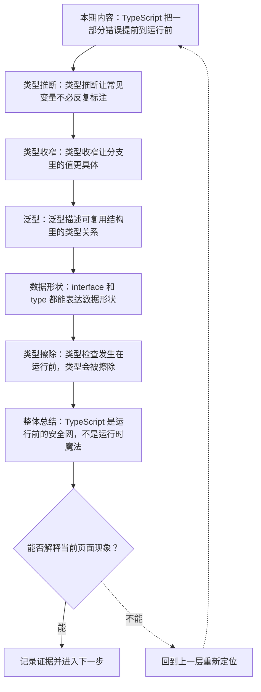
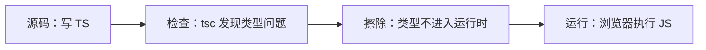

# TypeScript 静态类型系统：推断、收窄、泛型与类型擦除

&gt; 视频入口：B站合集《前端全链路：从浏览器基础到现代生态》上传并核验后回填正式链接。
&gt; 本文是 EP18 的博客深讲版，包含视频主线，但比视频补充更多机制、流程图、边界判断和排查清单。


## 这篇文章解决什么问题

这期解释 TypeScript 怎样在运行前检查代码，以及它和 JavaScript 运行时的边界。

这一篇的中心问题可以概括成：TypeScript 如何在不改变 JavaScript 运行时的前提下提供静态安全？

关键词：TypeScript、type inference、narrowing、type erasure、string、return、union、typeof、generic、T

## 视频主线回顾

### 1. TypeScript 的位置

TypeScript 在运行前检查代码，编译后输出 JavaScript。

### 2. 推断、收窄和泛型

推断减少重复，收窄跟随分支，泛型保留输入输出关系。

### 3. 数据形状与边界

interface、type 和联合类型帮助表达接口、表单和组件参数。

### 4. 类型擦除

类型不进入运行时，外部输入仍需要运行时校验。

## 技术流程图

先用一张图把本期内容串起来。它不是背诵路线，而是排查问题时可以顺着走的证据路线。




## 深入展开

### 1. TypeScript 把一部分错误提前到运行前

这一期进入 TypeScript。我们会看类型推断怎样减少标注，类型收窄怎样让分支里的代码更安全，泛型怎样描述可复用结构，接口和类型别名怎样表达数据形状，以及类型擦除为什么说明 TypeScript 最终仍然变成 JavaScript 运行。理解这条边界，后面看工程化诊断和框架类型才不会迷糊。

这里可以多看一层：先找输入，再看处理过程，最后确认输出。前端很多问题之所以绕，是因为现象出现在页面上，原因却可能藏在网络、样式计算、运行时或构建结果里。



排查时可以顺着这条线问：当前现象是输入不对、处理过程不对，还是最终结果不对。只要能把问题归到其中一格，后面的工具选择就会轻很多。

### 2. 类型推断让常见变量不必反复标注

TypeScript 不要求每个地方都写类型。给变量赋一个字符串，它会推断出 string；函数返回数字，它也能推断返回值。好的类型标注通常放在边界上，比如函数参数、接口数据、外部 API 返回值。内部局部变量可以更多依赖推断，让代码保持清爽。

把这段机制放到工程里看，最实用的切口是证据。不要急着猜是哪一行代码错了，先确认浏览器或工具实际拿到了什么、计算了什么、丢出了什么结果。

```js
const userName = "Ada";

function add(a: number, b: number) {
  return a + b;
}
```

- 变量类型可由初始值推断。
- 参数边界适合明确标注。
- 返回值可从表达式推断。

排查时可以顺着这条线问：当前现象是输入不对、处理过程不对，还是最终结果不对。只要能把问题归到其中一格，后面的工具选择就会轻很多。

### 3. 类型收窄让分支里的值更具体

当一个值可能是 string 或 number，直接调用字符串方法会有风险。用 typeof、in、判空或自定义守卫判断之后，TypeScript 会在分支里把类型收窄到更具体的范围。类型收窄的意义，是让代码里的运行时判断和编辑器里的静态信息对齐。

这个点在真实项目里常常不是孤立问题。它会和状态、缓存、布局、依赖或团队约束连在一起，所以博客版更强调边界：什么归它管，什么应该交给下一层机制判断。

```js
function print(value: string | number) {
  if (typeof value === "string") {
    console.log(value.toUpperCase());
  }
}
```

- 进入 if 后 value 是 string。
- 静态检查跟随运行时判断。

排查时可以顺着这条线问：当前现象是输入不对、处理过程不对，还是最终结果不对。只要能把问题归到其中一格，后面的工具选择就会轻很多。

### 4. 泛型描述可复用结构里的类型关系

数组、Promise、请求函数、组件 props，经常需要表达“传进来什么类型，返回也是什么类型”。泛型用一个类型参数保存这种关系。比如 identity&lt;T&gt; 接收 T，返回 T；fetchJson&lt;T&gt; 表示请求结果应该符合某个结构。泛型用得好，公共函数就既灵活又安全。

如果要把它讲给别人听，可以按“现象—证据—机制—边界”的顺序。先让对方看到问题，再解释浏览器或工具为什么会给出这样的结果。

```js
function identity<T>(value: T): T {
  return value;
}

const n = identity(42);
```

- T 由调用位置决定。
- 输入和输出保持同一类型。

排查时可以顺着这条线问：当前现象是输入不对、处理过程不对，还是最终结果不对。只要能把问题归到其中一格，后面的工具选择就会轻很多。

### 5. interface 和 type 都能表达数据形状

前端经常处理接口返回、表单数据和组件参数。interface 和 type 都能描述对象形状。很多团队用 interface 表示可扩展对象，用 type 表示联合类型、工具类型和组合类型。关键不是争哪个更高级，而是让数据边界清楚：哪些字段必填，哪些可选，哪些值只能取固定集合。

这里可以多看一层：先找输入，再看处理过程，最后确认输出。前端很多问题之所以绕，是因为现象出现在页面上，原因却可能藏在网络、样式计算、运行时或构建结果里。

| 维度 | 含义 |
| --- | --- |
| required | 必须出现的字段。 |
| optional | 可能不存在的字段。 |
| union | 限定状态取值。 |

排查时可以顺着这条线问：当前现象是输入不对、处理过程不对，还是最终结果不对。只要能把问题归到其中一格，后面的工具选择就会轻很多。

### 6. 类型检查发生在运行前，类型会被擦除

TypeScript 编译后会移除类型标注，输出 JavaScript。也就是说，类型系统能帮你在运行前发现很多错误，但它不会自动验证线上接口真的返回了正确数据。外部输入、用户输入和网络响应，仍然需要运行时校验。把静态类型和运行时校验分清，是写可靠前端的基本功。

把这段机制放到工程里看，最实用的切口是证据。不要急着猜是哪一行代码错了，先确认浏览器或工具实际拿到了什么、计算了什么、丢出了什么结果。


排查时可以顺着这条线问：当前现象是输入不对、处理过程不对，还是最终结果不对。只要能把问题归到其中一格，后面的工具选择就会轻很多。

## 常见误区与边界

- 不要把 TypeScript 讲成浏览器新运行时。
- 不要暗示类型能自动校验外部数据。
- 这一篇不展开：高级类型体操。
- 这一篇不展开：完整 tsconfig 选项。
- 这一篇不展开：框架类型系统深水区。

## 排查和验证清单

- 先确认问题发生在哪一层：页面结构、样式计算、JavaScript 运行、网络请求、构建产物还是线上交付。
- 用浏览器或工具拿到证据，不只凭肉眼判断。能截图、能看到日志、能看到请求和产物，结论才稳。
- 把最小例子缩到只剩一个变量。变量越少，越容易看清机制。
- 记录输入、处理过程和输出。前端问题往往不是“某个 API 错了”，而是链路中某一步的假设不成立。
- 如果准备把结论放到项目里，再补一层测试、类型检查、可访问性或性能验证。

## 动手练习

1. 用一个最小 HTML 页面复现 TypeScript 静态类型系统 里的核心现象。
2. 打开 DevTools，分别记录结构、样式、控制台、网络或性能面板里的一个证据点。
3. 改一个变量，再观察结果是否符合这篇文章里的流程图；如果不符合，把差异写下来。

## 参考来源与本系列依据

- 官方文档：TypeScript Handbook：类型系统解释
- 工具：tsc：诊断和编译产物
- 运行时：JavaScript：最终执行环境

## 总结

TypeScript 是前端工程里的静态安全网。它提升代码可维护性，但不能替代运行时校验。

博客版到这里就把视频主线扩成了可复习的技术笔记：先知道它在链路里的位置，再知道它怎么运行，最后知道遇到问题该从哪里查。
