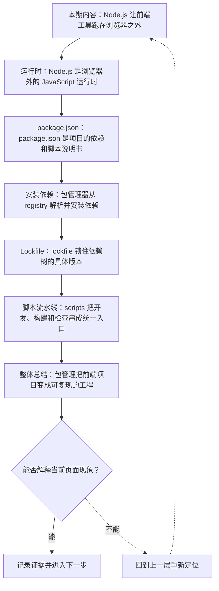
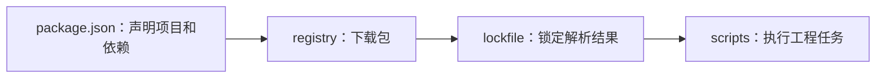
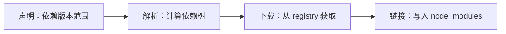
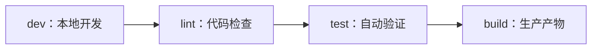

# Node.js 与包管理：npm、pnpm、依赖树和 Lockfile

&gt; 视频入口：B站合集《前端全链路：从浏览器基础到现代生态》上传并核验后回填正式链接。
&gt; 本文是 EP19 的博客深讲版，包含视频主线，但比视频补充更多机制、流程图、边界判断和排查清单。


## 这篇文章解决什么问题

这期解释前端项目为什么离不开 Node.js 和包管理，以及 lockfile 怎样保证依赖可复现。

这一篇的中心问题可以概括成：前端项目为什么需要 Node.js、包管理器和 lockfile？

关键词：Node.js、package.json、lockfile、pnpm、runtime、DOM、filesystem、dependencies、devDependencies、scripts

## 视频主线回顾

### 1. Node.js 的角色

Node.js 让前端工具可以在本地和 CI 中运行。

### 2. package.json

它记录依赖、脚本和项目约定。

### 3. 依赖树与安装

包管理器从 registry 解析并安装一整棵依赖树。

### 4. lockfile

锁文件让安装结果更可复现。

## 技术流程图

先用一张图把本期内容串起来。它不是背诵路线，而是排查问题时可以顺着走的证据路线。




## 深入展开

### 1. Node.js 让前端工具跑在浏览器之外

这一期看 Node.js 与包管理。我们会讲 Node.js 在前端工程里的位置，package.json 记录什么，npm 和 pnpm 怎样从 registry 安装依赖，依赖树和 node_modules 为什么会复杂，lockfile 如何锁住版本，以及脚本命令怎样把开发、构建、检查和测试串起来。

这里可以多看一层：先找输入，再看处理过程，最后确认输出。前端很多问题之所以绕，是因为现象出现在页面上，原因却可能藏在网络、样式计算、运行时或构建结果里。



排查时可以顺着这条线问：当前现象是输入不对、处理过程不对，还是最终结果不对。只要能把问题归到其中一格，后面的工具选择就会轻很多。

### 2. Node.js 是浏览器外的 JavaScript 运行时

浏览器负责运行页面里的 JavaScript，Node.js 则让 JavaScript 可以在本地终端、构建服务器和后端环境里运行。前端工程里的 Vite、ESLint、测试工具、脚本生成器，大多依赖 Node.js。它不等于浏览器：没有 DOM，但有文件系统、进程和网络等能力。

把这段机制放到工程里看，最实用的切口是证据。不要急着猜是哪一行代码错了，先确认浏览器或工具实际拿到了什么、计算了什么、丢出了什么结果。

| 维度 | 含义 |
| --- | --- |
| Browser | DOM、渲染、用户交互。 |
| Node.js | 文件、进程、工具脚本。 |
| CI | 自动安装、检查和构建。 |

排查时可以顺着这条线问：当前现象是输入不对、处理过程不对，还是最终结果不对。只要能把问题归到其中一格，后面的工具选择就会轻很多。

### 3. package.json 是项目的依赖和脚本说明书

package.json 里常见的 dependencies 是运行需要的依赖，devDependencies 是开发和构建需要的依赖。scripts 则把命令变成统一入口，比如 dev、build、lint、test。团队协作时，大家不是靠口头记命令，而是通过 package.json 共享项目约定。

这个点在真实项目里常常不是孤立问题。它会和状态、缓存、布局、依赖或团队约束连在一起，所以博客版更强调边界：什么归它管，什么应该交给下一层机制判断。

```js
"scripts": {
  "dev": "vite",
  "build": "vite build",
  "test": "vitest"
}
```

- 命令被固定在项目里。
- CI 和本地使用同一入口。

排查时可以顺着这条线问：当前现象是输入不对、处理过程不对，还是最终结果不对。只要能把问题归到其中一格，后面的工具选择就会轻很多。

### 4. 包管理器从 registry 解析并安装依赖

当执行 npm install 或 pnpm install，包管理器会根据版本范围到 registry 查找包，再递归解析每个包自己的依赖。一个小工具可能间接带来很多子依赖。pnpm 的存储和链接策略与 npm 不同，但核心问题一样：让项目拿到正确版本的依赖，并能在多人和 CI 环境里复现。

如果要把它讲给别人听，可以按“现象—证据—机制—边界”的顺序。先让对方看到问题，再解释浏览器或工具为什么会给出这样的结果。



排查时可以顺着这条线问：当前现象是输入不对、处理过程不对，还是最终结果不对。只要能把问题归到其中一格，后面的工具选择就会轻很多。

### 5. lockfile 锁住依赖树的具体版本

版本范围像 ^1.2.0 允许安装兼容的新版本。lockfile 会记录这次解析出来的具体版本、下载地址和完整依赖关系。团队提交 lockfile，CI 再按锁文件安装，就能降低“我这里能跑，你那里不能跑”的概率。更新依赖时，也应该审查 lockfile 变化。

这里可以多看一层：先找输入，再看处理过程，最后确认输出。前端很多问题之所以绕，是因为现象出现在页面上，原因却可能藏在网络、样式计算、运行时或构建结果里。

| 维度 | 含义 |
| --- | --- |
| 版本范围 | ^1.2.0 表示允许兼容更新。 |
| 锁定结果 | lockfile 记录具体版本。 |
| 可复现 | CI 按锁文件安装。 |

排查时可以顺着这条线问：当前现象是输入不对、处理过程不对，还是最终结果不对。只要能把问题归到其中一格，后面的工具选择就会轻很多。

### 6. scripts 把开发、构建和检查串成统一入口

一个前端项目通常会有 dev 启动开发服务器，build 生成生产产物，lint 检查代码风格和问题，test 跑自动化测试。脚本把这些工具藏在统一命令后面，降低团队使用成本。后面讲 Vite 和代码质量工具链时，我们会继续沿着这些入口往下看。

把这段机制放到工程里看，最实用的切口是证据。不要急着猜是哪一行代码错了，先确认浏览器或工具实际拿到了什么、计算了什么、丢出了什么结果。



排查时可以顺着这条线问：当前现象是输入不对、处理过程不对，还是最终结果不对。只要能把问题归到其中一格，后面的工具选择就会轻很多。

## 常见误区与边界

- 不要把 Node.js 与浏览器 API 混为一谈。
- 不要忽略 lockfile 的协作价值。
- 这一篇不展开：Node.js 后端开发。
- 这一篇不展开：包管理器源码实现。
- 这一篇不展开：私有 registry 运维。

## 排查和验证清单

- 先确认问题发生在哪一层：页面结构、样式计算、JavaScript 运行、网络请求、构建产物还是线上交付。
- 用浏览器或工具拿到证据，不只凭肉眼判断。能截图、能看到日志、能看到请求和产物，结论才稳。
- 把最小例子缩到只剩一个变量。变量越少，越容易看清机制。
- 记录输入、处理过程和输出。前端问题往往不是“某个 API 错了”，而是链路中某一步的假设不成立。
- 如果准备把结论放到项目里，再补一层测试、类型检查、可访问性或性能验证。

## 动手练习

1. 用一个最小 HTML 页面复现 Node.js 与包管理 里的核心现象。
2. 打开 DevTools，分别记录结构、样式、控制台、网络或性能面板里的一个证据点。
3. 改一个变量，再观察结果是否符合这篇文章里的流程图；如果不符合，把差异写下来。

## 参考来源与本系列依据

- 官方文档：Node.js Docs：运行时定位
- 工具文档：npm / pnpm Docs：包管理行为
- 工程实践：lockfile / CI：可复现安装

## 总结

Node.js 和包管理器是前端工程的依赖入口。理解 package.json、依赖树和 lockfile，才能稳定协作和构建。

博客版到这里就把视频主线扩成了可复习的技术笔记：先知道它在链路里的位置，再知道它怎么运行，最后知道遇到问题该从哪里查。
