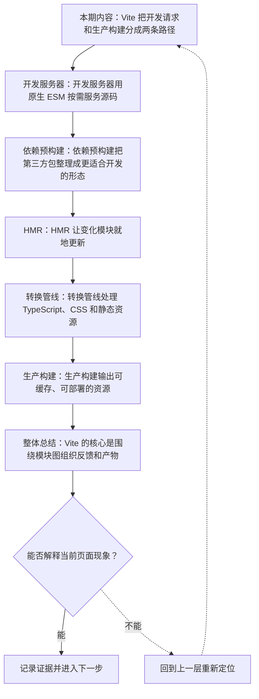
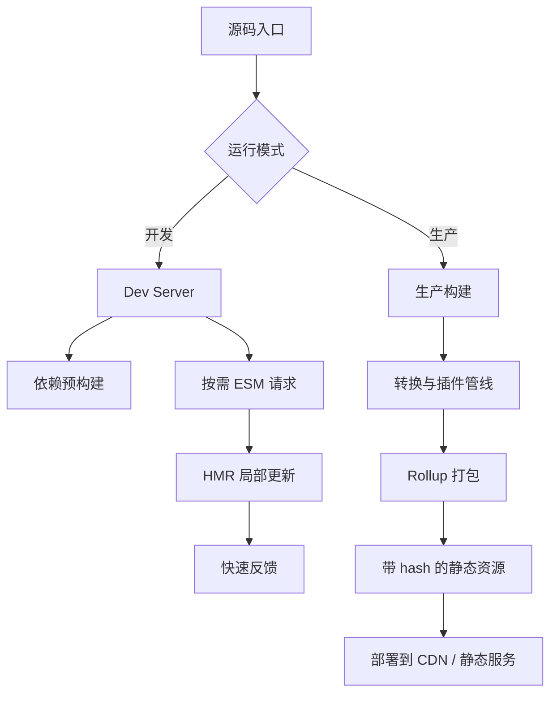
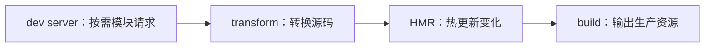

# Vite 构建流水线：原生 ESM、HMR、转换与打包

&gt; 视频入口：B站合集《前端全链路：从浏览器基础到现代生态》上传并核验后回填正式链接。
&gt; 本文是 EP20 的博客深讲版，包含视频主线，但比视频补充更多机制、流程图、边界判断和排查清单。

## 这篇文章解决什么问题

这期解释 Vite 开发时为什么快，以及生产构建怎样从模块图输出可部署资源。

这一篇的中心问题可以概括成：Vite 如何用模块图同时服务开发反馈和生产构建？

关键词：Vite、ESM、HMR、bundle、dev server、native ESM、import、pre-bundle、dependency、module

## 视频主线回顾

### 1. 开发服务器

Vite 开发期利用浏览器原生 ESM 按需处理模块。

### 2. 依赖预构建和 HMR

预构建减少第三方依赖压力，HMR 缩短反馈路径。

### 3. 转换管线

TypeScript、CSS 和静态资源都会经过转换。

### 4. 生产构建

上线产物需要打包、压缩、分包和 hash。

## 技术流程图

先用一张图把本期内容串起来。它不是背诵路线，而是排查问题时可以顺着走的证据路线。

## Vite 开发与生产两条路径

这张图把本期最关键的结构单独拎出来，适合在复习或做笔记时当作索引。

## 深入展开

### 1. Vite 把开发请求和生产构建分成两条路径

这一期看 Vite 构建流水线。我们会讲原生 ESM 开发服务器怎样按需返回模块，依赖预构建为什么能加速启动，HMR 如何只更新变化模块，转换管线怎样处理 TypeScript、CSS 和资源，以及生产构建为什么还要打包、压缩和代码分割。

这里可以多看一层：先找输入，再看处理过程，最后确认输出。前端很多问题之所以绕，是因为现象出现在页面上，原因却可能藏在网络、样式计算、运行时或构建结果里。

排查时可以顺着这条线问：当前现象是输入不对、处理过程不对，还是最终结果不对。只要能把问题归到其中一格，后面的工具选择就会轻很多。

### 2. 开发服务器用原生 ESM 按需服务源码

传统开发模式常常先把项目打成一个大包，再启动页面。Vite 的开发服务器更多利用浏览器原生 ESM：入口加载后，浏览器沿着 import 发起模块请求，服务器按需转换并返回。项目越大，按需模型越能减少首次启动压力。

把这段机制放到工程里看，最实用的切口是证据。不要急着猜是哪一行代码错了，先确认浏览器或工具实际拿到了什么、计算了什么、丢出了什么结果。

排查时可以顺着这条线问：当前现象是输入不对、处理过程不对，还是最终结果不对。只要能把问题归到其中一格，后面的工具选择就会轻很多。

### 3. 依赖预构建把第三方包整理成更适合开发的形态

很多第三方包体积大、文件多，格式也不完全统一。Vite 会在开发前对依赖做预构建，把常见依赖转换成浏览器更容易加载的 ESM，并减少大量零散请求。这样页面启动和后续更新都更稳定。

这个点在真实项目里常常不是孤立问题。它会和状态、缓存、布局、依赖或团队约束连在一起，所以博客版更强调边界：什么归它管，什么应该交给下一层机制判断。

| 维度 | 含义 |
| --- | --- |
| 格式统一 | 转换成开发期 ESM。 |
| 减少请求 | 整理第三方依赖。 |
| 缓存复用 | 依赖不常变化。 |

排查时可以顺着这条线问：当前现象是输入不对、处理过程不对，还是最终结果不对。只要能把问题归到其中一格，后面的工具选择就会轻很多。

### 4. HMR 让变化模块就地更新

HMR 是 Hot Module Replacement。开发时文件变化后，Vite 会定位受影响模块，把更新消息推给浏览器。框架插件接到更新后，可以尽量保留页面状态，只替换组件或样式。HMR 的价值不是炫技，而是缩短修改到反馈的时间。

如果要把它讲给别人听，可以按“现象—证据—机制—边界”的顺序。先让对方看到问题，再解释浏览器或工具为什么会给出这样的结果。

排查时可以顺着这条线问：当前现象是输入不对、处理过程不对，还是最终结果不对。只要能把问题归到其中一格，后面的工具选择就会轻很多。

### 5. 转换管线处理 TypeScript、CSS 和静态资源

Vite 在开发和构建中都会经过转换管线。TypeScript 要去掉类型，现代 JavaScript 可能要转换兼容性，CSS 可能经过预处理或模块化，图片和字体会变成可引用资源。插件系统让这些转换在统一流水线里协作。

这里可以多看一层：先找输入，再看处理过程，最后确认输出。前端很多问题之所以绕，是因为现象出现在页面上，原因却可能藏在网络、样式计算、运行时或构建结果里。

| 维度 | 含义 |
| --- | --- |
| TS | 去掉类型或转语法。 |
| CSS | 预处理和模块化。 |
| assets | 图片字体生成 URL。 |

排查时可以顺着这条线问：当前现象是输入不对、处理过程不对，还是最终结果不对。只要能把问题归到其中一格，后面的工具选择就会轻很多。

### 6. 生产构建输出可缓存、可部署的资源

生产构建通常会基于 Rollup 打包，输出带 hash 的 JavaScript、CSS 和资源文件。代码会被压缩，模块会被合并或拆分成 chunk。动态导入可以变成按需加载的分包。最终产物进入 CDN、缓存和监控链路，这也是后面交付章节要展开的内容。

把这段机制放到工程里看，最实用的切口是证据。不要急着猜是哪一行代码错了，先确认浏览器或工具实际拿到了什么、计算了什么、丢出了什么结果。

排查时可以顺着这条线问：当前现象是输入不对、处理过程不对，还是最终结果不对。只要能把问题归到其中一格，后面的工具选择就会轻很多。

## 常见误区与边界

- 不要把开发服务器和生产构建混成一条命令。
- 不要只背 Vite 快，要解释快在哪里。
- 这一篇不展开：插件 API 全量讲解。
- 这一篇不展开：Rollup 深度配置。
- 这一篇不展开：具体框架模板细节。

## 排查和验证清单

- 先确认问题发生在哪一层：页面结构、样式计算、JavaScript 运行、网络请求、构建产物还是线上交付。
- 用浏览器或工具拿到证据，不只凭肉眼判断。能截图、能看到日志、能看到请求和产物，结论才稳。
- 把最小例子缩到只剩一个变量。变量越少，越容易看清机制。
- 记录输入、处理过程和输出。前端问题往往不是“某个 API 错了”，而是链路中某一步的假设不成立。
- 如果准备把结论放到项目里，再补一层测试、类型检查、可访问性或性能验证。

## 动手练习

1. 用一个最小 HTML 页面复现 Vite 构建流水线 里的核心现象。
2. 打开 DevTools，分别记录结构、样式、控制台、网络或性能面板里的一个证据点。
3. 改一个变量，再观察结果是否符合这篇文章里的流程图；如果不符合，把差异写下来。

## 参考来源与本系列依据

- 官方文档：Vite Guide：开发服务器与构建
- 工具链：Rollup：生产打包语境
- Web 平台：ES Modules：按需模块加载基础

## 总结

Vite 的价值在于用模块图组织开发反馈和生产产物。理解这条流水线，比记命令更重要。

博客版到这里就把视频主线扩成了可复习的技术笔记：先知道它在链路里的位置，再知道它怎么运行，最后知道遇到问题该从哪里查。
