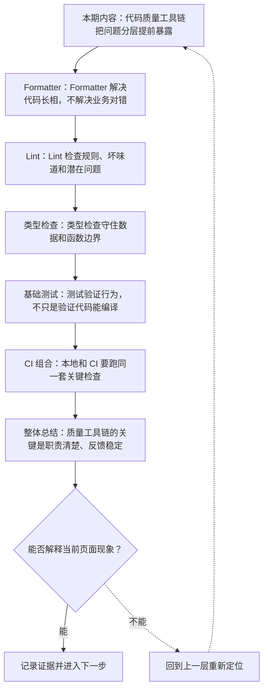
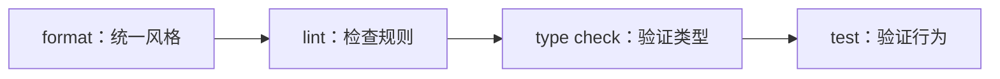

# 前端代码质量工具链：Formatter、Lint、类型检查与测试

&gt; 视频入口：B站合集《前端全链路：从浏览器基础到现代生态》上传并核验后回填正式链接。
&gt; 本文是 EP21 的博客深讲版，包含视频主线，但比视频补充更多机制、流程图、边界判断和排查清单。


## 这篇文章解决什么问题

这期解释前端代码提交前通常要经过哪些检查，以及每类工具负责什么边界。

这一篇的中心问题可以概括成：前端质量工具链中 Formatter、Lint、类型检查和测试各自负责什么？

关键词：Formatter、Lint、type check、test、Prettier、style、ESLint、rule、warning、TypeScript

## 视频主线回顾

### 1. Formatter

统一代码长相，减少风格争论。

### 2. Lint

检查规则、坏味道和潜在问题。

### 3. 类型检查

TypeScript 验证数据和函数边界。

### 4. 测试与 CI

测试提供行为证据，CI 保证检查可重复执行。

## 技术流程图

先用一张图把本期内容串起来。它不是背诵路线，而是排查问题时可以顺着走的证据路线。




## 深入展开

### 1. 代码质量工具链把问题分层提前暴露

这一期看前端代码质量工具链。我们会讲 Formatter 负责统一格式，Lint 负责规则和潜在问题，TypeScript type check 负责类型边界，基础测试负责行为反馈，最后看这些检查怎样在本地、提交前和 CI 里组合。重点是分清每类工具的职责，不把所有问题都塞给同一个工具。

这里可以多看一层：先找输入，再看处理过程，最后确认输出。前端很多问题之所以绕，是因为现象出现在页面上，原因却可能藏在网络、样式计算、运行时或构建结果里。



排查时可以顺着这条线问：当前现象是输入不对、处理过程不对，还是最终结果不对。只要能把问题归到其中一格，后面的工具选择就会轻很多。

### 2. Formatter 解决代码长相，不解决业务对错

Formatter 会统一缩进、换行、引号和尾逗号等代码样式。它不理解你的业务逻辑，也不会判断按钮点击是否正确。把格式交给工具，团队 review 时就能少争“这里要不要换行”，把注意力放回结构、边界和行为。

把这段机制放到工程里看，最实用的切口是证据。不要急着猜是哪一行代码错了，先确认浏览器或工具实际拿到了什么、计算了什么、丢出了什么结果。

| 维度 | 含义 |
| --- | --- |
| 缩进 | 统一空格和层级。 |
| 换行 | 稳定代码布局。 |
| 减少争论 | 风格自动化。 |

排查时可以顺着这条线问：当前现象是输入不对、处理过程不对，还是最终结果不对。只要能把问题归到其中一格，后面的工具选择就会轻很多。

### 3. Lint 检查规则、坏味道和潜在问题

Lint 可以检查未使用变量、危险写法、Hook 调用规则、可访问性提示和团队自定义约束。它比 Formatter 更接近代码语义，但也不是万能测试。好的 Lint 规则应该能稳定降低风险；过度复杂、误报很多的规则，反而会被团队绕过。

这个点在真实项目里常常不是孤立问题。它会和状态、缓存、布局、依赖或团队约束连在一起，所以博客版更强调边界：什么归它管，什么应该交给下一层机制判断。

| 维度 | 含义 |
| --- | --- |
| 错误规则 | 明显问题直接失败。 |
| 警告规则 | 提醒潜在风险。 |
| 团队规则 | 固化协作约定。 |

排查时可以顺着这条线问：当前现象是输入不对、处理过程不对，还是最终结果不对。只要能把问题归到其中一格，后面的工具选择就会轻很多。

### 4. 类型检查守住数据和函数边界

TypeScript type check 会检查参数、返回值、对象字段和泛型关系。它能发现很多拼写错误、空值风险和接口不匹配。类型检查和 Lint 可以互补：Lint 更关注规则和风格，type check 更关注类型关系。外部数据仍然要运行时校验，这一点上一期已经打过底。

如果要把它讲给别人听，可以按“现象—证据—机制—边界”的顺序。先让对方看到问题，再解释浏览器或工具为什么会给出这样的结果。


排查时可以顺着这条线问：当前现象是输入不对、处理过程不对，还是最终结果不对。只要能把问题归到其中一格，后面的工具选择就会轻很多。

### 5. 测试验证行为，不只是验证代码能编译

测试会用输入和断言验证函数、组件或流程的行为。单元测试反馈快，适合纯函数和小逻辑；组件测试能覆盖 UI 状态；更大的集成和 E2E 测试会留到 EP26 详细讲。这一期只先看它在质量流水线里的位置：提供行为层面的证据。

这里可以多看一层：先找输入，再看处理过程，最后确认输出。前端很多问题之所以绕，是因为现象出现在页面上，原因却可能藏在网络、样式计算、运行时或构建结果里。

```js
expect(formatPrice(12)).toBe("¥12.00");
```

- 给定输入。
- 期待输出。
- 失败时提供反馈。

排查时可以顺着这条线问：当前现象是输入不对、处理过程不对，还是最终结果不对。只要能把问题归到其中一格，后面的工具选择就会轻很多。

### 6. 本地和 CI 要跑同一套关键检查

本地开发时可以快速跑 format、lint、type check 和相关测试。提交前可以用 hook 做轻量检查。CI 则应该跑关键命令，避免只在某个人机器上成立。流水线不是越长越好，而是把反馈速度和风险级别匹配起来：越早发现，修复成本越低。

把这段机制放到工程里看，最实用的切口是证据。不要急着猜是哪一行代码错了，先确认浏览器或工具实际拿到了什么、计算了什么、丢出了什么结果。


排查时可以顺着这条线问：当前现象是输入不对、处理过程不对，还是最终结果不对。只要能把问题归到其中一格，后面的工具选择就会轻很多。

## 常见误区与边界

- 不要把 Lint、类型检查和测试混成一个东西。
- 不要让质量工具听起来像形式主义。
- 这一篇不展开：测试分层完整展开，留到 EP26。
- 这一篇不展开：CI 平台配置细节。
- 这一篇不展开：各工具所有规则配置。

## 排查和验证清单

- 先确认问题发生在哪一层：页面结构、样式计算、JavaScript 运行、网络请求、构建产物还是线上交付。
- 用浏览器或工具拿到证据，不只凭肉眼判断。能截图、能看到日志、能看到请求和产物，结论才稳。
- 把最小例子缩到只剩一个变量。变量越少，越容易看清机制。
- 记录输入、处理过程和输出。前端问题往往不是“某个 API 错了”，而是链路中某一步的假设不成立。
- 如果准备把结论放到项目里，再补一层测试、类型检查、可访问性或性能验证。

## 动手练习

1. 用一个最小 HTML 页面复现 前端代码质量工具链 里的核心现象。
2. 打开 DevTools，分别记录结构、样式、控制台、网络或性能面板里的一个证据点。
3. 改一个变量，再观察结果是否符合这篇文章里的流程图；如果不符合，把差异写下来。

## 参考来源与本系列依据

- 工具文档：Prettier / ESLint / TypeScript：工具职责
- 测试工具：Vitest / Testing Library：行为验证
- 工程实践：CI pipeline：重复执行和反馈速度

## 总结

前端质量工具链不是一个工具包名，而是一组分层反馈：格式、规则、类型和行为。职责越清楚，协作越稳定。

博客版到这里就把视频主线扩成了可复习的技术笔记：先知道它在链路里的位置，再知道它怎么运行，最后知道遇到问题该从哪里查。
