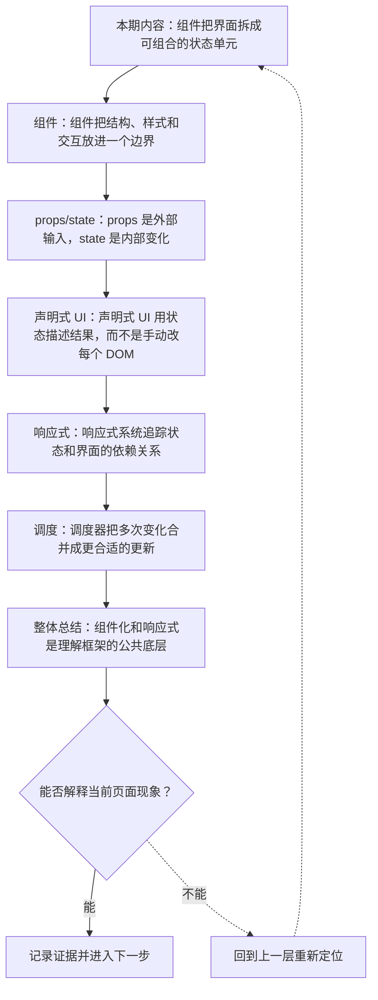
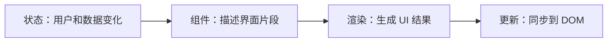
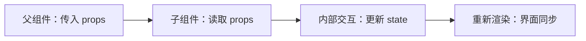
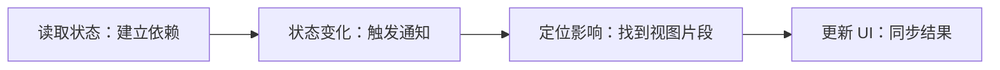

# 组件化 UI 与响应式更新模型

&gt; 视频入口：B站合集《前端全链路：从浏览器基础到现代生态》上传并核验后回填正式链接。
&gt; 本文是 EP22 的博客深讲版，包含视频主线，但比视频补充更多机制、流程图、边界判断和排查清单。


## 这篇文章解决什么问题

这期解释组件化 UI 为什么出现，以及状态驱动更新和直接 DOM 操作有什么区别。

这一篇的中心问题可以概括成：组件化 UI 和响应式更新模型如何改变前端界面组织方式？

关键词：component、props、state、reactivity、boundary、reuse、data flow、declarative UI、DOM、render

## 视频主线回顾

### 1. 组件边界

组件把 UI 的结构、输入、状态和事件放进可推理边界。

### 2. props 与 state

props 来自外部，state 表示内部变化。

### 3. 声明式 UI

用状态描述结果，由框架处理 DOM 更新。

### 4. 响应式和调度

框架追踪依赖并安排更新时机。

## 技术流程图

先用一张图把本期内容串起来。它不是背诵路线，而是排查问题时可以顺着走的证据路线。




## 深入展开

### 1. 组件把界面拆成可组合的状态单元

这一期进入组件化 UI 与响应式更新模型。我们会讲组件为什么把结构、状态和交互放在一起，props 和 state 怎样形成数据入口，声明式 UI 如何从状态推导界面，响应式系统怎样知道哪里需要更新，以及调度器为什么要把多次变化合并处理。理解这层模型，再看 React、Vue、Angular 和 Svelte 会清楚很多。

这里可以多看一层：先找输入，再看处理过程，最后确认输出。前端很多问题之所以绕，是因为现象出现在页面上，原因却可能藏在网络、样式计算、运行时或构建结果里。



排查时可以顺着这条线问：当前现象是输入不对、处理过程不对，还是最终结果不对。只要能把问题归到其中一格，后面的工具选择就会轻很多。

### 2. 组件把结构、样式和交互放进一个边界

组件不是简单地把 HTML 切成小块。它更像一个带输入、内部状态和事件输出的 UI 单元。组件边界清楚时，团队可以复用、测试和替换它。边界混乱时，状态到处流动，DOM 到处被改，界面就会越来越难维护。

把这段机制放到工程里看，最实用的切口是证据。不要急着猜是哪一行代码错了，先确认浏览器或工具实际拿到了什么、计算了什么、丢出了什么结果。

| 维度 | 含义 |
| --- | --- |
| 输入 | props 或参数。 |
| 状态 | 组件内部变化。 |
| 输出 | 事件和回调。 |

排查时可以顺着这条线问：当前现象是输入不对、处理过程不对，还是最终结果不对。只要能把问题归到其中一格，后面的工具选择就会轻很多。

### 3. props 是外部输入，state 是内部变化

props 通常来自父组件，用来描述这个组件应该显示什么。state 则记录组件自己管理的变化，比如输入框内容、展开状态、加载状态。把 props 当成只读输入，把 state 控制在合适范围内，组件才容易推理。状态越靠近使用位置，越容易维护；跨越多个组件时，就要考虑共享状态。

这个点在真实项目里常常不是孤立问题。它会和状态、缓存、布局、依赖或团队约束连在一起，所以博客版更强调边界：什么归它管，什么应该交给下一层机制判断。



排查时可以顺着这条线问：当前现象是输入不对、处理过程不对，还是最终结果不对。只要能把问题归到其中一格，后面的工具选择就会轻很多。

### 4. 声明式 UI 用状态描述结果，而不是手动改每个 DOM

直接 DOM 编程通常是：找到节点，改文本，改类名，绑定事件。声明式 UI 更像是：当 count 是 1 时，界面显示 1；当 count 变成 2，界面自然应该显示 2。框架会比较状态前后的结果，把必要变化应用到 DOM。这样代码更接近业务状态，而不是一串操作步骤。

如果要把它讲给别人听，可以按“现象—证据—机制—边界”的顺序。先让对方看到问题，再解释浏览器或工具为什么会给出这样的结果。

```js
view = render(state)

state.count = state.count + 1
view = render(state)
```

- 界面来自状态。
- 更新来自重新计算。

排查时可以顺着这条线问：当前现象是输入不对、处理过程不对，还是最终结果不对。只要能把问题归到其中一格，后面的工具选择就会轻很多。

### 5. 响应式系统追踪状态和界面的依赖关系

不同框架追踪依赖的方式不一样。有的通过重新执行组件函数，有的通过响应式代理记录读取关系，有的在编译阶段提前分析。共同目标是：状态变化后，尽量只更新受影响的 UI，并保持开发者心智模型稳定。

这里可以多看一层：先找输入，再看处理过程，最后确认输出。前端很多问题之所以绕，是因为现象出现在页面上，原因却可能藏在网络、样式计算、运行时或构建结果里。



排查时可以顺着这条线问：当前现象是输入不对、处理过程不对，还是最终结果不对。只要能把问题归到其中一格，后面的工具选择就会轻很多。

### 6. 调度器把多次变化合并成更合适的更新

用户输入、网络响应和定时器可能连续触发多次状态变化。如果每次都立刻更新 DOM，性能和体验都会受影响。调度器会把更新放进合适的队列，合并重复工作，并在浏览器渲染节奏里安排执行。事件循环和渲染时机，在这里会重新派上用场。

把这段机制放到工程里看，最实用的切口是证据。不要急着猜是哪一行代码错了，先确认浏览器或工具实际拿到了什么、计算了什么、丢出了什么结果。

| 维度 | 含义 |
| --- | --- |
| batch | 合并多次变化。 |
| priority | 区分紧急程度。 |
| paint | 配合浏览器渲染。 |

排查时可以顺着这条线问：当前现象是输入不对、处理过程不对，还是最终结果不对。只要能把问题归到其中一格，后面的工具选择就会轻很多。

## 常见误区与边界

- 不要把组件讲成简单 HTML 片段。
- 不要把响应式等同于某一个框架的实现。
- 这一篇不展开：具体框架 API 细节。
- 这一篇不展开：虚拟 DOM 算法深挖。
- 这一篇不展开：状态管理库选型。

## 排查和验证清单

- 先确认问题发生在哪一层：页面结构、样式计算、JavaScript 运行、网络请求、构建产物还是线上交付。
- 用浏览器或工具拿到证据，不只凭肉眼判断。能截图、能看到日志、能看到请求和产物，结论才稳。
- 把最小例子缩到只剩一个变量。变量越少，越容易看清机制。
- 记录输入、处理过程和输出。前端问题往往不是“某个 API 错了”，而是链路中某一步的假设不成立。
- 如果准备把结论放到项目里，再补一层测试、类型检查、可访问性或性能验证。

## 动手练习

1. 用一个最小 HTML 页面复现 组件化与响应式 里的核心现象。
2. 打开 DevTools，分别记录结构、样式、控制台、网络或性能面板里的一个证据点。
3. 改一个变量，再观察结果是否符合这篇文章里的流程图；如果不符合，把差异写下来。

## 参考来源与本系列依据

- 框架文档：React / Vue / Angular / Svelte：组件和响应式模型
- 浏览器基础：DOM rendering：更新落点
- 工程实践：state management：组件边界

## 总结

组件化和响应式是现代前端框架的共同底层。理解状态如何驱动界面，才能理解框架差异。

博客版到这里就把视频主线扩成了可复习的技术笔记：先知道它在链路里的位置，再知道它怎么运行，最后知道遇到问题该从哪里查。
