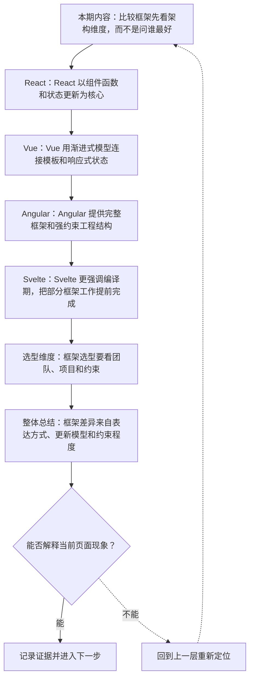
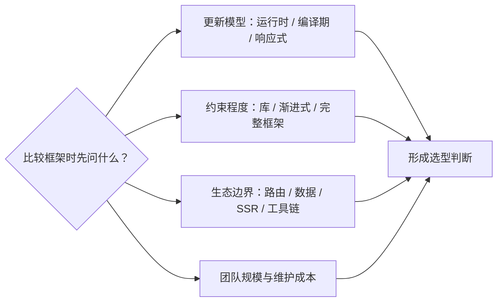
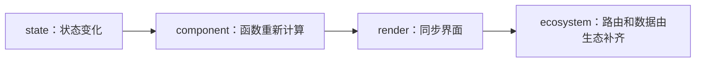
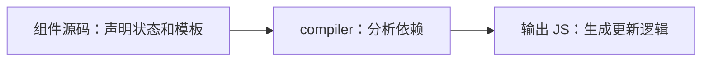

# 前端框架架构比较：React、Vue、Angular 与 Svelte

&gt; 视频入口：B站合集《前端全链路：从浏览器基础到现代生态》上传并核验后回填正式链接。
&gt; 本文是 EP23 的博客深讲版，包含视频主线，但比视频补充更多机制、流程图、边界判断和排查清单。

## 这篇文章解决什么问题

这期用统一维度比较四类主流前端框架，重点看更新模型、约束程度和生态边界。

这一篇的中心问题可以概括成：如何用统一维度理解 React、Vue、Angular 和 Svelte 的架构差异？

关键词：React、Vue、Angular、Svelte、JSX、ecosystem、template、reactivity、DI、framework

## 视频主线回顾

### 1. 比较维度

从表达方式、更新模型、运行时/编译器和约束程度比较框架。

### 2. React 与 Vue

React 偏组合生态，Vue 更强调渐进式响应式。

### 3. Angular 与 Svelte

Angular 强约束完整框架，Svelte 把更多工作提前到编译期。

### 4. 选型不是排名

框架适配团队经验、项目复杂度和生态需求。

## 技术流程图

先用一张图把本期内容串起来。它不是背诵路线，而是排查问题时可以顺着走的证据路线。

## 四类框架的比较维度

这张图把本期最关键的结构单独拎出来，适合在复习或做笔记时当作索引。

## 深入展开

### 1. 比较框架先看架构维度，而不是问谁最好

这一期比较 React、Vue、Angular 和 Svelte。我们会用同一组维度来看：组件表达方式，响应式和更新模型，运行时与编译器分工，工程约束程度，生态集成方式，以及适用场景。这里不做排行榜，重点是建立选型地图。

这里可以多看一层：先找输入，再看处理过程，最后确认输出。前端很多问题之所以绕，是因为现象出现在页面上，原因却可能藏在网络、样式计算、运行时或构建结果里。

| 维度 | 含义 |
| --- | --- |
| 表达 | JSX、template、组件文件。 |
| 更新 | 状态变化到 UI。 |
| 约束 | 自由度和规范。 |

排查时可以顺着这条线问：当前现象是输入不对、处理过程不对，还是最终结果不对。只要能把问题归到其中一格，后面的工具选择就会轻很多。

### 2. React 以组件函数和状态更新为核心

React 用组件描述 UI，常见表达是 JSX。状态变化会触发组件重新计算 UI，框架再把差异同步到界面。React 本身偏 UI 层，路由、数据请求、状态管理、构建方案通常由生态组合完成。这给了很高自由度，也要求团队有清晰约定。

把这段机制放到工程里看，最实用的切口是证据。不要急着猜是哪一行代码错了，先确认浏览器或工具实际拿到了什么、计算了什么、丢出了什么结果。

排查时可以顺着这条线问：当前现象是输入不对、处理过程不对，还是最终结果不对。只要能把问题归到其中一格，后面的工具选择就会轻很多。

### 3. Vue 用渐进式模型连接模板和响应式状态

Vue 常用单文件组件组织 template、script 和 style。它的响应式系统会追踪状态读取和变化，让模板随状态更新。Vue 可以从简单页面增强开始，也可以配合路由、状态和构建工具做完整应用。它在约束和灵活之间取了一个比较平衡的位置。

这个点在真实项目里常常不是孤立问题。它会和状态、缓存、布局、依赖或团队约束连在一起，所以博客版更强调边界：什么归它管，什么应该交给下一层机制判断。

| 维度 | 含义 |
| --- | --- |
| template | 模板描述结构。 |
| reactivity | 追踪状态依赖。 |
| progressive | 渐进式采用。 |

排查时可以顺着这条线问：当前现象是输入不对、处理过程不对，还是最终结果不对。只要能把问题归到其中一格，后面的工具选择就会轻很多。

### 4. Angular 提供完整框架和强约束工程结构

Angular 通常包含路由、表单、HTTP、依赖注入、构建和测试等完整方案。它的约束更强，学习成本也更集中。对于大型团队和长期维护项目，统一架构能减少自由组合带来的不确定性；对于小项目，它可能显得偏重。

如果要把它讲给别人听，可以按“现象—证据—机制—边界”的顺序。先让对方看到问题，再解释浏览器或工具为什么会给出这样的结果。

| 维度 | 含义 |
| --- | --- |
| DI | 依赖注入组织服务。 |
| Router | 路由内建方案。 |
| Forms | 表单体系完整。 |

排查时可以顺着这条线问：当前现象是输入不对、处理过程不对，还是最终结果不对。只要能把问题归到其中一格，后面的工具选择就会轻很多。

### 5. Svelte 更强调编译期，把部分框架工作提前完成

Svelte 的一个突出特点，是把很多响应式和更新逻辑放到编译阶段处理。开发者写组件，编译器分析状态使用关系，生成更直接的运行时代码。这样可以减少部分运行时框架负担，但也意味着你要理解它的编译规则和生态边界。

这里可以多看一层：先找输入，再看处理过程，最后确认输出。前端很多问题之所以绕，是因为现象出现在页面上，原因却可能藏在网络、样式计算、运行时或构建结果里。

排查时可以顺着这条线问：当前现象是输入不对、处理过程不对，还是最终结果不对。只要能把问题归到其中一格，后面的工具选择就会轻很多。

### 6. 框架选型要看团队、项目和约束

比较框架时，可以看四个问题：团队熟悉哪种表达方式；项目需要多少内建能力；性能瓶颈在首屏、交互还是开发效率；生态和招聘是否匹配。选型不是找绝对最强，而是让约束、能力和维护成本匹配。

把这段机制放到工程里看，最实用的切口是证据。不要急着猜是哪一行代码错了，先确认浏览器或工具实际拿到了什么、计算了什么、丢出了什么结果。

| 维度 | 含义 |
| --- | --- |
| 团队 | 经验和协作方式。 |
| 项目 | 复杂度和生命周期。 |
| 生态 | 库、工具、招聘。 |

排查时可以顺着这条线问：当前现象是输入不对、处理过程不对，还是最终结果不对。只要能把问题归到其中一格，后面的工具选择就会轻很多。

## 常见误区与边界

- 不要做武断排名。
- 不要用过时刻板印象概括框架。
- 这一篇不展开：框架 API 教程。
- 这一篇不展开：性能排行榜。
- 这一篇不展开：版本细节争议。

## 排查和验证清单

- 先确认问题发生在哪一层：页面结构、样式计算、JavaScript 运行、网络请求、构建产物还是线上交付。
- 用浏览器或工具拿到证据，不只凭肉眼判断。能截图、能看到日志、能看到请求和产物，结论才稳。
- 把最小例子缩到只剩一个变量。变量越少，越容易看清机制。
- 记录输入、处理过程和输出。前端问题往往不是“某个 API 错了”，而是链路中某一步的假设不成立。
- 如果准备把结论放到项目里，再补一层测试、类型检查、可访问性或性能验证。

## 动手练习

1. 用一个最小 HTML 页面复现 前端框架架构比较 里的核心现象。
2. 打开 DevTools，分别记录结构、样式、控制台、网络或性能面板里的一个证据点。
3. 改一个变量，再观察结果是否符合这篇文章里的流程图；如果不符合，把差异写下来。

## 参考来源与本系列依据

- 官方文档：React / Vue / Angular / Svelte Docs：框架定位
- 工程实践：framework selection：团队约束
- Web 架构：rendering models：与下一集衔接

## 总结

前端框架的差异不是谁更高级，而是它们在表达、更新、约束和生态上的取舍不同。

博客版到这里就把视频主线扩成了可复习的技术笔记：先知道它在链路里的位置，再知道它怎么运行，最后知道遇到问题该从哪里查。
