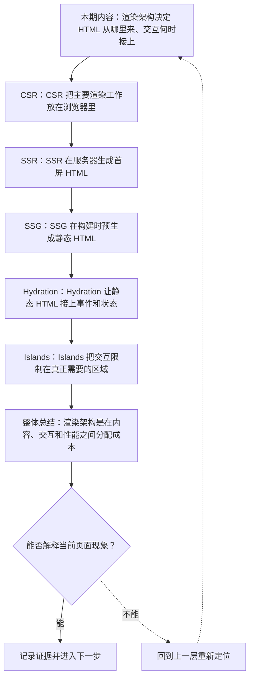
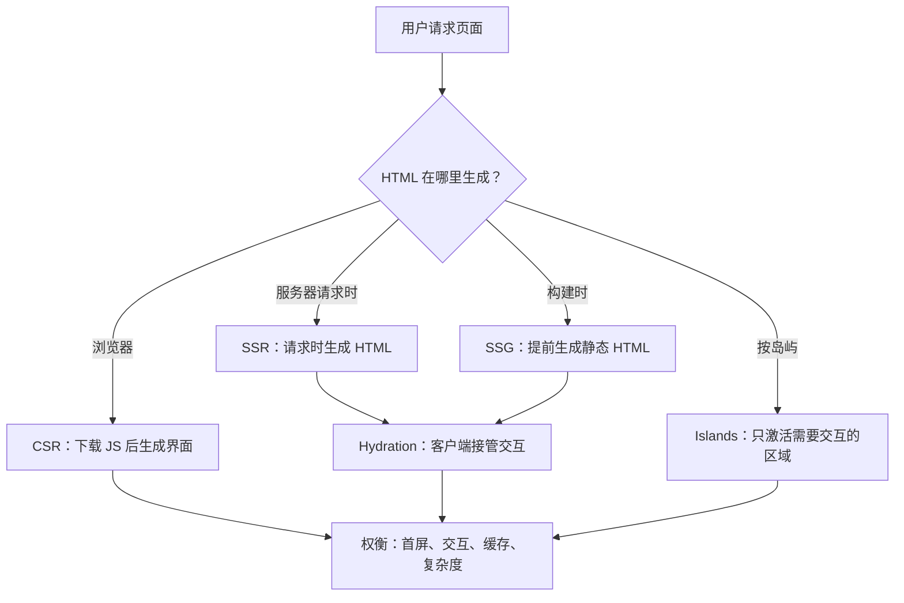
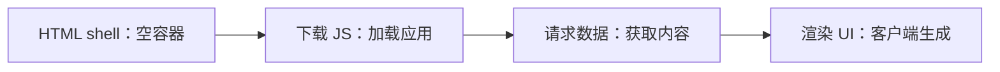

# Web 渲染架构：CSR、SSR、SSG、Hydration 与 Islands

&gt; 视频入口：B站合集《前端全链路：从浏览器基础到现代生态》上传并核验后回填正式链接。
&gt; 本文是 EP24 的博客深讲版，包含视频主线，但比视频补充更多机制、流程图、边界判断和排查清单。

## 这篇文章解决什么问题

这期解释页面 HTML 在哪里生成，JavaScript 怎样接管，以及不同渲染架构的取舍。

这一篇的中心问题可以概括成：CSR、SSR、SSG、Hydration 和 Islands 分别解决什么渲染问题？

关键词：CSR、SSR、SSG、Hydration、Islands、client、SPA、server、static、CDN

## 视频主线回顾

### 1. CSR

CSR 把主要渲染放在浏览器，适合强交互应用。

### 2. SSR 与 SSG

SSR 请求时生成 HTML，SSG 构建时预生成 HTML。

### 3. Hydration

Hydration 让静态 HTML 接上组件事件和状态。

### 4. Islands

Islands 只让必要区域加载客户端交互。

## 技术流程图

先用一张图把本期内容串起来。它不是背诵路线，而是排查问题时可以顺着走的证据路线。

## HTML 生成位置与客户端接管

这张图把本期最关键的结构单独拎出来，适合在复习或做笔记时当作索引。

## 深入展开

### 1. 渲染架构决定 HTML 从哪里来、交互何时接上

这一期看 Web 渲染架构。我们会讲 CSR 在浏览器生成界面，SSR 在服务器生成首屏 HTML，SSG 在构建时预生成静态页面，Hydration 怎样让静态 HTML 接上交互，Islands 如何只让部分区域变成可交互组件。重点是把“内容、交互、性能、缓存”放在同一张图里看。

这里可以多看一层：先找输入，再看处理过程，最后确认输出。前端很多问题之所以绕，是因为现象出现在页面上，原因却可能藏在网络、样式计算、运行时或构建结果里。

排查时可以顺着这条线问：当前现象是输入不对、处理过程不对，还是最终结果不对。只要能把问题归到其中一格，后面的工具选择就会轻很多。

### 2. CSR 把主要渲染工作放在浏览器里

CSR 是 Client Side Rendering。浏览器拿到基础 HTML 和 JavaScript 后，再请求数据、运行框架、生成界面。它适合交互强、登录后使用的应用，比如管理后台。但首屏依赖脚本下载和执行，内容型页面要特别关注加载体验和搜索可见性。

把这段机制放到工程里看，最实用的切口是证据。不要急着猜是哪一行代码错了，先确认浏览器或工具实际拿到了什么、计算了什么、丢出了什么结果。

排查时可以顺着这条线问：当前现象是输入不对、处理过程不对，还是最终结果不对。只要能把问题归到其中一格，后面的工具选择就会轻很多。

### 3. SSR 在服务器生成首屏 HTML

SSR 是 Server Side Rendering。服务器收到请求后生成带内容的 HTML 发给浏览器，用户可以更早看到页面。随后浏览器下载 JavaScript，把已有 HTML 和组件逻辑连接起来。SSR 常用于内容和交互都重要的页面，但服务器成本、缓存策略和 Hydration 开销都要一起考虑。

这个点在真实项目里常常不是孤立问题。它会和状态、缓存、布局、依赖或团队约束连在一起，所以博客版更强调边界：什么归它管，什么应该交给下一层机制判断。

排查时可以顺着这条线问：当前现象是输入不对、处理过程不对，还是最终结果不对。只要能把问题归到其中一格，后面的工具选择就会轻很多。

### 4. SSG 在构建时预生成静态 HTML

SSG 是 Static Site Generation。页面在构建阶段生成 HTML 文件，上线后可以直接由 CDN 提供。博客、文档、营销页经常适合这种方式。它的优势是快、稳、便宜；限制是内容更新需要重新构建，个性化和实时数据要额外设计。

如果要把它讲给别人听，可以按“现象—证据—机制—边界”的顺序。先让对方看到问题，再解释浏览器或工具为什么会给出这样的结果。

排查时可以顺着这条线问：当前现象是输入不对、处理过程不对，还是最终结果不对。只要能把问题归到其中一格，后面的工具选择就会轻很多。

### 5. Hydration 让静态 HTML 接上事件和状态

SSR 或 SSG 页面可能先展示 HTML，但按钮点击、表单状态和组件事件还需要 JavaScript 接管。Hydration 会把组件逻辑挂到已有 DOM 上，让页面从静态内容变成可交互应用。它也可能带来脚本体积和主线程压力，所以要看交互密度和页面复杂度。

这里可以多看一层：先找输入，再看处理过程，最后确认输出。前端很多问题之所以绕，是因为现象出现在页面上，原因却可能藏在网络、样式计算、运行时或构建结果里。

| 维度 | 含义 |
| --- | --- |
| 可见 | HTML 已显示。 |
| 加载 | JS 下载执行。 |
| 可交互 | 事件和状态接上。 |

排查时可以顺着这条线问：当前现象是输入不对、处理过程不对，还是最终结果不对。只要能把问题归到其中一格，后面的工具选择就会轻很多。

### 6. Islands 把交互限制在真正需要的区域

Islands 架构常用于内容页面：大部分 HTML 是静态的，只有搜索框、评论、购物车、动态图表这类区域加载客户端组件。这样可以减少 JavaScript 体积和 Hydration 成本。它提醒我们：渲染架构不是非黑即白，可以按页面区域分配交互预算。

把这段机制放到工程里看，最实用的切口是证据。不要急着猜是哪一行代码错了，先确认浏览器或工具实际拿到了什么、计算了什么、丢出了什么结果。

| 维度 | 含义 |
| --- | --- |
| 文章正文 | 静态 HTML。 |
| 评论框 | 交互 island。 |
| 搜索 | 按需加载。 |

排查时可以顺着这条线问：当前现象是输入不对、处理过程不对，还是最终结果不对。只要能把问题归到其中一格，后面的工具选择就会轻很多。

## 常见误区与边界

- 不要把 SSR 等同于一定更快。
- 不要忽视可交互时间和服务器成本。
- 这一篇不展开：具体框架路由实现。
- 这一篇不展开：边缘渲染平台细节。
- 这一篇不展开：SEO 深度专题。

## 排查和验证清单

- 先确认问题发生在哪一层：页面结构、样式计算、JavaScript 运行、网络请求、构建产物还是线上交付。
- 用浏览器或工具拿到证据，不只凭肉眼判断。能截图、能看到日志、能看到请求和产物，结论才稳。
- 把最小例子缩到只剩一个变量。变量越少，越容易看清机制。
- 记录输入、处理过程和输出。前端问题往往不是“某个 API 错了”，而是链路中某一步的假设不成立。
- 如果准备把结论放到项目里，再补一层测试、类型检查、可访问性或性能验证。

## 动手练习

1. 用一个最小 HTML 页面复现 Web 渲染架构 里的核心现象。
2. 打开 DevTools，分别记录结构、样式、控制台、网络或性能面板里的一个证据点。
3. 改一个变量，再观察结果是否符合这篇文章里的流程图；如果不符合，把差异写下来。

## 参考来源与本系列依据

- 框架文档：Next / Nuxt / Astro 等渲染模型：主流渲染术语
- Web 平台：HTML / JavaScript loading：接管基础
- 性能实践：hydration cost：主线程和脚本体积

## 总结

Web 渲染架构的核心问题是：HTML 从哪里来，JavaScript 接管多少，内容和交互成本怎样分配。

博客版到这里就把视频主线扩成了可复习的技术笔记：先知道它在链路里的位置，再知道它怎么运行，最后知道遇到问题该从哪里查。
