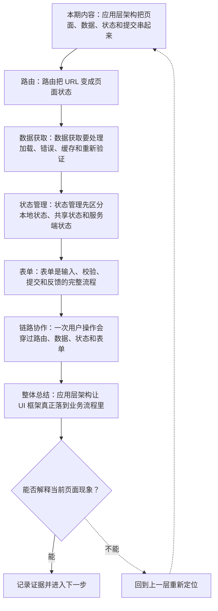
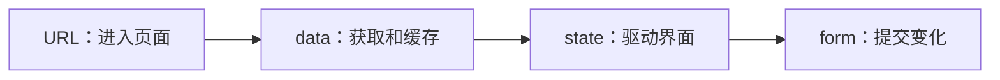
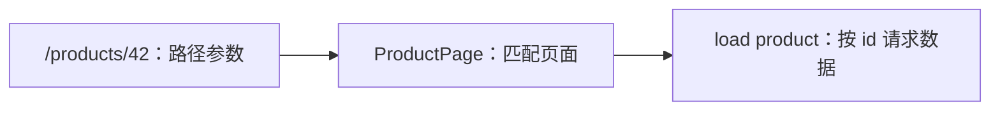
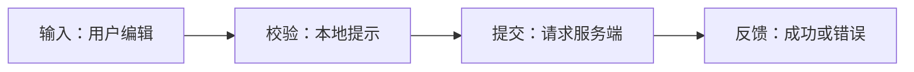
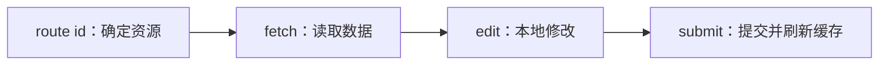

# 前端应用层架构：路由、数据获取、状态管理与表单

&gt; 视频入口：B站合集《前端全链路：从浏览器基础到现代生态》上传并核验后回填正式链接。
&gt; 本文是 EP25 的博客深讲版，包含视频主线，但比视频补充更多机制、流程图、边界判断和排查清单。

## 这篇文章解决什么问题

这期解释 UI 框架之外，前端应用还需要哪些应用层能力，以及它们怎样协作。

这一篇的中心问题可以概括成：前端应用层架构如何组织路由、数据、状态和表单？

关键词：router、data fetching、state management、form、URL、route params、loading、error、cache、revalidate

## 视频主线回顾

### 1. 路由

路由让 URL 成为页面状态入口。

### 2. 数据获取

请求要处理加载、错误、缓存和重新验证。

### 3. 状态管理

先区分本地状态、共享状态和服务端状态。

### 4. 表单流程

表单包含输入、校验、提交和反馈。

## 技术流程图

先用一张图把本期内容串起来。它不是背诵路线，而是排查问题时可以顺着走的证据路线。

## 深入展开

### 1. 应用层架构把页面、数据、状态和提交串起来

这一期看前端应用层架构。我们会讲路由怎样把 URL 映射到页面，数据获取怎样处理请求和缓存，状态管理怎样区分本地状态和共享状态，表单怎样完成输入、校验和提交，以及这些能力如何形成一条用户操作链路。

这里可以多看一层：先找输入，再看处理过程，最后确认输出。前端很多问题之所以绕，是因为现象出现在页面上，原因却可能藏在网络、样式计算、运行时或构建结果里。

排查时可以顺着这条线问：当前现象是输入不对、处理过程不对，还是最终结果不对。只要能把问题归到其中一格，后面的工具选择就会轻很多。

### 2. 路由把 URL 变成页面状态

前端路由会根据路径、参数和查询字符串决定显示哪个页面。商品详情页里的 id，搜索页里的 keyword，分页里的 page，都可以来自 URL。好的路由设计让页面可分享、可刷新、可回退，也让数据请求和权限判断有清楚入口。

把这段机制放到工程里看，最实用的切口是证据。不要急着猜是哪一行代码错了，先确认浏览器或工具实际拿到了什么、计算了什么、丢出了什么结果。

排查时可以顺着这条线问：当前现象是输入不对、处理过程不对，还是最终结果不对。只要能把问题归到其中一格，后面的工具选择就会轻很多。

### 3. 数据获取要处理加载、错误、缓存和重新验证

一次数据请求至少有 loading、success、error 三种状态。真实应用还会有缓存、重试、取消请求、后台重新验证和并发更新。把这些状态散落在组件里，项目很快会变乱；用清楚的数据获取层，可以让页面知道什么时候展示骨架屏、错误提示和最新数据。

这个点在真实项目里常常不是孤立问题。它会和状态、缓存、布局、依赖或团队约束连在一起，所以博客版更强调边界：什么归它管，什么应该交给下一层机制判断。

| 维度 | 含义 |
| --- | --- |
| loading | 展示等待状态。 |
| error | 给出恢复路径。 |
| cache | 复用已有结果。 |

排查时可以顺着这条线问：当前现象是输入不对、处理过程不对，还是最终结果不对。只要能把问题归到其中一格，后面的工具选择就会轻很多。

### 4. 状态管理先区分本地状态、共享状态和服务端状态

输入框内容和弹窗开关通常是本地状态。登录用户、主题、购物车可能是跨组件共享状态。接口返回的数据更像服务端状态，需要缓存、同步和失效策略。先分类，再决定放在哪里，比一开始就引入大型状态库更可靠。

如果要把它讲给别人听，可以按“现象—证据—机制—边界”的顺序。先让对方看到问题，再解释浏览器或工具为什么会给出这样的结果。

| 维度 | 含义 |
| --- | --- |
| local | 只影响当前组件。 |
| shared | 多个组件共同使用。 |
| server | 来自接口并需要同步。 |

排查时可以顺着这条线问：当前现象是输入不对、处理过程不对，还是最终结果不对。只要能把问题归到其中一格，后面的工具选择就会轻很多。

### 5. 表单是输入、校验、提交和反馈的完整流程

表单要处理默认值、输入状态、即时校验、提交中、服务端错误和成功反馈。前端校验能提高体验，但不能替代服务端校验。复杂表单还要考虑可访问性、键盘操作、错误定位和草稿保存。表单架构好不好，用户很快就能感受到。

这里可以多看一层：先找输入，再看处理过程，最后确认输出。前端很多问题之所以绕，是因为现象出现在页面上，原因却可能藏在网络、样式计算、运行时或构建结果里。

排查时可以顺着这条线问：当前现象是输入不对、处理过程不对，还是最终结果不对。只要能把问题归到其中一格，后面的工具选择就会轻很多。

### 6. 一次用户操作会穿过路由、数据、状态和表单

比如用户打开商品编辑页：路由解析 id，数据层请求商品，组件状态展示编辑界面，表单管理输入和校验，提交后更新服务端，再让缓存失效或刷新页面数据。每一层边界清楚，问题就容易定位；边界混乱，任何小改动都可能牵一大片。

把这段机制放到工程里看，最实用的切口是证据。不要急着猜是哪一行代码错了，先确认浏览器或工具实际拿到了什么、计算了什么、丢出了什么结果。

排查时可以顺着这条线问：当前现象是输入不对、处理过程不对，还是最终结果不对。只要能把问题归到其中一格，后面的工具选择就会轻很多。

## 常见误区与边界

- 不要把状态全部推给全局 store。
- 不要只讲库名，要讲链路职责。
- 这一篇不展开：具体路由库 API。
- 这一篇不展开：复杂状态库源码。
- 这一篇不展开：后端接口设计专题。

## 排查和验证清单

- 先确认问题发生在哪一层：页面结构、样式计算、JavaScript 运行、网络请求、构建产物还是线上交付。
- 用浏览器或工具拿到证据，不只凭肉眼判断。能截图、能看到日志、能看到请求和产物，结论才稳。
- 把最小例子缩到只剩一个变量。变量越少，越容易看清机制。
- 记录输入、处理过程和输出。前端问题往往不是“某个 API 错了”，而是链路中某一步的假设不成立。
- 如果准备把结论放到项目里，再补一层测试、类型检查、可访问性或性能验证。

## 动手练习

1. 用一个最小 HTML 页面复现 前端应用层架构 里的核心现象。
2. 打开 DevTools，分别记录结构、样式、控制台、网络或性能面板里的一个证据点。
3. 改一个变量，再观察结果是否符合这篇文章里的流程图；如果不符合，把差异写下来。

## 参考来源与本系列依据

- 框架生态：Router / data fetching docs：应用层能力
- Web 基础：URL / HTTP / forms：链路基础
- 工程实践：state classification：状态管理边界

## 总结

前端应用层架构把组件放进真实用户链路：URL 进入页面，数据驱动界面，状态组织变化，表单完成提交。

博客版到这里就把视频主线扩成了可复习的技术笔记：先知道它在链路里的位置，再知道它怎么运行，最后知道遇到问题该从哪里查。
