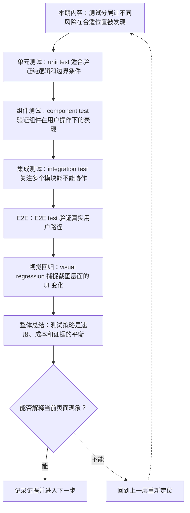
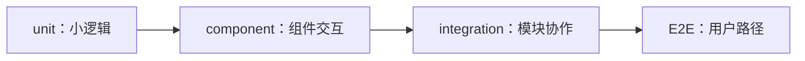
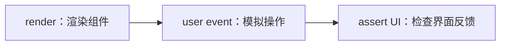

# 前端测试分层：单元、组件、集成、E2E 与视觉回归

&gt; 视频入口：B站合集《前端全链路：从浏览器基础到现代生态》上传并核验后回填正式链接。
&gt; 本文是 EP26 的博客深讲版，包含视频主线，但比视频补充更多机制、流程图、边界判断和排查清单。


## 这篇文章解决什么问题

这期解释前端测试为什么要分层，以及不同测试层分别提供什么证据。

这一篇的中心问题可以概括成：前端测试为什么要分层，各层测试分别提供什么证据？

关键词：unit test、component test、E2E、visual regression、assertion、edge case、event、a11y、integration test、mock

## 视频主线回顾

### 1. 单元与组件测试

单元测试快，组件测试更接近用户交互。

### 2. 集成测试

集成测试关注多个模块的连接处。

### 3. E2E

E2E 覆盖关键用户路径，但成本更高。

### 4. 视觉回归

截图对比补充界面层证据。

## 技术流程图

先用一张图把本期内容串起来。它不是背诵路线，而是排查问题时可以顺着走的证据路线。




## 深入展开

### 1. 测试分层让不同风险在合适位置被发现

这一期看前端测试分层。我们会讲 unit test 验证小逻辑，component test 验证组件交互，integration test 验证模块协作，E2E test 验证真实用户路径，visual regression 验证界面变化。重点是理解每层测试的速度、成本、稳定性和覆盖范围，而不是堆满测试名词。

这里可以多看一层：先找输入，再看处理过程，最后确认输出。前端很多问题之所以绕，是因为现象出现在页面上，原因却可能藏在网络、样式计算、运行时或构建结果里。



排查时可以顺着这条线问：当前现象是输入不对、处理过程不对，还是最终结果不对。只要能把问题归到其中一格，后面的工具选择就会轻很多。

### 2. unit test 适合验证纯逻辑和边界条件

格式化价格、权限判断、日期转换、数据归一化，这些小函数很适合 unit test。单元测试不追求模拟整个浏览器世界，而是用明确输入和断言验证输出。它适合覆盖边界条件，也适合在重构时告诉你核心逻辑有没有被改坏。

把这段机制放到工程里看，最实用的切口是证据。不要急着猜是哪一行代码错了，先确认浏览器或工具实际拿到了什么、计算了什么、丢出了什么结果。

```js
expect(canEdit({ role: "admin" })).toBe(true);
```

- 输入明确。
- 断言直接。
- 失败定位清楚。

排查时可以顺着这条线问：当前现象是输入不对、处理过程不对，还是最终结果不对。只要能把问题归到其中一格，后面的工具选择就会轻很多。

### 3. component test 验证组件在用户操作下的表现

组件测试会渲染组件，模拟点击、输入和键盘操作，再断言界面变化。比如点击展开按钮后内容是否出现，输入非法邮箱是否显示错误提示。组件测试比单元测试更接近用户，但仍然比完整浏览器路径轻。

这个点在真实项目里常常不是孤立问题。它会和状态、缓存、布局、依赖或团队约束连在一起，所以博客版更强调边界：什么归它管，什么应该交给下一层机制判断。



排查时可以顺着这条线问：当前现象是输入不对、处理过程不对，还是最终结果不对。只要能把问题归到其中一格，后面的工具选择就会轻很多。

### 4. integration test 关注多个模块能不能协作

数据获取、路由跳转、状态缓存和组件展示组合起来，才是一个功能。集成测试会检查这些模块连起来是否符合预期。它经常需要 mock 网络或测试数据库，也需要控制测试范围，避免变成慢而脆的大杂烩。

如果要把它讲给别人听，可以按“现象—证据—机制—边界”的顺序。先让对方看到问题，再解释浏览器或工具为什么会给出这样的结果。

| 维度 | 含义 |
| --- | --- |
| 路由 | 进入正确页面。 |
| 数据 | 请求和缓存。 |
| 组件 | 展示结果。 |

排查时可以顺着这条线问：当前现象是输入不对、处理过程不对，还是最终结果不对。只要能把问题归到其中一格，后面的工具选择就会轻很多。

### 5. E2E test 验证真实用户路径

E2E 测试会在真实浏览器里模拟用户：登录、搜索、下单、提交表单。它能发现跨页面、跨服务、跨浏览器的问题，但运行慢、维护成本高，也容易受环境波动影响。适合覆盖少量关键路径，而不是替代所有低层测试。

这里可以多看一层：先找输入，再看处理过程，最后确认输出。前端很多问题之所以绕，是因为现象出现在页面上，原因却可能藏在网络、样式计算、运行时或构建结果里。


排查时可以顺着这条线问：当前现象是输入不对、处理过程不对，还是最终结果不对。只要能把问题归到其中一格，后面的工具选择就会轻很多。

### 6. visual regression 捕捉截图层面的 UI 变化

视觉回归会对关键页面或组件截图，并和基线图片比较。它适合发现布局错位、颜色异常、文字溢出和响应式断点问题。视觉测试需要控制字体、视口、动画和数据，否则误报会很多。它补的是“看起来是否仍然正确”这层证据。

把这段机制放到工程里看，最实用的切口是证据。不要急着猜是哪一行代码错了，先确认浏览器或工具实际拿到了什么、计算了什么、丢出了什么结果。

| 维度 | 含义 |
| --- | --- |
| baseline | 已有正确截图。 |
| diff | 比较像素差异。 |
| review | 人工确认变化。 |

排查时可以顺着这条线问：当前现象是输入不对、处理过程不对，还是最终结果不对。只要能把问题归到其中一格，后面的工具选择就会轻很多。

## 常见误区与边界

- 不要暗示 E2E 越多越好。
- 不要把视觉回归当成自动审美。
- 这一篇不展开：具体测试工具 API 教程。
- 这一篇不展开：测试覆盖率 KPI 深挖。
- 这一篇不展开：后端契约测试专题。

## 排查和验证清单

- 先确认问题发生在哪一层：页面结构、样式计算、JavaScript 运行、网络请求、构建产物还是线上交付。
- 用浏览器或工具拿到证据，不只凭肉眼判断。能截图、能看到日志、能看到请求和产物，结论才稳。
- 把最小例子缩到只剩一个变量。变量越少，越容易看清机制。
- 记录输入、处理过程和输出。前端问题往往不是“某个 API 错了”，而是链路中某一步的假设不成立。
- 如果准备把结论放到项目里，再补一层测试、类型检查、可访问性或性能验证。

## 动手练习

1. 用一个最小 HTML 页面复现 前端测试分层 里的核心现象。
2. 打开 DevTools，分别记录结构、样式、控制台、网络或性能面板里的一个证据点。
3. 改一个变量，再观察结果是否符合这篇文章里的流程图；如果不符合，把差异写下来。

## 参考来源与本系列依据

- 测试工具：Vitest / Testing Library / Playwright：常见测试层
- 工程实践：test pyramid：速度与成本权衡
- UI QA：visual regression：截图基线

## 总结

前端测试分层的核心是把风险放到合适层级验证，用速度、成本和证据构成可维护的测试策略。

博客版到这里就把视频主线扩成了可复习的技术笔记：先知道它在链路里的位置，再知道它怎么运行，最后知道遇到问题该从哪里查。
