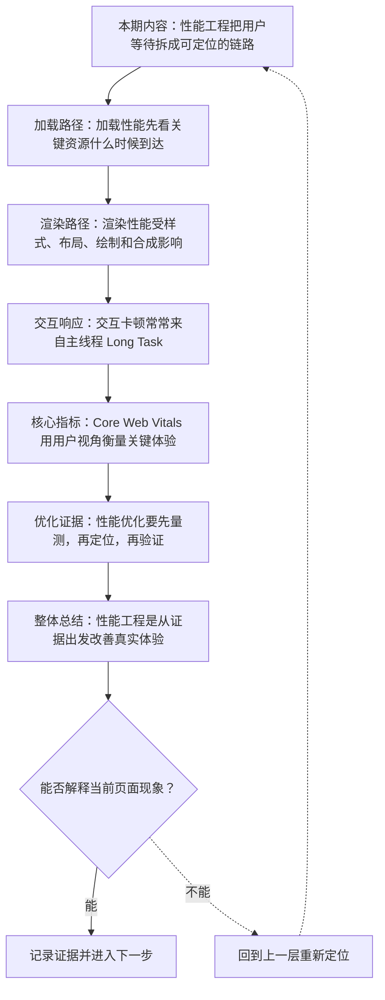
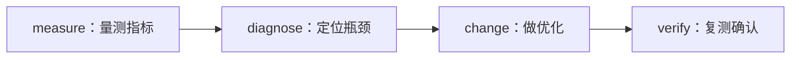

# Web 性能工程：加载、渲染、交互与 Core Web Vitals

&gt; 视频入口：B站合集《前端全链路：从浏览器基础到现代生态》上传并核验后回填正式链接。
&gt; 本文是 EP27 的博客深讲版，包含视频主线，但比视频补充更多机制、流程图、边界判断和排查清单。

## 这篇文章解决什么问题

这期解释 Web 性能不是单个分数，而是加载、渲染和交互组成的用户体验链路。

这一篇的中心问题可以概括成：Web 性能如何从加载、渲染、交互和指标四个角度定位？

关键词：Core Web Vitals、LCP、INP、CLS、Waterfall、bundle、cache、layout、paint、composite

## 视频主线回顾

### 1. 加载路径

Network Waterfall 帮助定位关键资源和缓存问题。

### 2. 渲染路径

样式、布局、绘制和合成共同决定画面稳定性。

### 3. 交互响应

Long Task 会阻塞主线程和用户输入。

### 4. Core Web Vitals

LCP、INP、CLS 分别观察加载、交互和稳定性。

## 技术流程图

先用一张图把本期内容串起来。它不是背诵路线，而是排查问题时可以顺着走的证据路线。

## 深入展开

### 1. 性能工程把用户等待拆成可定位的链路

这一期看 Web 性能工程。我们会讲加载路径怎样从 DNS、网络和资源开始，渲染路径怎样受到 CSS、JavaScript 和图片影响，交互为什么会被 Long Task 卡住，Core Web Vitals 里的 LCP、INP、CLS 分别观察什么，以及优化时怎样用证据定位瓶颈。

这里可以多看一层：先找输入，再看处理过程，最后确认输出。前端很多问题之所以绕，是因为现象出现在页面上，原因却可能藏在网络、样式计算、运行时或构建结果里。

排查时可以顺着这条线问：当前现象是输入不对、处理过程不对，还是最终结果不对。只要能把问题归到其中一格，后面的工具选择就会轻很多。

### 2. 加载性能先看关键资源什么时候到达

Network Waterfall 能看到 HTML、CSS、JavaScript、图片和字体的请求顺序。阻塞渲染的 CSS、过大的 bundle、没有命中缓存的图片，都会影响首屏。优化加载时，先问哪些资源是关键路径，哪些可以延后、压缩、缓存或预加载。

把这段机制放到工程里看，最实用的切口是证据。不要急着猜是哪一行代码错了，先确认浏览器或工具实际拿到了什么、计算了什么、丢出了什么结果。

排查时可以顺着这条线问：当前现象是输入不对、处理过程不对，还是最终结果不对。只要能把问题归到其中一格，后面的工具选择就会轻很多。

### 3. 渲染性能受样式、布局、绘制和合成影响

浏览器要计算样式、布局、绘制和合成。频繁读取布局再写样式，可能触发布局抖动。大面积阴影、滤镜和复杂动画也会增加绘制成本。性能优化不是永远少写 CSS，而是理解哪些变化会影响布局，哪些可以交给合成层更平滑地处理。

这个点在真实项目里常常不是孤立问题。它会和状态、缓存、布局、依赖或团队约束连在一起，所以博客版更强调边界：什么归它管，什么应该交给下一层机制判断。

| 维度 | 含义 |
| --- | --- |
| style | 计算样式。 |
| layout | 计算位置尺寸。 |
| paint | 绘制像素。 |

排查时可以顺着这条线问：当前现象是输入不对、处理过程不对，还是最终结果不对。只要能把问题归到其中一格，后面的工具选择就会轻很多。

### 4. 交互卡顿常常来自主线程 Long Task

JavaScript 执行、样式布局和渲染调度都要占用主线程。一个很长的任务会阻塞输入响应，让用户感觉卡顿。拆分长任务、减少同步计算、延迟非关键逻辑、使用 Web Worker，都是降低交互阻塞的常见方向。

如果要把它讲给别人听，可以按“现象—证据—机制—边界”的顺序。先让对方看到问题，再解释浏览器或工具为什么会给出这样的结果。

排查时可以顺着这条线问：当前现象是输入不对、处理过程不对，还是最终结果不对。只要能把问题归到其中一格，后面的工具选择就会轻很多。

### 5. Core Web Vitals 用用户视角衡量关键体验

LCP 关注主要内容什么时候显示出来，INP 关注交互响应是否及时，CLS 关注页面是否发生意外布局移动。它们分别对应加载、交互和稳定性。一个页面可能 LCP 很好但 INP 很差，也可能视觉稳定性差到让用户误点。

这里可以多看一层：先找输入，再看处理过程，最后确认输出。前端很多问题之所以绕，是因为现象出现在页面上，原因却可能藏在网络、样式计算、运行时或构建结果里。

| 维度 | 含义 |
| --- | --- |
| LCP | 主要内容出现。 |
| INP | 交互响应。 |
| CLS | 布局稳定。 |

排查时可以顺着这条线问：当前现象是输入不对、处理过程不对，还是最终结果不对。只要能把问题归到其中一格，后面的工具选择就会轻很多。

### 6. 性能优化要先量测，再定位，再验证

可以用 Lighthouse、Performance 面板、真实用户监控和构建分析报告一起看问题。实验室数据方便复现，真实用户数据能看到设备、网络和地区差异。优化后要回到同一指标验证，不要只凭感觉说页面更快。

把这段机制放到工程里看，最实用的切口是证据。不要急着猜是哪一行代码错了，先确认浏览器或工具实际拿到了什么、计算了什么、丢出了什么结果。

排查时可以顺着这条线问：当前现象是输入不对、处理过程不对，还是最终结果不对。只要能把问题归到其中一格，后面的工具选择就会轻很多。

## 常见误区与边界

- 不要把性能简化为 Lighthouse 分数。
- 不要提出没有验证闭环的优化。
- 这一篇不展开：具体性能平台接入。
- 这一篇不展开：极限微优化。
- 这一篇不展开：浏览器内核实现源码。

## 排查和验证清单

- 先确认问题发生在哪一层：页面结构、样式计算、JavaScript 运行、网络请求、构建产物还是线上交付。
- 用浏览器或工具拿到证据，不只凭肉眼判断。能截图、能看到日志、能看到请求和产物，结论才稳。
- 把最小例子缩到只剩一个变量。变量越少，越容易看清机制。
- 记录输入、处理过程和输出。前端问题往往不是“某个 API 错了”，而是链路中某一步的假设不成立。
- 如果准备把结论放到项目里，再补一层测试、类型检查、可访问性或性能验证。

## 动手练习

1. 用一个最小 HTML 页面复现 Web 性能工程 里的核心现象。
2. 打开 DevTools，分别记录结构、样式、控制台、网络或性能面板里的一个证据点。
3. 改一个变量，再观察结果是否符合这篇文章里的流程图；如果不符合，把差异写下来。

## 参考来源与本系列依据

- Web.dev：Core Web Vitals：指标定义
- 浏览器工具：Chrome DevTools Performance：定位证据
- 工程实践：RUM / bundle analysis：真实用户与构建证据

## 总结

Web 性能工程的核心不是背技巧，而是用证据找到等待发生在哪里，再验证优化是否真的改善体验。

博客版到这里就把视频主线扩成了可复习的技术笔记：先知道它在链路里的位置，再知道它怎么运行，最后知道遇到问题该从哪里查。
