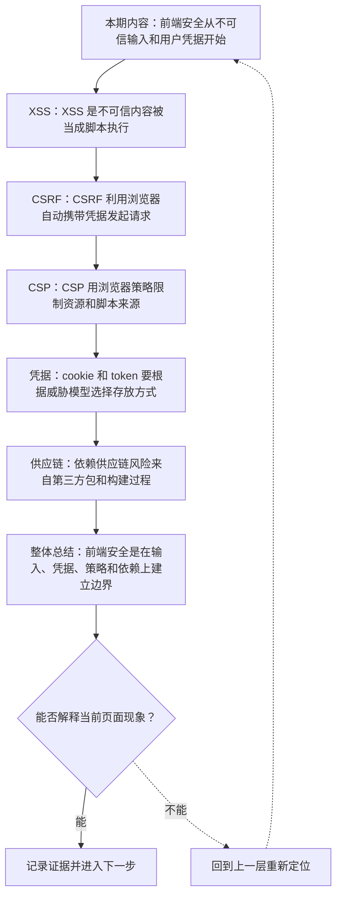
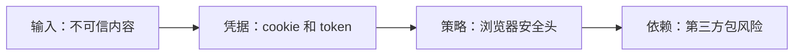
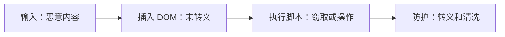
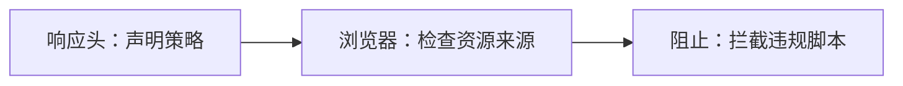
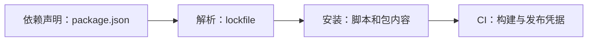

# Web 前端安全：XSS、CSRF、CSP 与依赖供应链

&gt; 视频入口：B站合集《前端全链路：从浏览器基础到现代生态》上传并核验后回填正式链接。
&gt; 本文是 EP28 的博客深讲版，包含视频主线，但比视频补充更多机制、流程图、边界判断和排查清单。

## 这篇文章解决什么问题

这期解释前端安全里最常见的输入、凭据、浏览器策略和依赖风险。

这一篇的中心问题可以概括成：前端安全如何围绕输入、凭据、浏览器策略和依赖供应链建立边界？

关键词：XSS、CSRF、CSP、supply chain、innerHTML、sanitize、SameSite、token、Origin、nonce

## 视频主线回顾

### 1. XSS

不可信内容进入页面并被当成脚本执行，是 XSS 的核心风险。

### 2. CSRF

CSRF 利用浏览器自动携带凭据，需要 SameSite、token 和来源校验。

### 3. CSP 与凭据

CSP 限制资源来源，cookie 属性影响凭据暴露面。

### 4. 供应链

第三方包、lockfile、CI 凭据都是前端安全的一部分。

## 技术流程图

先用一张图把本期内容串起来。它不是背诵路线，而是排查问题时可以顺着走的证据路线。

## 深入展开

### 1. 前端安全从不可信输入和用户凭据开始

这一期看 Web 前端安全。我们会讲 XSS 为什么来自不可信内容进入页面，CSRF 为什么和浏览器自动携带凭据有关，CSP 怎样限制脚本执行来源，cookie 的 SameSite、HttpOnly、Secure 这些属性解决什么问题，以及 npm 依赖供应链为什么也是前端安全的一部分。

这里可以多看一层：先找输入，再看处理过程，最后确认输出。前端很多问题之所以绕，是因为现象出现在页面上，原因却可能藏在网络、样式计算、运行时或构建结果里。

排查时可以顺着这条线问：当前现象是输入不对、处理过程不对，还是最终结果不对。只要能把问题归到其中一格，后面的工具选择就会轻很多。

### 2. XSS 是不可信内容被当成脚本执行

XSS 的核心，是攻击者让恶意脚本进入页面并执行。常见来源包括未转义的 HTML、危险的 innerHTML、富文本编辑器和第三方内容。防护思路是默认转义、谨慎插入 HTML、做内容清洗，并避免把用户输入拼进脚本上下文。

把这段机制放到工程里看，最实用的切口是证据。不要急着猜是哪一行代码错了，先确认浏览器或工具实际拿到了什么、计算了什么、丢出了什么结果。

排查时可以顺着这条线问：当前现象是输入不对、处理过程不对，还是最终结果不对。只要能把问题归到其中一格，后面的工具选择就会轻很多。

### 3. CSRF 利用浏览器自动携带凭据发起请求

CSRF 是 Cross-Site Request Forgery。用户登录了某个站点后，浏览器可能会自动带上 cookie。恶意页面如果诱导浏览器向目标站点发请求，就可能借用用户身份。防护通常包括 SameSite cookie、CSRF token、校验 Origin 或 Referer，以及避免用 GET 执行敏感修改。

这个点在真实项目里常常不是孤立问题。它会和状态、缓存、布局、依赖或团队约束连在一起，所以博客版更强调边界：什么归它管，什么应该交给下一层机制判断。

| 维度 | 含义 |
| --- | --- |
| SameSite | 限制跨站携带 cookie。 |
| token | 请求带随机令牌。 |
| Origin | 校验请求来源。 |

排查时可以顺着这条线问：当前现象是输入不对、处理过程不对，还是最终结果不对。只要能把问题归到其中一格，后面的工具选择就会轻很多。

### 4. CSP 用浏览器策略限制资源和脚本来源

Content Security Policy 可以限制脚本、样式、图片和连接来源。比如只允许加载本站脚本，禁止 inline script，或要求 nonce。CSP 不是替代转义和清洗的万能盾牌，但它能作为重要的浏览器级防线，减少 XSS 成功后的破坏范围。

如果要把它讲给别人听，可以按“现象—证据—机制—边界”的顺序。先让对方看到问题，再解释浏览器或工具为什么会给出这样的结果。

排查时可以顺着这条线问：当前现象是输入不对、处理过程不对，还是最终结果不对。只要能把问题归到其中一格，后面的工具选择就会轻很多。

### 5. cookie 和 token 要根据威胁模型选择存放方式

HttpOnly cookie 可以避免 JavaScript 直接读取，Secure 要求 HTTPS 传输，SameSite 降低跨站请求风险。token 放在内存、本地存储或 cookie 中，各有取舍。安全设计要结合 XSS、CSRF、会话过期、刷新机制和后端校验，不要只套一个固定答案。

这里可以多看一层：先找输入，再看处理过程，最后确认输出。前端很多问题之所以绕，是因为现象出现在页面上，原因却可能藏在网络、样式计算、运行时或构建结果里。

| 维度 | 含义 |
| --- | --- |
| HttpOnly | JS 不能直接读取。 |
| Secure | 只走 HTTPS。 |
| SameSite | 限制跨站携带。 |

排查时可以顺着这条线问：当前现象是输入不对、处理过程不对，还是最终结果不对。只要能把问题归到其中一格，后面的工具选择就会轻很多。

### 6. 依赖供应链风险来自第三方包和构建过程

npm 依赖可能包含维护者变更、恶意版本、被劫持账号、安装脚本和传递依赖风险。降低风险可以从锁定 lockfile、审查依赖变化、减少不必要包、使用安全扫描、限制发布权限和保护 CI 凭据开始。供应链安全不是恐慌，而是让依赖更新有证据。

把这段机制放到工程里看，最实用的切口是证据。不要急着猜是哪一行代码错了，先确认浏览器或工具实际拿到了什么、计算了什么、丢出了什么结果。

排查时可以顺着这条线问：当前现象是输入不对、处理过程不对，还是最终结果不对。只要能把问题归到其中一格，后面的工具选择就会轻很多。

## 常见误区与边界

- 不要给可直接滥用的攻击步骤。
- 不要把安全讲成单一工具能解决。
- 这一篇不展开：密码学细节。
- 这一篇不展开：后端认证全流程。
- 这一篇不展开：漏洞利用演示。

## 排查和验证清单

- 先确认问题发生在哪一层：页面结构、样式计算、JavaScript 运行、网络请求、构建产物还是线上交付。
- 用浏览器或工具拿到证据，不只凭肉眼判断。能截图、能看到日志、能看到请求和产物，结论才稳。
- 把最小例子缩到只剩一个变量。变量越少，越容易看清机制。
- 记录输入、处理过程和输出。前端问题往往不是“某个 API 错了”，而是链路中某一步的假设不成立。
- 如果准备把结论放到项目里，再补一层测试、类型检查、可访问性或性能验证。

## 动手练习

1. 用一个最小 HTML 页面复现 Web 前端安全 里的核心现象。
2. 打开 DevTools，分别记录结构、样式、控制台、网络或性能面板里的一个证据点。
3. 改一个变量，再观察结果是否符合这篇文章里的流程图；如果不符合，把差异写下来。

## 参考来源与本系列依据

- Web 安全：OWASP / MDN Web Security：XSS、CSRF、CSP 基线
- 浏览器策略：Cookie attributes / CSP：凭据和响应头
- 供应链：npm security / lockfile / CI：依赖风险

## 总结

前端安全不是一个开关，而是在输入、凭据、浏览器策略和依赖链路上持续建立边界。

博客版到这里就把视频主线扩成了可复习的技术笔记：先知道它在链路里的位置，再知道它怎么运行，最后知道遇到问题该从哪里查。
