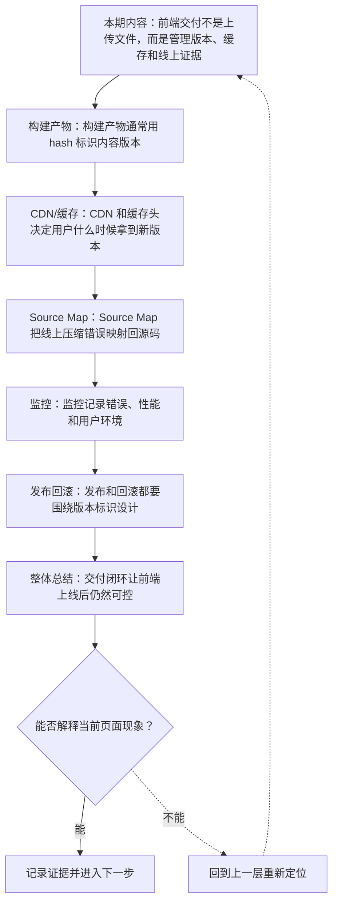
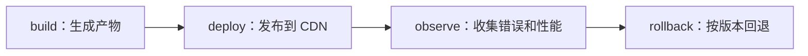
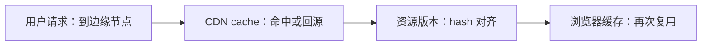
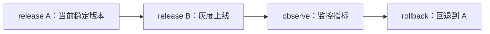

# 前端交付与可观测性：构建产物、CDN、缓存、Source Map 与监控

&gt; 视频入口：B站合集《前端全链路：从浏览器基础到现代生态》上传并核验后回填正式链接。
&gt; 本文是 EP29 的博客深讲版，包含视频主线，但比视频补充更多机制、流程图、边界判断和排查清单。

## 这篇文章解决什么问题

这期解释前端从构建产物到线上监控的交付链路，以及如何定位和回滚问题。

这一篇的中心问题可以概括成：前端交付如何管理构建产物、缓存、Source Map、监控和回滚？

关键词：CDN、cache、Source Map、monitoring、hash、asset、HTML、Cache-Control、version、minify

## 视频主线回顾

### 1. 构建产物和 hash

内容 hash 让静态资源可长期缓存，同时支持版本更新。

### 2. CDN 与缓存

缓存策略决定用户什么时候拿到新版本。

### 3. Source Map

Source Map 把压缩错误映射回源码。

### 4. 监控与回滚

错误、性能和 release 标识构成交付闭环。

## 技术流程图

先用一张图把本期内容串起来。它不是背诵路线，而是排查问题时可以顺着走的证据路线。

## 深入展开

### 1. 前端交付不是上传文件，而是管理版本、缓存和线上证据

这一期看前端交付与可观测性。我们会讲构建产物怎样带 hash，CDN 和缓存头怎样影响用户拿到的版本，Source Map 如何帮助定位压缩后的错误，错误监控和性能监控记录什么，以及发布、灰度和回滚为什么都需要版本标识。

这里可以多看一层：先找输入，再看处理过程，最后确认输出。前端很多问题之所以绕，是因为现象出现在页面上，原因却可能藏在网络、样式计算、运行时或构建结果里。

排查时可以顺着这条线问：当前现象是输入不对、处理过程不对，还是最终结果不对。只要能把问题归到其中一格，后面的工具选择就会轻很多。

### 2. 构建产物通常用 hash 标识内容版本

生产构建会输出 JavaScript、CSS、图片和字体等静态资源。内容 hash 让文件名随内容变化而变化：代码没变，文件名不变，可以长期缓存；代码变了，hash 改变，浏览器会请求新文件。入口 HTML 通常缓存更短，用来指向最新资源。

把这段机制放到工程里看，最实用的切口是证据。不要急着猜是哪一行代码错了，先确认浏览器或工具实际拿到了什么、计算了什么、丢出了什么结果。

| 维度 | 含义 |
| --- | --- |
| app.8f3a.js | 内容变，hash 变。 |
| index.html | 指向最新资源。 |
| manifest | 记录资源映射。 |

排查时可以顺着这条线问：当前现象是输入不对、处理过程不对，还是最终结果不对。只要能把问题归到其中一格，后面的工具选择就会轻很多。

### 3. CDN 和缓存头决定用户什么时候拿到新版本

静态资源常放在 CDN 上，通过 Cache-Control 控制缓存时间。带 hash 的资源可以长缓存，HTML 入口要谨慎缓存，否则可能引用旧资源或新旧混搭。发布时要考虑缓存失效、资源原子性和跨地区传播延迟。很多线上问题，其实不是代码错，而是版本和缓存没对齐。

这个点在真实项目里常常不是孤立问题。它会和状态、缓存、布局、依赖或团队约束连在一起，所以博客版更强调边界：什么归它管，什么应该交给下一层机制判断。

排查时可以顺着这条线问：当前现象是输入不对、处理过程不对，还是最终结果不对。只要能把问题归到其中一格，后面的工具选择就会轻很多。

### 4. Source Map 把线上压缩错误映射回源码

生产 JavaScript 通常会压缩、合并和混淆。Source Map 记录压缩后代码和源码之间的映射，让错误监控平台能显示原始文件、行列和函数位置。Source Map 也有安全和访问控制问题，公开还是私有上传，要按项目风险决定。

如果要把它讲给别人听，可以按“现象—证据—机制—边界”的顺序。先让对方看到问题，再解释浏览器或工具为什么会给出这样的结果。

排查时可以顺着这条线问：当前现象是输入不对、处理过程不对，还是最终结果不对。只要能把问题归到其中一格，后面的工具选择就会轻很多。

### 5. 监控记录错误、性能和用户环境

前端监控通常记录 JavaScript 错误、资源加载失败、接口错误、页面性能、用户设备和版本信息。错误要能聚合、去重、关联 release。性能要区分实验室分数和真实用户数据。监控不是为了制造数字，而是让线上问题能被发现、定位和评估影响面。

这里可以多看一层：先找输入，再看处理过程，最后确认输出。前端很多问题之所以绕，是因为现象出现在页面上，原因却可能藏在网络、样式计算、运行时或构建结果里。

| 维度 | 含义 |
| --- | --- |
| error | JS 和资源错误。 |
| performance | 真实用户指标。 |
| release | 关联版本。 |

排查时可以顺着这条线问：当前现象是输入不对、处理过程不对，还是最终结果不对。只要能把问题归到其中一格，后面的工具选择就会轻很多。

### 6. 发布和回滚都要围绕版本标识设计

可靠发布通常包含构建编号、提交哈希、产物清单和监控 release。灰度发布可以先让一部分用户拿到新版本，观察错误率和性能。发现问题时，要能切回上一个稳定产物，并确认 CDN 和 HTML 入口也回到一致状态。

把这段机制放到工程里看，最实用的切口是证据。不要急着猜是哪一行代码错了，先确认浏览器或工具实际拿到了什么、计算了什么、丢出了什么结果。

排查时可以顺着这条线问：当前现象是输入不对、处理过程不对，还是最终结果不对。只要能把问题归到其中一格，后面的工具选择就会轻很多。

## 常见误区与边界

- 不要把上传成功当成交付完成。
- 不要忽略 Source Map 访问控制。
- 这一篇不展开：具体云厂商配置。
- 这一篇不展开：复杂灰度平台实现。
- 这一篇不展开：隐私合规深度专题。

## 排查和验证清单

- 先确认问题发生在哪一层：页面结构、样式计算、JavaScript 运行、网络请求、构建产物还是线上交付。
- 用浏览器或工具拿到证据，不只凭肉眼判断。能截图、能看到日志、能看到请求和产物，结论才稳。
- 把最小例子缩到只剩一个变量。变量越少，越容易看清机制。
- 记录输入、处理过程和输出。前端问题往往不是“某个 API 错了”，而是链路中某一步的假设不成立。
- 如果准备把结论放到项目里，再补一层测试、类型检查、可访问性或性能验证。

## 动手练习

1. 用一个最小 HTML 页面复现 前端交付与可观测性 里的核心现象。
2. 打开 DevTools，分别记录结构、样式、控制台、网络或性能面板里的一个证据点。
3. 改一个变量，再观察结果是否符合这篇文章里的流程图；如果不符合，把差异写下来。

## 参考来源与本系列依据

- 构建工具：Vite build / asset hashing：产物机制
- Web 缓存：HTTP Cache-Control / CDN：缓存策略
- 可观测性：Source Map / RUM / error monitoring：线上定位

## 总结

前端交付的关键不是上传文件，而是让版本、缓存、错误定位、性能观察和回滚形成闭环。

博客版到这里就把视频主线扩成了可复习的技术笔记：先知道它在链路里的位置，再知道它怎么运行，最后知道遇到问题该从哪里查。
