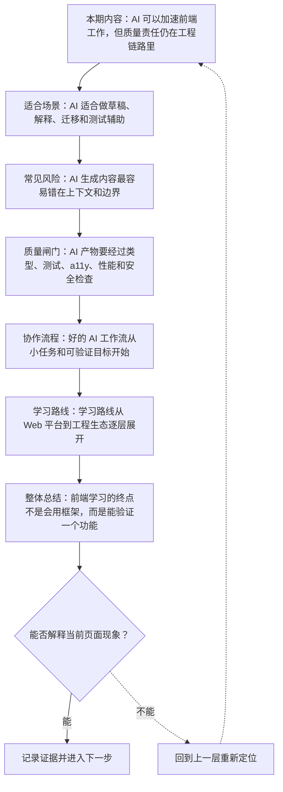
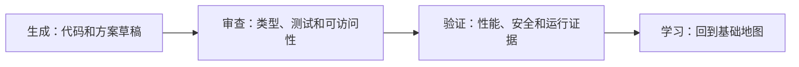
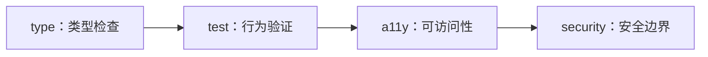

# AI 辅助前端工程与学习路线：生成、验证与质量边界

&gt; 视频入口：B站合集《前端全链路：从浏览器基础到现代生态》上传并核验后回填正式链接。
&gt; 本文是 EP30 的博客深讲版，包含视频主线，但比视频补充更多机制、流程图、边界判断和排查清单。

## 这篇文章解决什么问题

这期收束全系列，解释 AI 在前端工程中的合适位置，以及从基础到生态的学习路线。

这一篇的中心问题可以概括成：AI 辅助前端工程应该放在怎样的质量边界和学习路线中？

关键词：AI、review、test、learning path、AI coding、migration、hallucination、a11y、architecture、TypeScript

## 视频主线回顾

### 1. AI 适合做什么

AI 可以加速草稿、解释、迁移、测试和文档。

### 2. AI 常见风险

过时 API、边界混乱、可访问性缺失和安全假设都要验证。

### 3. 质量闸门

类型、Lint、测试、a11y、性能和安全检查是生成代码的落点。

### 4. 学习路线

从 Web 平台、Web API、工程化、框架到质量交付逐层学习。

## 技术流程图

先用一张图把本期内容串起来。它不是背诵路线，而是排查问题时可以顺着走的证据路线。

## 深入展开

### 1. AI 可以加速前端工作，但质量责任仍在工程链路里

这一期作为系列收束，讲 AI 辅助前端工程与学习路线。我们会看 AI 适合帮你生成组件草稿、解释代码、迁移写法和补测试，也会看它容易犯的错：过时 API、无障碍缺失、状态边界混乱和安全假设。最后把全系列串成一条从 Web 平台到工程生态的学习路线。

这里可以多看一层：先找输入，再看处理过程，最后确认输出。前端很多问题之所以绕，是因为现象出现在页面上，原因却可能藏在网络、样式计算、运行时或构建结果里。

排查时可以顺着这条线问：当前现象是输入不对、处理过程不对，还是最终结果不对。只要能把问题归到其中一格，后面的工具选择就会轻很多。

### 2. AI 适合做草稿、解释、迁移和测试辅助

AI 很适合根据已有组件风格生成草稿，解释陌生代码，批量迁移重复写法，补充测试用例，整理文档和排查错误方向。它的优势是提速和扩展思路，但前提是你能给它上下文，并知道产物应该通过哪些检查。

把这段机制放到工程里看，最实用的切口是证据。不要急着猜是哪一行代码错了，先确认浏览器或工具实际拿到了什么、计算了什么、丢出了什么结果。

| 维度 | 含义 |
| --- | --- |
| 草稿 | 快速搭结构。 |
| 解释 | 理解陌生代码。 |
| 测试 | 补充用例思路。 |

排查时可以顺着这条线问：当前现象是输入不对、处理过程不对，还是最终结果不对。只要能把问题归到其中一格，后面的工具选择就会轻很多。

### 3. AI 生成内容最容易错在上下文和边界

AI 可能引用过时 API，编出不存在的配置，把状态放错层级，忽略键盘和屏幕阅读器，漏掉错误处理，或者给出不符合你团队架构的代码。越是自信的答案，越要回到项目上下文、官方文档和自动化检查里验证。

这个点在真实项目里常常不是孤立问题。它会和状态、缓存、布局、依赖或团队约束连在一起，所以博客版更强调边界：什么归它管，什么应该交给下一层机制判断。

| 维度 | 含义 |
| --- | --- |
| 过时 API | 要查官方文档。 |
| 边界混乱 | 要看架构约定。 |
| 体验缺失 | 要测 a11y 和交互。 |

排查时可以顺着这条线问：当前现象是输入不对、处理过程不对，还是最终结果不对。只要能把问题归到其中一格，后面的工具选择就会轻很多。

### 4. AI 产物要经过类型、测试、a11y、性能和安全检查

AI 写出的组件，至少要能通过 TypeScript、Lint、基础测试和人工 review。涉及 UI 的部分要看可访问性、响应式和视觉回归。涉及请求、凭据和用户输入，要看安全边界。涉及首屏和交互，要看性能指标。质量闸门越清楚，AI 越像加速器，而不是风险放大器。

如果要把它讲给别人听，可以按“现象—证据—机制—边界”的顺序。先让对方看到问题，再解释浏览器或工具为什么会给出这样的结果。

排查时可以顺着这条线问：当前现象是输入不对、处理过程不对，还是最终结果不对。只要能把问题归到其中一格，后面的工具选择就会轻很多。

### 5. 好的 AI 工作流从小任务和可验证目标开始

不要直接让 AI“写完整项目”。更好的方式是给出目标、现有代码、约束和验收标准，比如“按这个组件风格补一个筛选面板，并通过现有测试”。让 AI 先解释方案，再小步修改，再运行检查。你负责判断取舍，它负责加速探索和执行。

这里可以多看一层：先找输入，再看处理过程，最后确认输出。前端很多问题之所以绕，是因为现象出现在页面上，原因却可能藏在网络、样式计算、运行时或构建结果里。

排查时可以顺着这条线问：当前现象是输入不对、处理过程不对，还是最终结果不对。只要能把问题归到其中一格，后面的工具选择就会轻很多。

### 6. 学习路线从 Web 平台到工程生态逐层展开

回看全系列，可以按六层学习：先理解浏览器、HTML、CSS、JavaScript 和 DevTools；再掌握语义、表单、布局和可访问性；接着学习 DOM、事件循环、Fetch、存储和模块；然后进入 TypeScript、Node、包管理和 Vite；再看组件、框架和渲染架构；最后用测试、性能、安全和交付闭环验证工程质量。

把这段机制放到工程里看，最实用的切口是证据。不要急着猜是哪一行代码错了，先确认浏览器或工具实际拿到了什么、计算了什么、丢出了什么结果。

排查时可以顺着这条线问：当前现象是输入不对、处理过程不对，还是最终结果不对。只要能把问题归到其中一格，后面的工具选择就会轻很多。

## 常见误区与边界

- 不要把 AI 描述成替代基础。
- 不要鼓励未经审查直接上线。
- 这一篇不展开：具体 AI 产品横评。
- 这一篇不展开：提示词玄学。
- 这一篇不展开：自动发布和平台运营。

## 排查和验证清单

- 先确认问题发生在哪一层：页面结构、样式计算、JavaScript 运行、网络请求、构建产物还是线上交付。
- 用浏览器或工具拿到证据，不只凭肉眼判断。能截图、能看到日志、能看到请求和产物，结论才稳。
- 把最小例子缩到只剩一个变量。变量越少，越容易看清机制。
- 记录输入、处理过程和输出。前端问题往往不是“某个 API 错了”，而是链路中某一步的假设不成立。
- 如果准备把结论放到项目里，再补一层测试、类型检查、可访问性或性能验证。

## 动手练习

1. 用一个最小 HTML 页面复现 AI 辅助前端工程与学习路线 里的核心现象。
2. 打开 DevTools，分别记录结构、样式、控制台、网络或性能面板里的一个证据点。
3. 改一个变量，再观察结果是否符合这篇文章里的流程图；如果不符合，把差异写下来。

## 参考来源与本系列依据

- 工程实践：AI-assisted coding workflow：协作方式
- 质量体系：TypeScript / tests / a11y / security：验证边界
- 系列内容：frontend foundations roadmap：学习路线收束

## 总结

AI 能让前端工程更快，但真正的能力仍然是理解机制、做出取舍，并用类型、测试、性能、安全和交付证据验证结果。

博客版到这里就把视频主线扩成了可复习的技术笔记：先知道它在链路里的位置，再知道它怎么运行，最后知道遇到问题该从哪里查。
