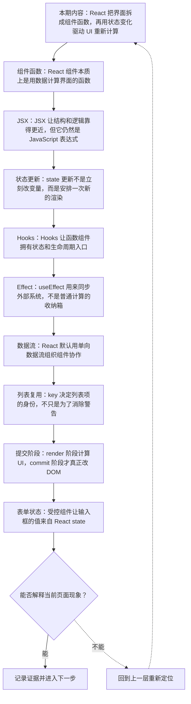
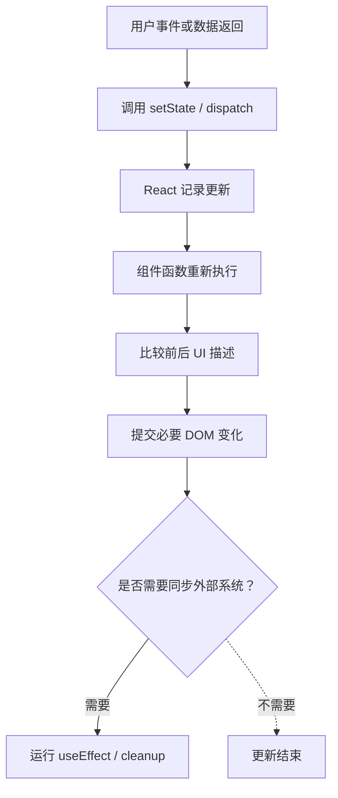
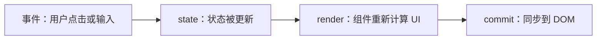
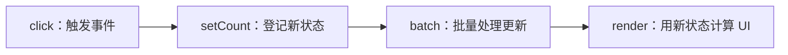
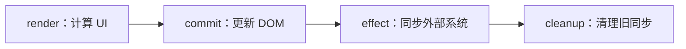
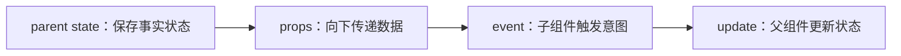
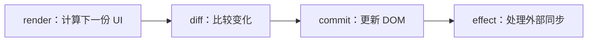
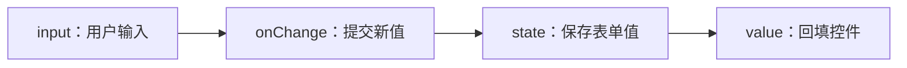
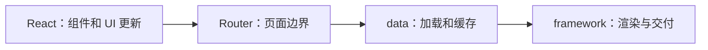

# React 深讲：组件函数、Hooks、状态更新与生态边界

&gt; 视频入口：B站合集《前端全链路：从浏览器基础到现代生态》上传并核验后回填正式链接。
&gt; 本文是 EP31 的博客深讲版，包含视频主线，但比视频补充更多机制、流程图、边界判断和排查清单。


## 这篇文章解决什么问题

这期把 React 单独拆开，具体说明组件函数如何描述 UI，状态更新如何触发重新渲染，Hooks、effect、列表 key 和生态边界分别解决什么问题。

这一篇的中心问题可以概括成：React 如何用组件函数、Hooks 和状态更新组织 UI，以及它和生态工具的边界在哪里？

关键词：React、JSX、Hooks、state、component、props、render、JavaScript、className、useState

## 视频主线回顾

### 1. 组件函数是 React 的入口

组件接收 props，读取 state，返回当前 UI 描述。它会随着状态变化重新执行。

### 2. state 更新安排新的渲染

调用更新函数不是原地改变量，而是让 React 在下一次渲染里使用新状态。

### 3. Hooks 的规则来自状态槽位

Hooks 必须稳定调用，React 才能把每次渲染中的 Hook 对应到同一份内部状态。

### 4. React 的生态边界

React 偏 UI 层，路由、数据、SSR 和全栈能力通常由生态框架和库补齐。

## 技术流程图

先用一张图把本期内容串起来。它不是背诵路线，而是排查问题时可以顺着走的证据路线。



## React 状态更新链路

这张图把本期最关键的结构单独拎出来，适合在复习或做笔记时当作索引。



## 深入展开

### 1. React 把界面拆成组件函数，再用状态变化驱动 UI 重新计算

这一期看 React。内容会比框架横向比较更具体：组件函数怎样返回 UI，JSX 为什么既像 HTML 又是 JavaScript，props 和 state 怎样分工，Hooks 为什么必须按固定顺序调用，useEffect 适合放什么副作用，列表 key 为什么会影响复用，最后再看 React 本身和路由、数据请求、服务端渲染框架之间的边界。看完之后，你应该能判断一个 React 问题到底发生在组件表达、状态更新、effect、列表复用，还是生态工具层。

这里可以多看一层：先找输入，再看处理过程，最后确认输出。前端很多问题之所以绕，是因为现象出现在页面上，原因却可能藏在网络、样式计算、运行时或构建结果里。



排查时可以顺着这条线问：当前现象是输入不对、处理过程不对，还是最终结果不对。只要能把问题归到其中一格，后面的工具选择就会轻很多。

### 2. React 组件本质上是用数据计算界面的函数

React 组件通常写成函数。函数接收 props，读取当前 state，然后返回一段 UI 描述。这里容易误解的一点是，组件函数不是只在页面第一次打开时运行一次；只要相关状态变化，它就可能再次执行。React 关心的是这次执行返回的结果和上一次有什么差异，然后把需要变化的部分提交给浏览器。也就是说，组件函数里应该主要放“根据数据得到界面”的逻辑，不适合直接塞网络请求、定时器、手动改 DOM 这类有外部影响的动作。

把这段机制放到工程里看，最实用的切口是证据。不要急着猜是哪一行代码错了，先确认浏览器或工具实际拿到了什么、计算了什么、丢出了什么结果。

```js
function Counter({ step }) {
  const [count, setCount] = useState(0);
  return <button>{count + step}</button>;
}
```

- props 是外部输入。
- state 是组件记住的状态。
- 返回值描述当前 UI。

排查时可以顺着这条线问：当前现象是输入不对、处理过程不对，还是最终结果不对。只要能把问题归到其中一格，后面的工具选择就会轻很多。

### 3. JSX 让结构和逻辑靠得更近，但它仍然是 JavaScript 表达式

JSX 不是浏览器原生 HTML 文件里的语法，它会经过工具转换，变成 JavaScript 可以执行的函数调用或等价结构。它的好处是把 UI 结构、变量、条件和列表放在同一个组件上下文里，坏处是你必须记住它遵守 JavaScript 规则。比如 class 要写成 className，事件处理器传的是函数引用，花括号里放表达式而不是语句。初学 React 时，很多报错不是“标签写错了”，而是 JSX 里混入了不合法的 JavaScript 表达式。

这个点在真实项目里常常不是孤立问题。它会和状态、缓存、布局、依赖或团队约束连在一起，所以博客版更强调边界：什么归它管，什么应该交给下一层机制判断。

| 维度 | 含义 |
| --- | --- |
| 看起来像 HTML | &lt;button className="primary"&gt;保存&lt;/button&gt; |
| 实际走 JS | 变量、条件、数组 map 都按 JavaScript 规则执行。 |

排查时可以顺着这条线问：当前现象是输入不对、处理过程不对，还是最终结果不对。只要能把问题归到其中一格，后面的工具选择就会轻很多。

### 4. state 更新不是立刻改变量，而是安排一次新的渲染

useState 返回当前 state 和一个更新函数。调用更新函数时，不应该把它理解成“把这个变量原地改掉”，更准确的说法是：告诉 React 下一次渲染应该使用新的状态值。React 会把同一次事件里的多个更新合并处理，减少不必要的 DOM 操作。遇到基于旧值计算新值的场景，推荐传入更新函数，比如 setCount(c =&gt; c + 1)。这样可以避免在闭包里读到旧值。这个模型解释了很多 React 里的“为什么 console 里还是旧值”的问题。

如果要把它讲给别人听，可以按“现象—证据—机制—边界”的顺序。先让对方看到问题，再解释浏览器或工具为什么会给出这样的结果。



排查时可以顺着这条线问：当前现象是输入不对、处理过程不对，还是最终结果不对。只要能把问题归到其中一格，后面的工具选择就会轻很多。

### 5. Hooks 让函数组件拥有状态和生命周期入口

Hooks 解决的是函数组件怎样记住状态、读取上下文、缓存计算和执行副作用。它有一个很重要的规则：不要在条件、循环或嵌套函数里调用 Hook。原因不是语法洁癖，而是 React 需要靠调用顺序把每次渲染里的 Hook 对应到同一个状态槽位。如果某次渲染少调用了一个 Hook，后面的状态就会错位。把这个规则想清楚，再看 useState、useMemo、useCallback、useRef，就不会把它们当成随机散落的魔法函数。

这里可以多看一层：先找输入，再看处理过程，最后确认输出。前端很多问题之所以绕，是因为现象出现在页面上，原因却可能藏在网络、样式计算、运行时或构建结果里。

| 维度 | 含义 |
| --- | --- |
| useState | 保存会触发渲染的状态。 |
| useRef | 保存不触发渲染的可变引用。 |
| useMemo | 缓存一次计算结果。 |

排查时可以顺着这条线问：当前现象是输入不对、处理过程不对，还是最终结果不对。只要能把问题归到其中一格，后面的工具选择就会轻很多。

### 6. useEffect 用来同步外部系统，不是普通计算的收纳箱

useEffect 常被初学者当成“组件加载后执行代码”的地方，但它真正适合处理的是和外部系统同步：订阅事件、启动定时器、请求数据、接入第三方库，或者把 React 状态同步到浏览器 API。它的依赖数组描述的是 effect 依赖哪些值；值变了，旧的同步关系可能需要清理，再建立新的同步关系。很多 React 代码混乱，是因为把派生数据、格式化计算、状态重置都塞进 effect，结果制造出额外渲染和难追踪的依赖。

把这段机制放到工程里看，最实用的切口是证据。不要急着猜是哪一行代码错了，先确认浏览器或工具实际拿到了什么、计算了什么、丢出了什么结果。



排查时可以顺着这条线问：当前现象是输入不对、处理过程不对，还是最终结果不对。只要能把问题归到其中一格，后面的工具选择就会轻很多。

### 7. React 默认用单向数据流组织组件协作

React 项目里，最常见的数据流是父组件保存状态，通过 props 传给子组件；子组件发生点击、输入或选择时，调用父组件传下来的回调，告诉父组件“我想改变什么”。这种单向数据流让变化路径更容易追踪，但也会带来 props 层层传递的问题。小范围可以提升状态位置，大范围可以用 context 或状态管理库。关键不是看到 props 多就立刻上库，而是先判断状态属于局部交互、跨组件共享，还是服务端数据缓存。

这个点在真实项目里常常不是孤立问题。它会和状态、缓存、布局、依赖或团队约束连在一起，所以博客版更强调边界：什么归它管，什么应该交给下一层机制判断。



排查时可以顺着这条线问：当前现象是输入不对、处理过程不对，还是最终结果不对。只要能把问题归到其中一格，后面的工具选择就会轻很多。

### 8. key 决定列表项的身份，不只是为了消除警告

渲染列表时，key 用来告诉 React 每个列表项的稳定身份。没有 key，或者把数组下标当成会变化列表的 key，React 可能在插入、删除、排序时复用错组件实例。表面上看只是数据顺序变了，实际可能导致输入框内容跑到另一行、动画状态错位、局部状态被错误保留。稳定 key 通常来自业务 ID，而不是当前位置。理解 key，其实是在理解 React 怎样在两次渲染结果之间做身份匹配。

如果要把它讲给别人听，可以按“现象—证据—机制—边界”的顺序。先让对方看到问题，再解释浏览器或工具为什么会给出这样的结果。

| 维度 | 含义 |
| --- | --- |
| 不稳定 key | 用 index 表示身份，排序后身份跟着位置跑。 |
| 稳定 key | 用 id 表示身份，排序后组件还能对应原数据。 |

排查时可以顺着这条线问：当前现象是输入不对、处理过程不对，还是最终结果不对。只要能把问题归到其中一格，后面的工具选择就会轻很多。

### 9. render 阶段计算 UI，commit 阶段才真正改 DOM

React 更新可以粗略分成两个阶段。render 阶段根据新的 props 和 state 计算下一份 UI 描述，这个阶段应该保持纯净，不直接读写外部系统。commit 阶段才把需要变化的部分提交到 DOM，并运行 layout effect 或普通 effect。把这两个阶段分开，会解释很多现象：为什么组件函数可能被调用多次，为什么 Strict Mode 会帮助暴露不纯的渲染逻辑，为什么手动读 DOM 尺寸要放到合适的 effect 里，而不是随手写在组件函数顶部。

这里可以多看一层：先找输入，再看处理过程，最后确认输出。前端很多问题之所以绕，是因为现象出现在页面上，原因却可能藏在网络、样式计算、运行时或构建结果里。



排查时可以顺着这条线问：当前现象是输入不对、处理过程不对，还是最终结果不对。只要能把问题归到其中一格，后面的工具选择就会轻很多。

### 10. 受控组件让输入框的值来自 React state

React 里常见的受控表单，是把 input 的 value 绑定到 state，再用 onChange 更新 state。这样做的好处是校验、禁用按钮、联动字段、提交前整理数据都可以从同一份状态推导出来。代价是每次输入都会触发状态更新和重新渲染，所以大型表单需要拆分组件、减少无关渲染，或者使用专门的表单库管理字段订阅。简单表单可以直接受控，超大表单要考虑性能和用户输入延迟，不能只看写法优雅。

把这段机制放到工程里看，最实用的切口是证据。不要急着猜是哪一行代码错了，先确认浏览器或工具实际拿到了什么、计算了什么、丢出了什么结果。



排查时可以顺着这条线问：当前现象是输入不对、处理过程不对，还是最终结果不对。只要能把问题归到其中一格，后面的工具选择就会轻很多。

### 11. 服务端数据不是普通 UI state，需要处理缓存、重试和失效

React 本身不规定数据请求方案。你可以在 effect 里请求数据，但真实项目还要处理加载状态、错误状态、重复请求、缓存命中、参数变化、页面切换、重新验证和取消过期请求。这里要区分两类状态：UI state 是当前页面交互产生的状态，比如弹窗开关；server state 是服务端事实在客户端的缓存副本，比如商品列表。server state 往往需要专门的数据请求库或框架能力来管理，否则组件里会堆满请求、loading、error 和清理逻辑。

这个点在真实项目里常常不是孤立问题。它会和状态、缓存、布局、依赖或团队约束连在一起，所以博客版更强调边界：什么归它管，什么应该交给下一层机制判断。

| 维度 | 含义 |
| --- | --- |
| UI state | 弹窗、选中项、临时输入，主要由页面交互产生。 |
| server state | 接口数据的缓存副本，需要刷新、失效和错误处理。 |

排查时可以顺着这条线问：当前现象是输入不对、处理过程不对，还是最终结果不对。只要能把问题归到其中一格，后面的工具选择就会轻很多。

### 12. React 性能问题通常来自无关渲染、昂贵计算和不稳定引用

React 组件重新渲染本身不是错误。真正需要关注的是：一次更新让太大的组件树都重新计算，列表里每一项都做昂贵计算，或者传给子组件的对象和函数每次都变，导致 memo 失效。优化时先用 Profiler 或浏览器 Performance 找证据，再决定拆组件、移动状态、虚拟列表、useMemo、useCallback 或 React.memo。没有证据地到处包 memo，常常只是增加理解成本，还可能掩盖数据流设计本身的问题。

如果要把它讲给别人听，可以按“现象—证据—机制—边界”的顺序。先让对方看到问题，再解释浏览器或工具为什么会给出这样的结果。

| 维度 | 含义 |
| --- | --- |
| 先测量 | Profiler 找出慢在哪里。 |
| 再拆分 | 缩小受影响组件树。 |
| 后缓存 | memo 只用于有证据的热点。 |

排查时可以顺着这条线问：当前现象是输入不对、处理过程不对，还是最终结果不对。只要能把问题归到其中一格，后面的工具选择就会轻很多。

### 13. React 应用常常需要框架来补齐路由、数据和渲染架构

做一个真实 React 应用，不只写组件。你还要决定路由怎么切，数据在哪里加载，错误边界怎么处理，SEO 是否需要服务端生成 HTML，静态页面是否可以提前构建，部署后缓存和回滚怎么做。React 官方也把新应用引导到框架语境里，因为 Next.js、Remix 这类方案会把路由、数据加载、SSR、SSG、构建和部署约束组合起来。选择 React 时，不能只问组件写法喜不喜欢，还要问团队准备采用哪套应用框架和工程纪律。

这里可以多看一层：先找输入，再看处理过程，最后确认输出。前端很多问题之所以绕，是因为现象出现在页面上，原因却可能藏在网络、样式计算、运行时或构建结果里。



排查时可以顺着这条线问：当前现象是输入不对、处理过程不对，还是最终结果不对。只要能把问题归到其中一格，后面的工具选择就会轻很多。

## 常见误区与边界

- 不要把 useEffect 讲成万能生命周期。
- 不要把 React 生态能力说成 React 核心内建能力。
- 这一篇不展开：完整 React API 教程。
- 这一篇不展开：React Native。
- 这一篇不展开：具体状态管理库排行榜。

## 排查和验证清单

- 先确认问题发生在哪一层：页面结构、样式计算、JavaScript 运行、网络请求、构建产物还是线上交付。
- 用浏览器或工具拿到证据，不只凭肉眼判断。能截图、能看到日志、能看到请求和产物，结论才稳。
- 把最小例子缩到只剩一个变量。变量越少，越容易看清机制。
- 记录输入、处理过程和输出。前端问题往往不是“某个 API 错了”，而是链路中某一步的假设不成立。
- 如果准备把结论放到项目里，再补一层测试、类型检查、可访问性或性能验证。

## 动手练习

1. 用一个最小 HTML 页面复现 React 深讲 里的核心现象。
2. 打开 DevTools，分别记录结构、样式、控制台、网络或性能面板里的一个证据点。
3. 改一个变量，再观察结果是否符合这篇文章里的流程图；如果不符合，把差异写下来。

## 参考来源与本系列依据

- 官方文档：react.dev Learn / Reference：组件、JSX、state、Hooks 与 effect
- 官方建议：react.dev start a new React project：框架与生态边界
- 工程实践：React list keys and data flow：列表复用和单向数据流

## 总结

React 的学习重点不是 API 背诵，而是理解组件函数、状态更新、Hooks 调用顺序、effect 边界和生态组合方式。

博客版到这里就把视频主线扩成了可复习的技术笔记：先知道它在链路里的位置，再知道它怎么运行，最后知道遇到问题该从哪里查。
