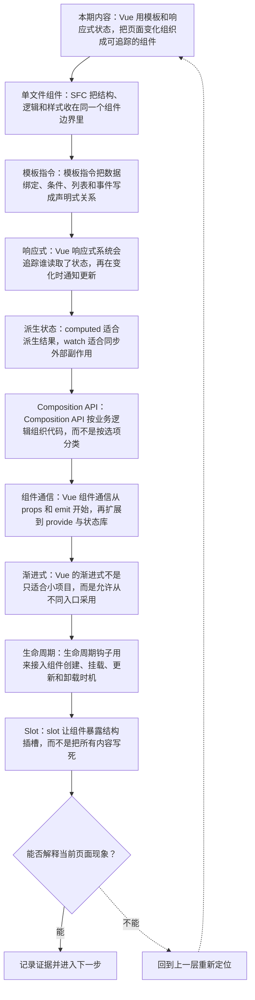
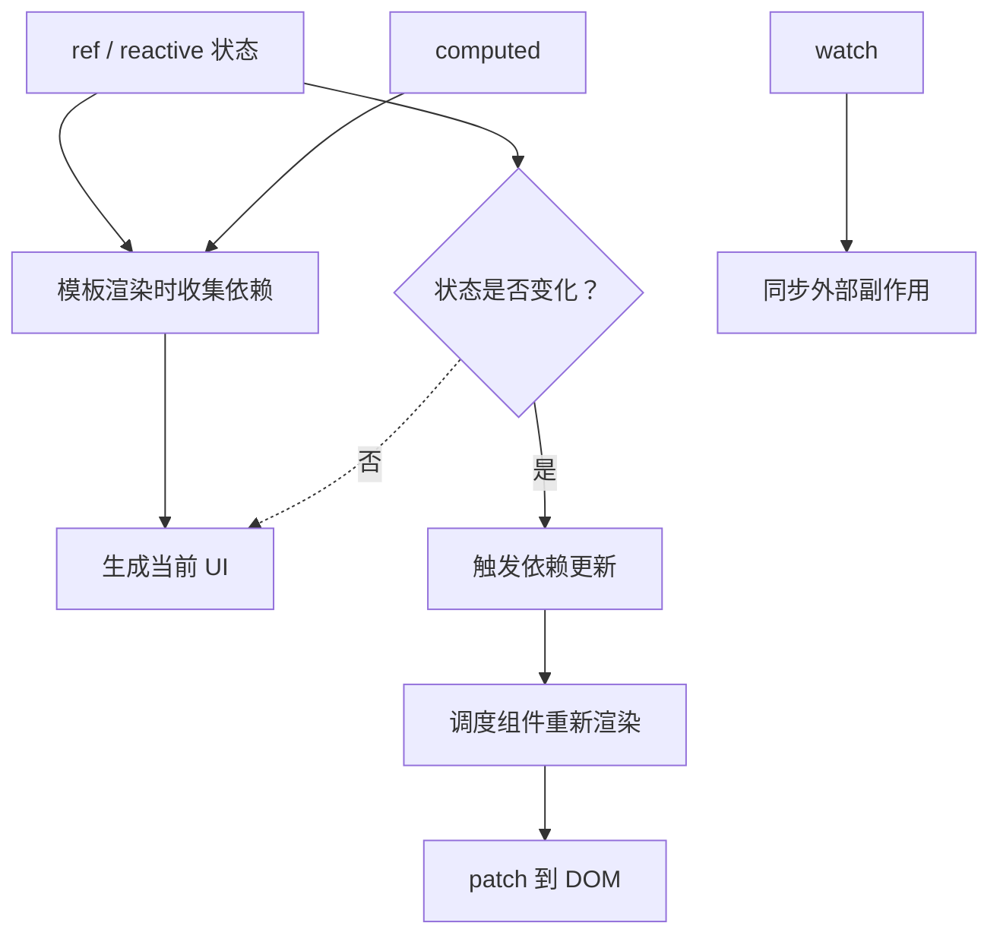
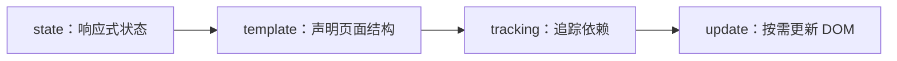
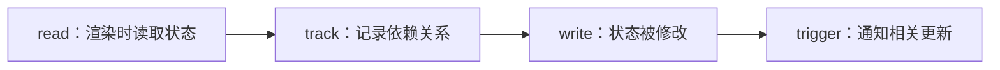
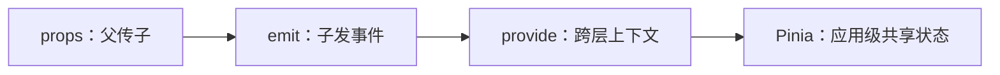
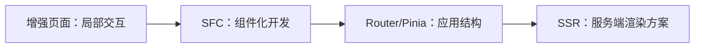
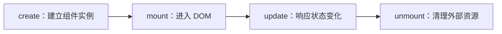
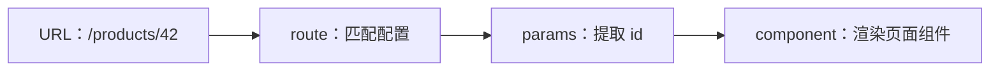
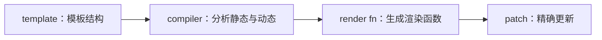

# Vue 深讲：单文件组件、响应式系统、Composition API 与渐进式架构

&gt; 视频入口：B站合集《前端全链路：从浏览器基础到现代生态》上传并核验后回填正式链接。
&gt; 本文是 EP32 的博客深讲版，包含视频主线，但比视频补充更多机制、流程图、边界判断和排查清单。


## 这篇文章解决什么问题

这期把 Vue 单独拆开，具体说明单文件组件如何组织界面，响应式系统怎样追踪依赖，Composition API 如何复用逻辑，以及 Vue 的渐进式边界在哪里。

这一篇的中心问题可以概括成：Vue 如何通过 SFC、模板指令、响应式系统和 Composition API 组织前端应用？

关键词：Vue、SFC、reactivity、Composition API、template、style、v-bind、v-if、v-for、v-on

## 视频主线回顾

### 1. SFC 定义组件边界

单文件组件把同一块 UI 的结构、逻辑和样式放在一个可维护边界里。

### 2. 模板指令描述绑定关系

v-bind、v-if、v-for、v-on 把状态、结构、列表和事件连接到页面。

### 3. 响应式系统追踪依赖

读取时记录依赖，写入时触发相关更新；ref、reactive、computed 和 watch 各有边界。

### 4. Composition API 复用逻辑

复杂组件可以按业务逻辑组织代码，并抽成 composable 复用。

## 技术流程图

先用一张图把本期内容串起来。它不是背诵路线，而是排查问题时可以顺着走的证据路线。



## Vue 响应式与组件更新

这张图把本期最关键的结构单独拎出来，适合在复习或做笔记时当作索引。



## 深入展开

### 1. Vue 用模板和响应式状态，把页面变化组织成可追踪的组件

这一期看 Vue。我们会具体拆开单文件组件为什么把 template、script 和 style 放在一起，模板指令怎样把数据、条件、列表和事件接到页面上，ref、reactive、computed、watch 这些响应式 API 各自负责什么，Composition API 为什么适合复用逻辑，最后再看 Vue Router、Pinia、构建工具和渐进式采用的边界。看完之后，你应该能判断一个 Vue 问题是在模板表达、响应式追踪、组件通信、逻辑复用，还是应用生态层。

这里可以多看一层：先找输入，再看处理过程，最后确认输出。前端很多问题之所以绕，是因为现象出现在页面上，原因却可能藏在网络、样式计算、运行时或构建结果里。



排查时可以顺着这条线问：当前现象是输入不对、处理过程不对，还是最终结果不对。只要能把问题归到其中一格，后面的工具选择就会轻很多。

### 2. SFC 把结构、逻辑和样式收在同一个组件边界里

Vue 常见写法是单文件组件，也就是 SFC。一个 .vue 文件里通常有 template、script 和 style。template 负责结构，script 负责状态和行为，style 可以限定当前组件样式。它的价值在于：当你维护一个按钮、弹窗或列表项时，相关结构、交互和样式都在同一个组件边界内。和纯 HTML 不同，template 会被 Vue 编译；和随便拼字符串不同，它仍然保留清晰的模板语义和静态分析空间。

把这段机制放到工程里看，最实用的切口是证据。不要急着猜是哪一行代码错了，先确认浏览器或工具实际拿到了什么、计算了什么、丢出了什么结果。

```js
<template>
  <button @click="count++">{{ count }}</button>
</template>

<script setup>
import { ref } from 'vue'
const count = ref(0)
</script>
```

- template 描述结构。
- script setup 声明状态和逻辑。
- style 可限定组件样式。

排查时可以顺着这条线问：当前现象是输入不对、处理过程不对，还是最终结果不对。只要能把问题归到其中一格，后面的工具选择就会轻很多。

### 3. 模板指令把数据绑定、条件、列表和事件写成声明式关系

Vue 模板里常见的 v-bind、v-if、v-for、v-on，本质上是在描述数据和页面之间的关系。v-bind 把变量绑定到属性，v-if 决定某块 DOM 是否存在，v-for 根据数组生成列表，v-on 监听用户事件。它们不是简单文本替换，而会进入 Vue 的编译和更新流程。模板让很多 UI 逻辑更接近 HTML 阅读习惯，但也要求你分清：能在模板里直接表达的关系，不一定要写成额外方法或 watcher。

这个点在真实项目里常常不是孤立问题。它会和状态、缓存、布局、依赖或团队约束连在一起，所以博客版更强调边界：什么归它管，什么应该交给下一层机制判断。

| 维度 | 含义 |
| --- | --- |
| v-bind | 变量绑定到属性。 |
| v-if / v-for | 控制结构和列表。 |
| v-on | 把事件接到函数。 |

排查时可以顺着这条线问：当前现象是输入不对、处理过程不对，还是最终结果不对。只要能把问题归到其中一格，后面的工具选择就会轻很多。

### 4. Vue 响应式系统会追踪谁读取了状态，再在变化时通知更新

Vue 的响应式不是“变量天生会刷新页面”。当组件渲染或 computed 执行时，如果读取了响应式状态，Vue 会记录这份依赖；之后状态被修改，相关渲染或计算就会重新运行。ref 适合包装一个值，reactive 适合包装对象。模板里读取 ref 会自动解包，JavaScript 里通常要用 .value。很多 Vue 初学问题都来自这里：你以为改的是响应式值，实际改的是普通变量；或者把解构后的字段拿出来，丢掉了原来的追踪关系。

如果要把它讲给别人听，可以按“现象—证据—机制—边界”的顺序。先让对方看到问题，再解释浏览器或工具为什么会给出这样的结果。



排查时可以顺着这条线问：当前现象是输入不对、处理过程不对，还是最终结果不对。只要能把问题归到其中一格，后面的工具选择就会轻很多。

### 5. computed 适合派生结果，watch 适合同步外部副作用

computed 用来表达从已有状态推导出来的结果，比如总价、过滤后的列表、按钮是否可用。它有缓存，依赖没变就不重新计算。watch 更适合在状态变化后做外部同步，比如请求接口、写入 localStorage、上报埋点，或者调用非 Vue 系统。把 computed 和 watch 分清楚，代码会清爽很多：能用表达式和 computed 得到的，就不要绕一圈写 watcher；确实要和外部世界同步时，再用 watch 或 watchEffect。

这里可以多看一层：先找输入，再看处理过程，最后确认输出。前端很多问题之所以绕，是因为现象出现在页面上，原因却可能藏在网络、样式计算、运行时或构建结果里。

| 维度 | 含义 |
| --- | --- |
| computed | 从响应式状态推导页面需要的值。 |
| watch | 监听变化并同步外部动作。 |

排查时可以顺着这条线问：当前现象是输入不对、处理过程不对，还是最终结果不对。只要能把问题归到其中一格，后面的工具选择就会轻很多。

### 6. Composition API 按业务逻辑组织代码，而不是按选项分类

Options API 会把 data、methods、computed、watch 分成不同选项，这对小组件很直观。但当组件变复杂，同一个业务逻辑可能散落在多个选项里。Composition API 允许你把一组相关状态、计算、方法和副作用写在一起，再抽成 useSomething 这样的组合函数复用。它不是为了显得高级，而是为了让“搜索逻辑”“分页逻辑”“表单校验逻辑”这些横切能力可以被清楚地搬走。代价是你要更主动地维护命名和模块边界。

把这段机制放到工程里看，最实用的切口是证据。不要急着猜是哪一行代码错了，先确认浏览器或工具实际拿到了什么、计算了什么、丢出了什么结果。

| 维度 | 含义 |
| --- | --- |
| Options API | 按 data、methods 等选项分组。 |
| Composition API | 按一组业务逻辑聚合。 |
| composable | 抽出可复用逻辑。 |

排查时可以顺着这条线问：当前现象是输入不对、处理过程不对，还是最终结果不对。只要能把问题归到其中一格，后面的工具选择就会轻很多。

### 7. Vue 组件通信从 props 和 emit 开始，再扩展到 provide 与状态库

Vue 里父子组件通信通常从 props 和 emit 开始。父组件把数据传给子组件，子组件通过 emit 发出事件，让父组件决定状态怎么改。层级更深时，可以用 provide 和 inject 传递上下文；跨页面或跨模块共享状态时，再考虑 Pinia 这类状态库。这里的判断和 React 类似：不要因为组件之间要通信就立刻上全局状态。先看这份状态属于单个组件、父子区域、页面上下文，还是整个应用。状态放得越全局，修改路径就越需要纪律。

这个点在真实项目里常常不是孤立问题。它会和状态、缓存、布局、依赖或团队约束连在一起，所以博客版更强调边界：什么归它管，什么应该交给下一层机制判断。



排查时可以顺着这条线问：当前现象是输入不对、处理过程不对，还是最终结果不对。只要能把问题归到其中一格，后面的工具选择就会轻很多。

### 8. Vue 的渐进式不是只适合小项目，而是允许从不同入口采用

Vue 经常被称为渐进式框架。这个词的意思不是“只适合简单页面”，而是它的采用层次比较灵活：你可以只用 Vue 接管一个已有页面里的交互区域，也可以使用 SFC、Vue Router、Pinia、Vite 和服务端渲染框架搭完整应用。渐进式的优点是迁移成本可控，团队可以逐步引入；风险是如果项目规模变大却没有及时建立目录、状态和路由规范，也会变得松散。Vue 给了平滑入口，不等于架构可以没有边界。

如果要把它讲给别人听，可以按“现象—证据—机制—边界”的顺序。先让对方看到问题，再解释浏览器或工具为什么会给出这样的结果。



排查时可以顺着这条线问：当前现象是输入不对、处理过程不对，还是最终结果不对。只要能把问题归到其中一格，后面的工具选择就会轻很多。

### 9. 生命周期钩子用来接入组件创建、挂载、更新和卸载时机

Vue 组件会经历创建、挂载、更新和卸载。onMounted 适合访问已经进入 DOM 的元素或接入第三方库，onUpdated 可以观察更新后的 DOM，onUnmounted 用来清理定时器、订阅和外部实例。生命周期钩子不是普通业务逻辑的默认容器，它更像组件和浏览器、第三方库、全局事件之间的连接点。如果只是根据状态计算一个显示值，优先用 computed；如果只是响应用户点击，直接写事件处理函数；只有真的需要某个组件时机，才用生命周期。

这里可以多看一层：先找输入，再看处理过程，最后确认输出。前端很多问题之所以绕，是因为现象出现在页面上，原因却可能藏在网络、样式计算、运行时或构建结果里。



排查时可以顺着这条线问：当前现象是输入不对、处理过程不对，还是最终结果不对。只要能把问题归到其中一格，后面的工具选择就会轻很多。

### 10. slot 让组件暴露结构插槽，而不是把所有内容写死

Vue 的 slot 用来把一块结构交给父组件决定。比如一个 Card 组件可以固定边框、阴影和间距，但标题、内容、底部按钮由调用方传进去。具名 slot 让不同区域分别填充，作用域 slot 还能把子组件内部数据暴露给父组件渲染。理解 slot 后，你会发现很多组件设计不需要几十个 props 开关。props 适合传数据和配置，slot 适合传结构和展示方式。两者分清楚，组件 API 会轻很多。

把这段机制放到工程里看，最实用的切口是证据。不要急着猜是哪一行代码错了，先确认浏览器或工具实际拿到了什么、计算了什么、丢出了什么结果。

| 维度 | 含义 |
| --- | --- |
| props | 传递数据、开关和配置。 |
| slot | 传递一块可渲染结构。 |

排查时可以顺着这条线问：当前现象是输入不对、处理过程不对，还是最终结果不对。只要能把问题归到其中一格，后面的工具选择就会轻很多。

### 11. Vue Router 把 URL 映射到组件树和页面状态

Vue Router 负责根据 URL 渲染对应组件，也处理嵌套路由、动态参数、导航守卫和懒加载。一个商品详情页里的 id，通常来自路由参数；登录后才能访问的页面，可以通过导航守卫控制；大型页面可以按路由拆分代码，减少首屏加载。路由设计的核心不是把页面塞进数组配置，而是决定哪些状态应该进入 URL，哪些页面可以独立刷新和分享，哪些模块需要按访问路径懒加载。

这个点在真实项目里常常不是孤立问题。它会和状态、缓存、布局、依赖或团队约束连在一起，所以博客版更强调边界：什么归它管，什么应该交给下一层机制判断。



排查时可以顺着这条线问：当前现象是输入不对、处理过程不对，还是最终结果不对。只要能把问题归到其中一格，后面的工具选择就会轻很多。

### 12. Pinia 适合管理跨页面共享状态，但不该替代局部 state

Pinia 是 Vue 生态里常见的应用级状态管理方案。它适合保存跨页面共享的状态，比如当前用户、购物车、权限信息、全局筛选条件。它不适合把每个输入框、每个弹窗开关都搬进去。局部状态留在组件里，父子共享先用 props 和 emit，跨层上下文可以考虑 provide/inject，多个页面都要读写的状态再放进 store。这样做的好处是状态边界更清楚，调试时也能知道一次修改为什么影响了这么多页面。

如果要把它讲给别人听，可以按“现象—证据—机制—边界”的顺序。先让对方看到问题，再解释浏览器或工具为什么会给出这样的结果。

| 维度 | 含义 |
| --- | --- |
| 局部 state | 组件自己的输入和开关。 |
| 父子通信 | props 和 emit。 |
| store | 跨页面共享事实。 |

排查时可以顺着这条线问：当前现象是输入不对、处理过程不对，还是最终结果不对。只要能把问题归到其中一格，后面的工具选择就会轻很多。

### 13. Vue 编译器会利用模板结构，帮助运行时更精确地更新

Vue 模板在构建时会被编译成渲染函数。因为模板结构相对明确，编译器可以标记哪些节点是静态的，哪些地方依赖动态数据，运行时更新时就能更快定位变化区域。这个机制解释了为什么 Vue 一方面保留模板写法，另一方面又能做组件级和节点级优化。开发时不需要背所有编译细节，但要知道：写出稳定、清晰、少副作用的模板，通常比在模板里塞复杂表达式更容易被人和工具理解。

这里可以多看一层：先找输入，再看处理过程，最后确认输出。前端很多问题之所以绕，是因为现象出现在页面上，原因却可能藏在网络、样式计算、运行时或构建结果里。



排查时可以顺着这条线问：当前现象是输入不对、处理过程不对，还是最终结果不对。只要能把问题归到其中一格，后面的工具选择就会轻很多。

## 常见误区与边界

- 不要把渐进式误说成只适合小项目。
- 不要把 watch 当成派生状态的默认选择。
- 这一篇不展开：完整 Vue API 教程。
- 这一篇不展开：Nuxt 深入专题。
- 这一篇不展开：状态库和 UI 库横评。

## 排查和验证清单

- 先确认问题发生在哪一层：页面结构、样式计算、JavaScript 运行、网络请求、构建产物还是线上交付。
- 用浏览器或工具拿到证据，不只凭肉眼判断。能截图、能看到日志、能看到请求和产物，结论才稳。
- 把最小例子缩到只剩一个变量。变量越少，越容易看清机制。
- 记录输入、处理过程和输出。前端问题往往不是“某个 API 错了”，而是链路中某一步的假设不成立。
- 如果准备把结论放到项目里，再补一层测试、类型检查、可访问性或性能验证。

## 动手练习

1. 用一个最小 HTML 页面复现 Vue 深讲 里的核心现象。
2. 打开 DevTools，分别记录结构、样式、控制台、网络或性能面板里的一个证据点。
3. 改一个变量，再观察结果是否符合这篇文章里的流程图；如果不符合，把差异写下来。

## 参考来源与本系列依据

- 官方文档：vuejs.org Guide：SFC、template、reactivity、Composition API
- 官方生态：Vue Router / Pinia：路由与状态边界
- 工程实践：progressive adoption：渐进式采用和项目约束

## 总结

Vue 的重点是用模板保持界面可读，用响应式系统追踪状态依赖，再用 Composition API 和渐进式生态扩展到完整应用。

博客版到这里就把视频主线扩成了可复习的技术笔记：先知道它在链路里的位置，再知道它怎么运行，最后知道遇到问题该从哪里查。
