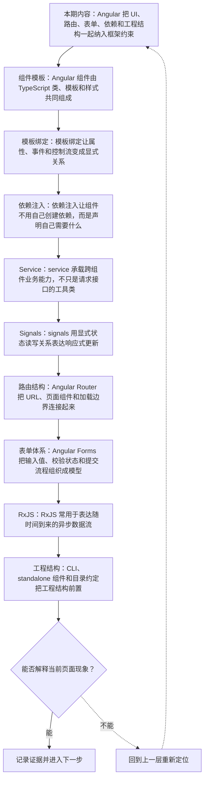
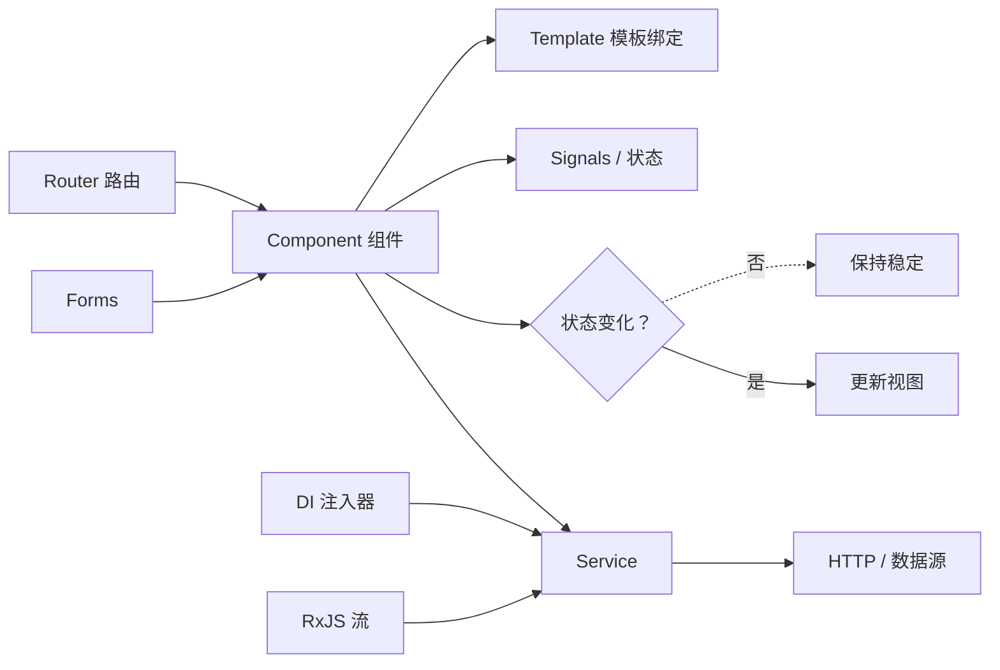
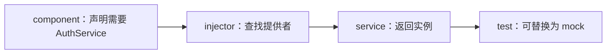
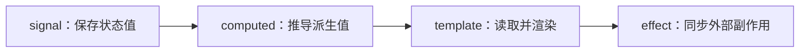
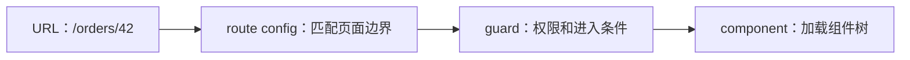
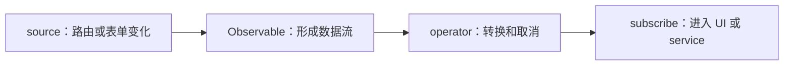
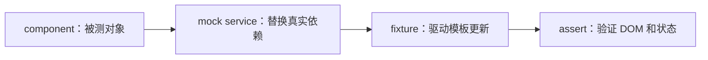
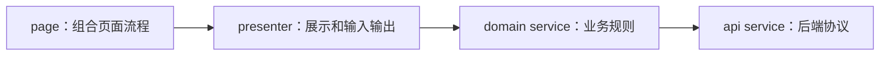

# Angular 深讲：完整框架、组件模板、依赖注入、Signals 与大型应用结构

&gt; 视频入口：B站合集《前端全链路：从浏览器基础到现代生态》上传并核验后回填正式链接。
&gt; 本文是 EP33 的博客深讲版，包含视频主线，但比视频补充更多机制、流程图、边界判断和排查清单。


## 这篇文章解决什么问题

这期把 Angular 单独拆开，具体说明完整框架如何组织大型应用，组件模板、依赖注入、service、signals、路由和表单分别承担什么责任。

这一篇的中心问题可以概括成：Angular 如何通过完整框架、依赖注入、signals、路由和表单组织大型前端应用？

关键词：Angular、DI、signals、Router、component、template、TypeScript、binding、event、control flow

## 视频主线回顾

### 1. 组件和模板

Angular 组件由 TypeScript 类、模板和样式组成，模板把状态和行为绑定到页面。

### 2. 依赖注入和 service

DI 让组件声明依赖，service 负责封装跨组件业务能力和外部通信。

### 3. signals 响应式状态

signal、computed 和 effect 让状态读取、派生和副作用关系更显式。

### 4. 路由和表单

Router 管理 URL 与页面边界，Forms 管理输入值、校验和提交状态。

## 技术流程图

先用一张图把本期内容串起来。它不是背诵路线，而是排查问题时可以顺着走的证据路线。



## Angular 大型应用组织方式

这张图把本期最关键的结构单独拎出来，适合在复习或做笔记时当作索引。



## 深入展开

### 1. Angular 把 UI、路由、表单、依赖和工程结构一起纳入框架约束

这一期看 Angular。内容会具体拆开：组件和模板怎样描述界面，dependency injection 为什么是 Angular 的核心组织方式，service 怎样承载业务逻辑和共享能力，signals 如何表达响应式状态，Router 和 Forms 为什么是框架内的重要部分，RxJS 和 Observable 又常出现在什么边界。看完之后，你应该能判断一个 Angular 问题是在模板绑定、依赖注入、service 设计、响应式状态、路由表单，还是工程结构层。

这里可以多看一层：先找输入，再看处理过程，最后确认输出。前端很多问题之所以绕，是因为现象出现在页面上，原因却可能藏在网络、样式计算、运行时或构建结果里。

| 维度 | 含义 |
| --- | --- |
| 组件 | 组织 UI 和模板。 |
| DI / service | 组织依赖和业务能力。 |
| Router / Forms | 内建应用能力。 |

排查时可以顺着这条线问：当前现象是输入不对、处理过程不对，还是最终结果不对。只要能把问题归到其中一格，后面的工具选择就会轻很多。

### 2. Angular 组件由 TypeScript 类、模板和样式共同组成

Angular 组件通常由一个 TypeScript 类、一个模板和一组样式组成。类里声明组件状态、方法和依赖，模板里使用插值、属性绑定、事件绑定和控制流语法把这些状态接到页面。和 React 的 JSX 不同，Angular 更强调模板语言和组件类的分工；和 Vue 的 SFC 类似，它也会把当前组件的 UI 边界收在一起。理解组件时，要把“模板怎么读状态”和“类怎么改变状态”连起来，而不是把 HTML 和 TypeScript 分成两张互不相关的表。

把这段机制放到工程里看，最实用的切口是证据。不要急着猜是哪一行代码错了，先确认浏览器或工具实际拿到了什么、计算了什么、丢出了什么结果。

```js
@Component({
  selector: 'app-counter',
  template: `<button (click)="inc()">{{ count() }}</button>`
})
export class CounterComponent {
  count = signal(0)
  inc() { this.count.update(v => v + 1) }
}
```

- 模板读取组件状态。
- 事件调用组件方法。
- TypeScript 类组织逻辑。

排查时可以顺着这条线问：当前现象是输入不对、处理过程不对，还是最终结果不对。只要能把问题归到其中一格，后面的工具选择就会轻很多。

### 3. 模板绑定让属性、事件和控制流变成显式关系

Angular 模板里的插值显示文本，属性绑定把组件值写到 DOM 属性或组件输入，事件绑定把用户行为接回组件方法，双向绑定常用于表单控件。新版 Angular 还提供更清晰的控制流写法，用来表达条件和列表。这里的关键是：模板应该描述 UI 和状态的关系，不应该承载太重的业务计算。复杂逻辑放回组件类或 service，模板保持可读，后续排查绑定、校验和性能问题才不会变成在 HTML 里翻业务代码。

这个点在真实项目里常常不是孤立问题。它会和状态、缓存、布局、依赖或团队约束连在一起，所以博客版更强调边界：什么归它管，什么应该交给下一层机制判断。

| 维度 | 含义 |
| --- | --- |
| {{ value }} | 文本插值。 |
| [prop] | 属性或输入绑定。 |
| (event) | 事件绑定到方法。 |

排查时可以顺着这条线问：当前现象是输入不对、处理过程不对，还是最终结果不对。只要能把问题归到其中一格，后面的工具选择就会轻很多。

### 4. 依赖注入让组件不用自己创建依赖，而是声明自己需要什么

dependency injection，通常简称 DI。它解决的问题是：组件、service、拦截器、守卫这些对象之间怎样拿到彼此，而不在代码里到处 new。组件声明自己需要某个 service，Angular 的 injector 负责找到或创建这个实例并提供给它。这样做的价值是依赖关系可替换、可测试、可按作用域管理。比如同一个 AuthService 可以被多个组件共享，测试时也可以换成假的实现。Angular 的强约束感，很大一部分就来自这套 DI 容器。

如果要把它讲给别人听，可以按“现象—证据—机制—边界”的顺序。先让对方看到问题，再解释浏览器或工具为什么会给出这样的结果。



排查时可以顺着这条线问：当前现象是输入不对、处理过程不对，还是最终结果不对。只要能把问题归到其中一格，后面的工具选择就会轻很多。

### 5. service 承载跨组件业务能力，不只是请求接口的工具类

Angular 项目常把可复用能力放进 service：访问后端接口、保存当前用户、封装权限判断、协调缓存、提供领域计算。组件负责展示和交互，service 负责更稳定的业务能力。这样一来，同一份逻辑不会散落在多个页面组件里，也更容易测试。service 的边界需要克制：太薄会变成请求函数集合，太厚会变成无法拆分的全局大对象。比较健康的方式，是按业务能力和生命周期拆分，而不是把所有东西塞进一个 AppService。

这里可以多看一层：先找输入，再看处理过程，最后确认输出。前端很多问题之所以绕，是因为现象出现在页面上，原因却可能藏在网络、样式计算、运行时或构建结果里。

| 维度 | 含义 |
| --- | --- |
| 组件 | 展示状态，响应用户操作。 |
| service | 封装业务能力和外部通信。 |
| 测试 | 替换依赖，验证规则。 |

排查时可以顺着这条线问：当前现象是输入不对、处理过程不对，还是最终结果不对。只要能把问题归到其中一格，后面的工具选择就会轻很多。

### 6. signals 用显式状态读写关系表达响应式更新

Angular 的 signals 提供了一种更直接的响应式状态模型。signal 保存一个值，computed 从其他 signal 推导结果，effect 用来响应状态变化并执行副作用。模板读取 signal 时，可以让框架知道这块 UI 依赖哪个状态。对初学者来说，signals 的好处是它把“谁依赖谁”写得更清楚；但也要注意，effect 仍然不应该变成普通业务计算的垃圾桶。能用 computed 表达的派生值，就不要绕到 effect 里再写回另一个状态。

把这段机制放到工程里看，最实用的切口是证据。不要急着猜是哪一行代码错了，先确认浏览器或工具实际拿到了什么、计算了什么、丢出了什么结果。



排查时可以顺着这条线问：当前现象是输入不对、处理过程不对，还是最终结果不对。只要能把问题归到其中一格，后面的工具选择就会轻很多。

### 7. Angular Router 把 URL、页面组件和加载边界连接起来

Angular Router 负责把 URL 映射到组件树，也支持嵌套路由、参数、守卫、懒加载和导航生命周期。对大型应用来说，路由不是“点菜单切页面”这么简单，它决定哪些功能模块什么时候加载，进入页面前要不要检查权限，URL 参数怎样变成页面状态，离开页面时是否需要保护未保存表单。把 Router 放进框架核心能力里，能让团队用同一套方式组织页面边界，但也要求目录、模块和权限规则提前设计清楚。

这个点在真实项目里常常不是孤立问题。它会和状态、缓存、布局、依赖或团队约束连在一起，所以博客版更强调边界：什么归它管，什么应该交给下一层机制判断。



排查时可以顺着这条线问：当前现象是输入不对、处理过程不对，还是最终结果不对。只要能把问题归到其中一格，后面的工具选择就会轻很多。

### 8. Angular Forms 把输入值、校验状态和提交流程组织成模型

Angular 的表单能力分为模板驱动和响应式表单。简单表单可以用模板驱动快速绑定，复杂表单更常用响应式表单，把 FormControl、FormGroup、校验器和状态变化放进 TypeScript 模型里。这样可以清楚地知道字段值、是否 touched、是否 dirty、是否 valid，以及异步校验和提交按钮什么时候可用。企业后台、审批系统、配置平台这类重表单场景，Angular 的表单体系往往比轻量 UI 库更有存在感。

如果要把它讲给别人听，可以按“现象—证据—机制—边界”的顺序。先让对方看到问题，再解释浏览器或工具为什么会给出这样的结果。

| 维度 | 含义 |
| --- | --- |
| value | 字段当前值。 |
| valid | 同步或异步校验结果。 |
| dirty / touched | 用户是否修改或访问。 |

排查时可以顺着这条线问：当前现象是输入不对、处理过程不对，还是最终结果不对。只要能把问题归到其中一格，后面的工具选择就会轻很多。

### 9. RxJS 常用于表达随时间到来的异步数据流

Angular 生态里经常会遇到 RxJS 和 Observable。Observable 表达的是一串随时间到来的值，而不是单个返回值。HTTP 请求、路由参数变化、表单 valueChanges、WebSocket 消息，都可以被组织成流。RxJS 的强大之处在于组合和转换，比如 map、switchMap、catchError 可以处理依赖请求、取消旧请求和错误恢复。它的成本也明显：操作符很多，滥用会让代码难读。对初学者来说，先把 Observable 当成可订阅的数据流，再逐步理解组合操作就够了。

这里可以多看一层：先找输入，再看处理过程，最后确认输出。前端很多问题之所以绕，是因为现象出现在页面上，原因却可能藏在网络、样式计算、运行时或构建结果里。



排查时可以顺着这条线问：当前现象是输入不对、处理过程不对，还是最终结果不对。只要能把问题归到其中一格，后面的工具选择就会轻很多。

### 10. CLI、standalone 组件和目录约定把工程结构前置

Angular CLI 负责创建项目、运行开发服务器、构建、测试和生成组件、service、路由等文件。较新的 Angular 项目更多使用 standalone 组件，减少传统 NgModule 的负担，但它仍然强调清晰的依赖声明和应用边界。目录结构上，常见做法是按功能域组织页面、组件、service、模型和路由。Angular 的体验像是“先给你一套公路和交通规则”，好处是团队协作一致，坏处是刚上手会觉得文件和概念比较多。

把这段机制放到工程里看，最实用的切口是证据。不要急着猜是哪一行代码错了，先确认浏览器或工具实际拿到了什么、计算了什么、丢出了什么结果。

| 维度 | 含义 |
| --- | --- |
| CLI | 创建、构建、测试和生成代码。 |
| standalone | 组件直接声明依赖。 |
| feature folder | 按业务域组织文件。 |

排查时可以顺着这条线问：当前现象是输入不对、处理过程不对，还是最终结果不对。只要能把问题归到其中一格，后面的工具选择就会轻很多。

### 11. Angular 的强结构让组件和 service 更容易替换依赖来测试

Angular 的测试优势和 DI 关系很紧。测试组件时，可以提供假的 service，控制返回数据和错误；测试 service 时，可以替换 HTTP 客户端或后端响应；测试表单时，可以直接检查 FormControl 的 value、valid 和 errors。强框架结构带来的不是“自动质量”，而是更容易建立稳定的测试入口。相反，如果组件里直接 new 依赖、直接读全局对象、把业务逻辑都塞进模板，Angular 的测试优势也会被你自己绕开。

这个点在真实项目里常常不是孤立问题。它会和状态、缓存、布局、依赖或团队约束连在一起，所以博客版更强调边界：什么归它管，什么应该交给下一层机制判断。



排查时可以顺着这条线问：当前现象是输入不对、处理过程不对，还是最终结果不对。只要能把问题归到其中一格，后面的工具选择就会轻很多。

### 12. 变更检测决定状态变化后哪些模板需要重新检查

Angular 传统上通过变更检测检查模板绑定是否需要更新。组件事件、异步任务、输入变化等都可能触发检查。signals 的引入让某些依赖关系可以表达得更细，但理解变更检测仍然重要：如果一个页面很大，频繁异步事件导致大量组件被检查，交互就可能变慢。优化通常不是盲目改策略，而是先看数据流、组件边界、列表规模和昂贵计算，再用 OnPush、track、signals 或拆分组件缩小更新影响范围。

如果要把它讲给别人听，可以按“现象—证据—机制—边界”的顺序。先让对方看到问题，再解释浏览器或工具为什么会给出这样的结果。

| 维度 | 含义 |
| --- | --- |
| 触发 | 事件、异步、输入变化。 |
| 检查 | 模板绑定是否变化。 |
| 缩小范围 | OnPush、signals、拆组件。 |

排查时可以顺着这条线问：当前现象是输入不对、处理过程不对，还是最终结果不对。只要能把问题归到其中一格，后面的工具选择就会轻很多。

### 13. Angular 适合把复杂业务拆成页面、领域 service 和共享基础设施

一个比较健康的 Angular 应用，通常会把页面组件、展示组件、领域 service、API service、表单模型、路由守卫和共享 UI 分开。页面组件负责组合流程，展示组件负责输入输出，领域 service 负责业务规则，API service 负责和后端协议打交道。这样拆的好处是改一个表单校验规则，不会顺手影响路由；换一个接口字段，也不会让所有组件知道 HTTP 细节。Angular 的强约束正适合这种长期维护场景，但前提是团队真的愿意持续维护这些边界。

这里可以多看一层：先找输入，再看处理过程，最后确认输出。前端很多问题之所以绕，是因为现象出现在页面上，原因却可能藏在网络、样式计算、运行时或构建结果里。



排查时可以顺着这条线问：当前现象是输入不对、处理过程不对，还是最终结果不对。只要能把问题归到其中一格，后面的工具选择就会轻很多。

## 常见误区与边界

- 不要把 Angular 简化成重型 React。
- 不要忽略 DI、Router、Forms 这些完整框架能力。
- 这一篇不展开：完整 Angular API 教程。
- 这一篇不展开：Angular Material 深入。
- 这一篇不展开：RxJS 全套操作符专题。

## 排查和验证清单

- 先确认问题发生在哪一层：页面结构、样式计算、JavaScript 运行、网络请求、构建产物还是线上交付。
- 用浏览器或工具拿到证据，不只凭肉眼判断。能截图、能看到日志、能看到请求和产物，结论才稳。
- 把最小例子缩到只剩一个变量。变量越少，越容易看清机制。
- 记录输入、处理过程和输出。前端问题往往不是“某个 API 错了”，而是链路中某一步的假设不成立。
- 如果准备把结论放到项目里，再补一层测试、类型检查、可访问性或性能验证。

## 动手练习

1. 用一个最小 HTML 页面复现 Angular 深讲 里的核心现象。
2. 打开 DevTools，分别记录结构、样式、控制台、网络或性能面板里的一个证据点。
3. 改一个变量，再观察结果是否符合这篇文章里的流程图；如果不符合，把差异写下来。

## 参考来源与本系列依据

- 官方文档：angular.dev Docs：组件、模板、DI、signals、router、forms
- 工程实践：large scale Angular architecture：service、测试和目录边界
- 生态边界：RxJS Observable：异步数据和框架协作

## 总结

Angular 的核心是完整框架和强工程约束：它用组件模板、DI、service、signals、Router 和 Forms 共同组织大型应用。

博客版到这里就把视频主线扩成了可复习的技术笔记：先知道它在链路里的位置，再知道它怎么运行，最后知道遇到问题该从哪里查。
